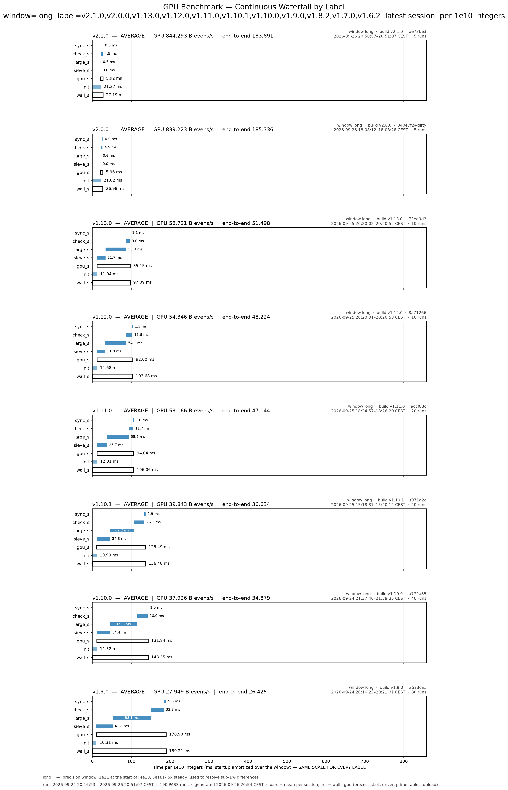

<h1 align="center">goldbach-l0</h1>

<p align="center">
  <b>A Level Zero Goldbach verifier for Intel Arc GPUs: 64.6 billion even numbers per second on one B580.</b><br>
  <a href="https://goldbach.net01.io">Live campaign</a> ·
  <a href="docs/CORRECTNESS.md">Correctness</a> ·
  <a href="docs/BENCHMARKING.md">Benchmarks</a> ·
  <a href="https://github.com/SINF-KEN/goldbach-web">Browser verifier</a>
</p>

<p align="center">
  
  
  
</p>

`goldbach-l0` verifies the even Goldbach conjecture — every even `n` in
`[start, limit]` is the sum of two primes `p + q` — on an Intel Arc
**B580** (Xe2 / Battlemage) through **Level Zero**, with OpenCL C kernels
compiled to SPIR-V and a C++20 host. It is running a campaign over
**[4×10¹⁸, 5×10¹⁸]**, beyond the published verification to 4×10¹⁸, and
records exact statistics of every even it verifies (smallest Goldbach
primes, prime and twin-prime counts).

**v2.3.0: 64.6 billion even numbers per second** at 4×10¹⁸ (63.8 G at the
top of the range, 2.8 J per 10⁹ evens) with exact statistics on — the whole
[4×10¹⁸, 5×10¹⁸] in about **90 days** on one B580.

| Document | Contents |
|---|---|
| [docs/CORRECTNESS.md](docs/CORRECTNESS.md) | what PASS means, the mathematical argument, every invariant and its guard, the v2.3.0 audit |
| [docs/DEVELOPMENT.md](docs/DEVELOPMENT.md) | hardware and software, build, tests, CI, the kernel shipping procedure, reproducibility, production operation |
| [docs/BENCHMARKING.md](docs/BENCHMARKING.md) | how performance is measured and compared; raw data in [bench/](bench/) |
| [docs/PROJECT-REFERENCE.md](docs/PROJECT-REFERENCE.md) | the detailed reference: configuration, CLI, environment, kernels, host, and the log of every optimization kept or dropped (§9.2) |
| [docs/PIPELINE.md](docs/PIPELINE.md) | the production run as a diagram, from `run_range.sh` to the journal |
| [ci/README.md](ci/README.md) | the local CI: release gating, production control |

## How it works

For each even `n` one partition suffices. Candidates `p` are the odd primes
up to 9781 (no even below 4×10¹⁸ needs more; above it the CPU fallback
looks further), so the problem becomes: build an exact primality map of the
odd `q` near the segment, then test `q = n - p` for each even. Per
425-million-integer segment, double-buffered while the CPU prepares the
next:

1. **`make_prime_map`** (tile sieve) — the map holds only `q` coprime to 30,
   as eight class arrays (one per residue mod 30); one work-group sieves one
   16 KB SLM tile: primes < 64 by whole-word mask tables, primes < 512 by
   each thread in its own words, primes up to the split (~430 K)
   prime-parallel with SLM atomics.
2. **`sieve_large_packed`** — primes from the split to 3× the segment's odd
   count (~6.4×10⁸), streamed at one byte per prime; a division-free
   float-float modulo finds the first multiple, and only multipliers coprime
   to 30030 are marked (the others are multiples of a prime ≤ 13, already
   cleared): the **multiplier wheel**.
3. **hit lists** (`hl_harvest` / `hl_apply`) — the largest primes hit a
   segment at most once. Every 128 segments one pass finds all their hits in
   the coming batch and writes each as a 4-byte offset into its segment's
   list; each segment then streams its list and marks it.
4. **`check30_a` / `check30_b`** — evens grouped by `n mod 30`, so for a
   candidate class every `q = n - p` lies in one class array and
   consecutive evens are consecutive bits: 32 evens are tested at once by a
   funnel shift, against several candidates per funnel; phase B probes the
   ~0.1% left one by one.

Evens the GPU cannot resolve are settled on the CPU by deterministic
Miller–Rabin. The verifier **fails closed**: any GPU error, buffer
overflow or counterexample exits non-zero; `result=PASS` means every even in
range was verified. Why that holds, and how each step is checked:
[docs/CORRECTNESS.md](docs/CORRECTNESS.md).

## Quick start

```bash
git clone https://github.com/SINF-KEN/goldbach-l0-tidy.git
cd goldbach-l0-tidy
bash build.sh

./build/goldbach_l0 --cpu-check 1000000          # independent CPU reference, no GPU
./build/goldbach_l0 --limit 1e9 --csv            # verify [4, 1e9] on the GPU
./build/goldbach_l0 --start 4e18 --limit 4000000010000000000 --csv
ctest --test-dir build -LE gpu                   # GPU-free tests
ctest --test-dir build -L gpu                    # GPU suite (~10 min)
bash tools/run_range.sh 4000000000000000000 5000000000000000000   # resumable campaign
```

Runs from the repository root write the campaign's statistics files there;
see [DEVELOPMENT.md](docs/DEVELOPMENT.md#tests) before testing next to a
running campaign. Key flags: `--start N`, `--limit N` (full decimal or
e-notation), `--segment N` (default 467.5M), `--csv` / `--json`, `--info`;
exit codes 0 PASS, 1 verification or GPU failure, 2 usage error. Full
reference: [PROJECT-REFERENCE.md](docs/PROJECT-REFERENCE.md) §5–§7.

## Performance

| Window (bench.py, v2.3.0 vs v2.2.1, 8 paired rounds) | v2.3.0 | v2.2.1 | change |
|---|---|---|---|
| long — 10¹¹ at 4×10¹⁸ | **64.62 G evens/s** | 59.54 G | +8.54% |
| long-end — 10¹¹ ending at 5×10¹⁸ | **63.77 G** | 58.38 G | +9.23% |

Per 10¹¹ integers at 4×10¹⁸: large-prime sieve 473 ms (packed kernel + hit
lists), tile sieve 204 ms, checker 92 ms. The history of every version and
every measured change is in [PROJECT-REFERENCE.md](docs/PROJECT-REFERENCE.md)
§9.2 and §13; methodology in [BENCHMARKING.md](docs/BENCHMARKING.md).



### The sparse path (`--sparse`, opt-in)

Each even needs only ONE prime `q`, so the map does not have to cover every
odd `q`: the sparse class map keeps 12 residue classes mod 30030 (0.04% of
the integers) chosen so that every even class reaches one of them, with
candidates up to 4×10⁷. It verifies ~1.04×10¹² evens/s at 4×10¹⁸ (17× the
dense path) but cannot produce the exact statistics (its map holds 12 of
5760 classes), so the campaign runs the dense path. Design and validation:
[PROJECT-REFERENCE.md](docs/PROJECT-REFERENCE.md) §9.2k.

## Goldbach ridge tracking (`My Top 30 Largest Goldbach Ridges`)

A *ridge* is the smallest prime of an even's Goldbach partition — "unusually
large because no smaller prime produces a valid pair", e.g.
`4000000000169717704 = 4000000000169713571 + 4133` (ridge 4133).

The dense verifier tracks them automatically: the phase-B checkers append
`(even n, smallest witness p)` of every pending even they resolve to a
device-shared buffer (word 0 = u32 count + `RIDGE_CAP` pairs, 64K x 16 B per
pipeline slot); the host merges each segment, **validates every entry with
exact integer arithmetic** (deterministic 64-bit Miller-Rabin on p and
q = n - p, plus full minimality — no smaller prime p' with n - p' prime —
before an entry may enter the top list), and keeps the 30 largest. The
recording threshold ratchets to the current 30th ridge, so the steady-state
append volume is a handful per segment.

- **Persistent store**: `goldbach_ridges.csv` (atomic rewrite per segment,
  accumulates across runs; `GB_RIDGE_FILE` overrides, delete to reset).
  Columns `rank,even,p,q,segment_start,found_unix`: `found_unix` is when the
  entry first entered the store (kept when a re-run finds it again; `0` for
  rows carried over from a v1 store). `scripts/goldbach_live.py` marks the
  newest entry with a `*`.
- **Output**: a `My Top 30 Largest Goldbach Ridges` section in the human
  output, `ridge_*` fields in `--csv`/`--json`, and a live section in
  `tools/live_stats.sh` (reads the store).
- **Knobs**: `GB_RIDGE=0` off, `GB_RIDGE_MIN=<p>` recording floor (default
  3000 = the phase-A bound; a lower value is raised to the active checker's
  phase-A bound, since ridges below it can be resolved early and missed), `GB_RIDGE_DEBUG=1` per-segment diagnostics; sparse only:
  `GB_RIDGE_SCAN=<evens>` phase-B pending sampling (default 64, `0` = off).
- **Completeness (v2.2)**: the dense checker plan keeps every phase-A
  funnel member below 3000, so every even with a ridge >= 3000 reaches
  phase B and is recorded: in dense runs the top list is complete (it
  holds ridges of ~4000-8000). Before v2.2 the plan used members up to 9749,
  and evens phase A resolved through such a member never reached phase B
  (~5/6 of the ridge-rich evens were missed; every kept entry was still
  exact). Stores written by v2.1.0 runs may therefore lack ridges from the
  ranges those runs covered. The sparse class map
  cannot compute smallest-prime witnesses at all (its map stores 12 of the
  5760 residue classes), so sparse runs record the rare CPU-fallback
  leftovers plus a **sampled subset of phase-B pending evens**: the host
  re-derives each sampled even's exact smallest witness by an ascending
  Miller-Rabin scan between segments (`GB_RIDGE_SCAN` evens per segment,
  ~0.5% GPU idle at the default 64; the sampled head depends on atomic
  scheduling order). Every recorded entry is exact regardless.

## Exact Goldbach statistics (v2.2, dense path, on by default)

Besides verifying, the dense verifier now records exact data about the
minimal Goldbach prime p(n) = the smallest prime p with n − p prime, and
about the primes it sieves anyway. Nothing is estimated; every number is
an exact count.

| Data | Coverage | Mechanism |
|---|---|---|
| p(n) of every even with **p(n) ≥ 3000** (histogram + first even in range per p) | **every even** | the checker plan keeps all phase-A funnel members < 3000, so those evens all reach phase B, whose ascending probe yields p(n) |
| full p(n) histogram (all p), per class n mod 30 | every 256th segment of a run (segment 0 always): ~4×10¹¹ evens per 2×10¹⁴ slice | `check30_xs*` test each class's first 64 useful candidates in ascending order, one at a time, bit-parallel (the bits a candidate sets first are exactly the evens with p(n) = p), `check30_xb` continues ascending |
| primes in [start, limit], by residue mod 30 | every segment | `count30`: popcounts of the exact class map |
| twin-prime pairs (q, q + 2) in [start, limit], by type | every segment | `count30`: AND of neighbouring class arrays |
| p(n) > 9781 (never seen; would be a new record) | every even | CPU fallback, ascending Miller–Rabin |

Measured cost (interleaved fresh-process A/B, 10¹² windows at 4×10¹⁸,
3 rounds): **+0.86% GPU time** (59.38 → 58.87 G evens/s vs v2.1.0;
count30 ~0.6%, the sampled segments ~0.1%). `GB_STATS=0` turns it off,
and is then marginally faster than v2.1.0 (59.43 G: the new tail-bounded
checker plan is a little cheaper than the old one).

Files (written only after a run PASSES; an interrupted or failed slice
leaves nothing, and a run overlapping an already recorded range is not
counted twice):
- `goldbach_stats.log` (`GB_STATS_LOG`): one line per run, ~2 KB — p(n)
  tail histogram, prime / twin counts, new first occurrences. A whole
  [4×10¹⁸, 5×10¹⁸] campaign in 2×10¹⁴ slices is ~10 MB.
- `goldbach_stats.state` (`GB_STATS_STATE`): cumulative campaign totals
  (per class n mod 30), first occurrence per p, covered ranges; ~40 KB,
  rewritten atomically.
- `python3 scripts/gstats.py [goldbach_stats.state] [--log goldbach_stats.log]`
  prints the summary: coverage, π and π₂ against Li(x) and the
  Hardy–Littlewood estimate, primes by residue (the mod-30 prime race), the
  p(n) tail and the record sequence (each n whose p(n) beats every earlier
  even in range), the sampled head (mean, quantiles, mean p(n) per
  n mod 30).

A first look at [4×10¹⁸, 4×10¹⁸ + 4×10¹¹]: 9,338,579,005 primes (Li
estimate 9,338,632,496), 287,852,668 twin pairs (Hardy–Littlewood ratio
0.99996), 38,626 evens with p(n) ≥ 3000, record p(n) = 5669 at
n = 4000000345255502716; mean p(n) = 100.0 (48.4 for n ≡ 0 mod 30, 152.3
for n ≡ 8 mod 30).

Validation: `stats_ref` (tests/stats_ref.cpp, independent CPU
Miller–Rabin reference) agrees bit-exactly with the GPU on every field
(histogram, tail, first occurrences, π, π₂ by residue) on windows at
10¹², 4×10¹⁸, 4.4×10¹⁸ and the top of the range, with 1–20,000 segments,
every sampling rate, and a test plan with tail bound 1000 that makes the
tail dense; host_tests check the plan tables (mutation-tested).
Knobs: `GB_STATS=0`, `GB_STATS_SAMPLE=N` (default 256; 1 = full histogram
everywhere, ~+30%), `GB_STATS_K` (exact prefix, default 64),
`GB_STATS_STATE`, `GB_STATS_LOG`. Statistics need the mod-30 checker and
start ≥ 10⁶; the sparse path has none (its map holds 12 of 5760 classes).

## The record hunt: p(n) > 9781 and the unknown S(p)

T. Oliveira e Silva's verification to 4×10¹⁸ (table `t0`,
https://sweet.ua.pt/tos/goldbach.html) found no even with a smallest
Goldbach prime above **9781** (first needed by n = 3325581707333960528), and
for **105 primes 8423..9769 S(p) is unknown** (no even ≤ 4×10¹⁸ has p(n) = p).
From his tail counts (7 evens with p(n) ≥ 9000 and 2 with ≥ 9500 among
2×10¹⁸), [4×10¹⁸, 5×10¹⁸] has very roughly a 20–40% chance of an even with
p(n) > 9781, and should determine S(p) for dozens of the 105 primes.

What the verifier does about it (dense path, statistics on):
- every even with p(n) ≥ 3000 gets its exact p(n) (complete), and the first
  even of the campaign per p is kept; p(n) > 9781 is found by the CPU
  fallback (ascending Miller–Rabin past the candidate list);
- each record-class event — **p(n) > 9781**, or the first even with p(n) = p
  for one of the 105 primes — is **re-proven on the CPU** (independent
  ascending scan, `cpu_check=OK`), appended at once to
  `goldbach_records.txt`, printed to stderr, and passed to the notification
  hook (below). An S(p) claim needs the campaign to cover [4×10¹⁸, n]
  without a gap: slices run by v2.1.0 (no statistics) have to be re-run.

**Live dashboard** (second terminal; read-only):
`python3 scripts/goldbach_live.py` — campaign / slice progress, speed, ETA,
GPU clock / temperature / power, the record panel (largest p(n) so far vs
9781, a bell + banner if beaten), S(p) found / proven, live prime and twin
counts, the Top 30 ridges and the latest events. Feeds:
`goldbach_live.json` (rewritten every 2 s by the verifier, no `--verbose`
needed), the journal, the state, the ridge store, the records file.

**Notifications**: `scripts/notify_record.sh KIND P N Q CHECK` runs in the
background for every event (`GB_RECORD_HOOK=cmd` replaces it, empty
disables). Built in: desktop popup (`notify-send`, on by default), terminal
broadcast (`GB_NOTIFY_WALL=1`), phone push via ntfy
(`GB_NTFY_TOPIC=<secret topic>`; app on iOS/Android, nothing is sent unless
set), e-mail (`GB_NOTIFY_MAIL=addr`, needs `mail`), any command
(`GB_NOTIFY_CMD`, e.g. a Telegram / Discord webhook script). Phone / mail
fire for RECORD always and for S(p) events with `GB_NOTIFY_SP=1`.

**Scientific output**: `curl -O https://sweet.ua.pt/tos/goldbach/t0.txt.gz`,
then `python3 scripts/gstats.py --ref t0.txt.gz --export goldbach_t0_ext.txt`
writes his table extended by the campaign (p ≥ 3000): S(p) with NEW
entries, L(p) to 4×10¹⁸ / in range / total, record-holders re-marked
(reproduces his 29 record-holders ≥ 3000 exactly).

**If p(n) > 9781 shows up**: (1) keep the run going (the slice still
PASSes; the event is already on disk); (2) re-check independently, e.g.
`./build/stats_ref N N` (prints pmax) and a CAS (`isprime`, PARI/GP
`forprime(p=3,P,if(isprime(N-p),print(p);break))`); (3) back it up with the
journal line and `goldbach_records.txt`; (4) report it to T. Oliveira e
Silva (contact on his Goldbach page) with n, p(n), q and the software
version, and consider OEIS (A025018 / A025019: records of the minimal
Goldbach prime).

## Repository layout

```
src/        main.cpp (CLI, output), l0_context.cpp (RAII Level Zero), primes.cpp
            (prime lists, cache, Miller-Rabin), verifier.cpp (dense pipeline),
            sparse.cpp (sparse pipeline)
include/    config.hpp (tuning constants, version), verifier.hpp, primes.hpp,
            check30.hpp (checker plan), gstats.hpp (exact statistics, state file),
            ridge.hpp, split_check.hpp (legacy checker plans), sparse*.hpp
kernels/    goldbach.cl (dense kernels), sparse.cl + the shipped SPIR-V
            modules (*_bmg.spv, rebuilt by CMake when ocloc is present)
tests/      host_tests.cpp, stats_ref.cpp (independent CPU reference),
            check_constants.py, cli_tests.sh, test_ci.py, test_stats_tools.py,
            stats_compare.py, known_windows.py (published windows of an
            independent verifier), gpu_validate.sh (GPU suite), data/
ci/         goldbach_ci.py — local CI and production control (ci/README.md)
scripts/    gstats.py (statistics summary, t0 export), goldbach_live.py
            (live dashboard), notify_record.sh (record notifications)
docs/       the documents above; images/ (benchmark figures), make-plots.sh
bench/      benchmark journals (append-only CSV)
tools/   -> ../goldbach-tools (optional companion: validators, bench.py, run_range.sh)
```
