# Production run pipeline: `run_range.sh` → log

Functions and kernels executed on the CPU and GPU from launching
`tools/run_range.sh` to the journal / log lines (default dense path:
`run_gpu` with the mod-30 class map, mod-30 checker and hit lists for the
largest primes; `run_range.sh` does not pass `--sparse`). Live stats
(`live_stats.sh`, `goldbach_live.json`) are not shown.

```mermaid
flowchart TD
    %% ================= BASH =================
    subgraph SH["run_range.sh (bash, CPU)"]
        A1["Parse START LIMIT SLICE JOURNAL<br/>set SEG=467.5M, GB_BUCKET_VERIFY=1000, GB_GAPS=sampled<br/>check: integers, even, START < LIMIT < 2^63<br/>binary: GB_RANGE_BIN / ci-state/active / ./build<br/>flock .goldbach-gpu.lock, no other goldbach_l0"]
        A2["Resume: walk the PASS chain in the journal<br/>next = last contiguous slice end + 2"]
        A3{"next > LIMIT?"}
        A3s{"stop file?"}
        A3x["exit 3 (clean stop,<br/>resume point intact)"]
        A4["Cut slice [a, b] = [next, next+SLICE-2]"]
        A5["Launch ./build/goldbach_l0<br/>--start a --limit b --segment 467.5M --split 0 --csv<br/>stderr → LOG.stderr"]
        A6{"rc == 0 and<br/>result=PASS?"}
        A7["RETRY row in the JOURNAL (+ GPU state)<br/>retry once after sleep 30"]
        A8["STOPPED: failed twice → LOG, exit 1"]
        A9["Append 'PASS a b ts csv-line release=R [attempts=2]'<br/>retried: .recheck queue + alert<br/>python3: % done + days left → LOG"]
        A10["COMPLETE → LOG"]
    end

    %% ================= HOST INIT =================
    subgraph CPU_INIT["goldbach_l0: main.cpp → run_gpu() init (CPU)"]
        M1["main: parse_count args<br/>→ run_gpu(limit, segment, spv, ...)"]
        I1["PrimeCacheView::load<br/>mmap base_primes.cache: all primes ≤ √limit"]
        I2["Pick split points:<br/>mask primes < 64, tile primes < 36000th prime,<br/>packed-large primes, hit-list primes above that"]
        I3["odd_primes_up_to 9781 → Goldbach candidates p<br/>make_plan30 / make_stats_plan: mod-30 checker plans"]
        I4["Level Zero: Context + immediate list<br/>Module(goldbach_bmg.spv), create kernels"]
        I5["Allocate 2 pipeline slots of buffers:<br/>prime_map, leftovers, pending, ridge, histograms"]
        I6["Hit-list geometry: K = 128 segment lists,<br/>capacity from Mertens estimate"]
        I7["pack_large_primes: base + gap byte encoding<br/>build_magic_reciprocals + 32-bit ms32 table"]
        I8["stage_upload + host_sync:<br/>candidates, plans, sieve primes,<br/>packed primes, reciprocals → VRAM"]
        I9["RidgeTracker.load goldbach_ridges.csv<br/>GoldbachStats init"]
    end

    %% ================= PER-SEGMENT HOST PREP =================
    subgraph CPU_SEG["Per-segment host prep (CPU, slot = seg % 2)"]
        P1["segment_geometry + class_geometry<br/>q range = seg_start-9781 .. seg_end-3, 8 classes mod 30"]
        P2["compute_first_bits_class<br/>first multiple of each tile prime per class"]
        P3["build_tile_first_table<br/>per-tile first mark (parallel_for)"]
        P4["small_prime_mask_table_step<br/>mask tables for primes 3..61"]
        P5["Set kernel args, reset events"]
    end

    %% ================= GPU =================
    subgraph GPU["GPU kernels, enqueued in order (Intel Arc, Level Zero)"]
        G1["make_prime_map<br/>SLM tile sieve: small-prime masks + medium primes<br/>writes the class-map bits: 1 = prime candidate q"]
        G2["Every 128th segment: hl_harvest<br/>each hit-list prime's hits in the next 128 segments<br/>→ per-segment u32 offset lists (overflow → bkt_err)"]
        G3["hl_apply<br/>streams this segment's list, atomic AND-clear"]
        G4["sieve_large_packed<br/>one item per packed large prime, atomic AND-clear"]
        G5["Every 1000th segment: GB_BUCKET_VERIFY<br/>make_prime_map + sieve_large_packed over ALL primes<br/>→ scratch map, map_compare → verify_diff"]
        G6["count30<br/>prime + twin-prime counts"]
        G7{"sampled segment?<br/>every 256th"}
        G8["check30_a: phase A<br/>1024 evens per item, tests n-p in the class map<br/>for the first candidates; unresolved → pending"]
        G9["check30_b: phase B<br/>one lane per pending even, probes the rest list;<br/>records ridges + tail histogram; unresolved → leftovers"]
        G10["check30_xs8/6/4/3 → check30_xb<br/>exact full p(n) histogram for this segment"]
    end

    %% ================= COLLECT =================
    subgraph CPU_COLL["Collect PREVIOUS segment (CPU, other slot, while the GPU runs the current one)"]
        C1["zeEventHostSynchronize(check event)"]
        C2["query_slot: kernel timestamps<br/>→ sieve_s, large_s, check_s"]
        C3{"bkt_err, verify_diff,<br/>pending or leftover overflow?"}
        C4["ridges.merge + collect_stats<br/>p(n) histograms, prime/twin counts"]
        C5["resolve_leftovers<br/>Miller-Rabin: n-p prime for p ≤ 9781,<br/>then any odd p ≤ n/2"]
        C6{"witness found?"}
        C7["ridges.save goldbach_ridges.csv"]
        C8["Drain the last segment the same way<br/>fill RunStats, free buffers"]
        C9["print_csv → stdout:<br/>result=PASS evens_per_sec=... ridge_max=..."]
        X1["throw 'Goldbach verification FAILED for n=…'<br/>or device-error message → stderr, exit 1"]
    end

    %% ================= FLOW =================
    A1 --> A2 --> A3
    A3 -- yes --> A10
    A3 -- no --> A3s
    A3s -- yes --> A3x
    A3s -- no --> A4 --> A5 --> M1
    M1 --> I1 --> I2 --> I3 --> I4 --> I5 --> I6 --> I7 --> I8 --> I9 --> P1
    P1 --> P2 --> P3 --> P4 --> P5 --> G1
    G1 -- barrier --> G2 --> G3 -- barrier --> G4 --> G5 -- barrier --> G6 --> G7
    G7 -- no --> G8 -- barrier --> G9
    G7 -- yes --> G10
    G9 --> C1
    G10 --> C1
    C1 --> C2 --> C3
    C3 -- yes --> X1
    C3 -- no --> C4 --> C5 --> C6
    C6 -- no --> X1
    C6 -- yes --> C7
    C7 -- "next segment" --> P1
    C7 -- "last segment done" --> C8 --> C9
    C9 --> A6
    X1 --> A6
    A6 -- yes --> A9 --> A3
    A6 -- "no, attempt 1" --> A7 --> A5
    A6 -- "no, attempt 2" --> A8
```

**Pipeline overlap:** the two slots let the CPU enqueue segment *k*
(prep → GPU kernels) and then collect segment *k−1*, so the GPU always has
the next segment queued while the CPU waits on the previous one's check
event. The chart draws this as a simple loop.

**What ends up where:**
- **Journal:** one `PASS a b timestamp <csv> release=<id>` line per slice
  (`attempts=2` if it passed only on the retry), plus a `RETRY` row for every
  failed first attempt (ignored by the resume chain).
- **Local CI** (`ci/goldbach_ci.py`, [ci/README.md](../ci/README.md)) stops
  the run through the stop file, re-verifies a banked slice with a candidate
  binary and restarts run_range with the active release.
- **Log:** start/resume lines, a per-slice `PASS … % done, days left` line,
  the binary's stderr, and any `FAILED` / `STOPPED` lines.
