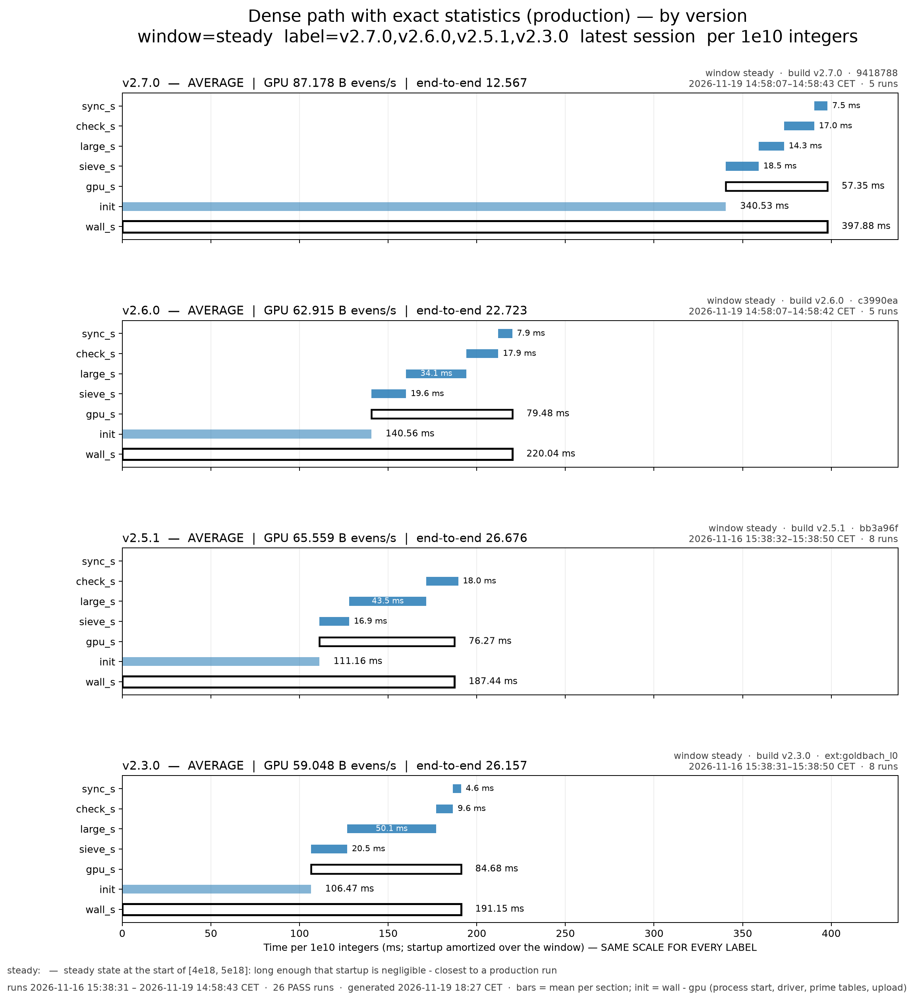
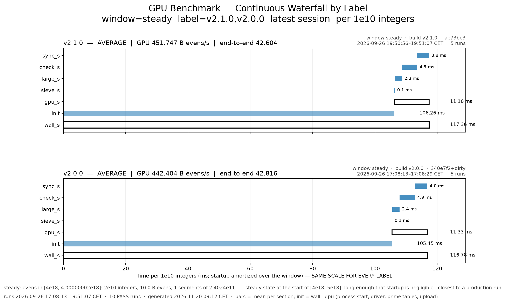
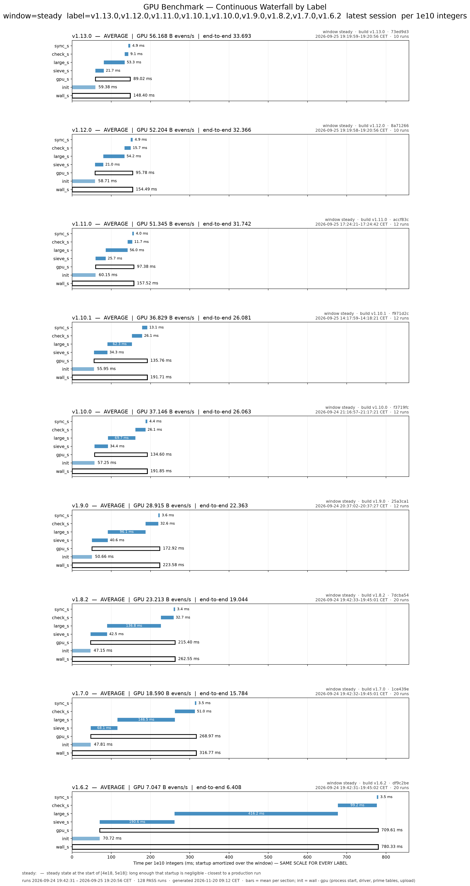
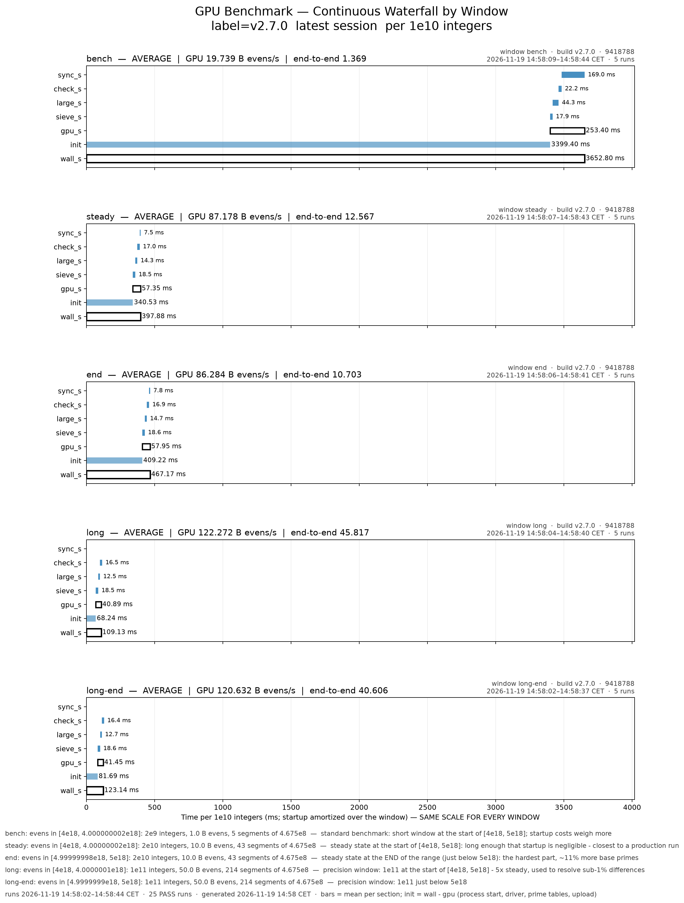

# PROJECT REFERENCE — goldbach-l0

The detailed reference: configuration, CLI, environment, pipeline, kernels
and host components. The log of every optimization kept or dropped (§9.2,
the pre-v2 measurements of §13.2, and §15, under the same numbers) is in
[HISTORY.md](HISTORY.md); the current measurement stays in §13.2 here.
Companion documents: [CORRECTNESS.md](CORRECTNESS.md) (the argument and its
invariants), [DEVELOPMENT.md](DEVELOPMENT.md) (build, tests, CI, shipping),
[BENCHMARKING.md](BENCHMARKING.md) (methodology), [PIPELINE.md](PIPELINE.md)
(the production run as a diagram).

--------------------------------------------------------------------------
## 1. What this project is

`goldbach-l0` verifies the even Goldbach conjecture (`n = p + q`, both
prime) for every even `n` in `[start, limit]`, on an Intel Arc B580
(Xe2 / Battlemage) through Level Zero — a from-scratch L0 implementation,
not ported from CUDA. The candidate side `p` only needs odd primes
`p <= 9781` (`MAX_GB_PRIME`, justified by the Oliveira e Silva 4e18
verification; the CPU fallback looks further); each `n` needs ONE prime
`q = n - p`.

Two pipelines: the dense path (default and production: mod-30 class map,
packed large-prime kernel, hit lists for the largest primes, mod-30
checker, exact statistics; §8, §9) and the opt-in **sparse class map**
(`--sparse` / `GB_SPARSE=1`; [§9.2k](HISTORY.md#92k-v20--sparse-class-map---sparse-kernelssparsecl-srcsparsecpp-includesparsehpp)): the map holds only 12 residue classes
mod 30030 (0.04% of the integers), candidates come from p <= 4e7, ~1.0e12
evens/s at 4e18 (~15x the dense path's ~70 G) but no exact statistics.

- `tools/` is a symlink to a sibling clone of the companion
  `goldbach-tools` repo (validators, bench.py, run_range.sh); without it the
  build produces the verifier and the host tests only.
- Version constant: `gb::VERSION` (include/config.hpp; release notes in
  [HISTORY.md](HISTORY.md) §R), echoed by `--info` and the `--csv` output.

--------------------------------------------------------------------------
## 2. Quick start

Run from the repository root (the default `--spv` path is relative). Build,
tests and CI: [DEVELOPMENT.md](DEVELOPMENT.md); benchmarks:
[BENCHMARKING.md](BENCHMARKING.md).

```bash
bash build.sh
./build/goldbach_l0 --cpu-check 1000000          # independent CPU reference -> PASS
./build/goldbach_l0 --info                       # device / driver / config
./build/goldbach_l0 --limit 100000000 --verbose  # small GPU run, human output
./build/goldbach_l0 --limit 1e8 --csv            # one key=value line
./build/goldbach_l0 --start 4e18 --limit 4000000010000000000 --csv
GB_PHASE=1 ./build/goldbach_l0 --start 4e18 --limit 4000000005000000000 --csv   # per-kernel trace
./build/debug_map                                # complete map vs Miller-Rabin (tools)
```

Production run of a whole range (resumable, slice journal, fail-stop):
`bash tools/run_range.sh 4000000000000000000 5000000000000000000`
(2e14-integer slices; re-run the same command to resume). Keep the display
on another GPU: a desktop compositor on the B580 costs ~20%.

Prime cache: a run uses `<cache>.<sqrt(limit)+16>` if present and valid,
else the smallest existing `<cache>.<L>` with L above it (only primes <=
its bound are used), else it generates and writes its own — so one
sqrt(5e18) cache (`base_primes.cache.2236067993`) serves every slice of
[4e18, 5e18]. A cache whose payload fails the content check is ignored.

--------------------------------------------------------------------------
## 3. Repository layout

```
goldbach-l0/
├── CMakeLists.txt          host targets, tests, ocloc SPIR-V rules (kernels/*.cl -> *_bmg.spv, -device bmg)
├── build.sh                cmake configure + build
├── include/
│   ├── config.hpp          tuning constants and VERSION (see §4)
│   ├── env.hpp             strict GB_* environment parsing (§7)
│   ├── host_math.hpp       pure host math of the dense pipeline (§8)
│   ├── l0_context.hpp      RAII Level Zero wrappers, ZE_CHECK, kernel timestamps
│   ├── primes.hpp          prime lists, cache view, mask tables, Miller-Rabin
│   ├── verifier.hpp        RunStats / SegmentStats, run_gpu, verify_cpu
│   ├── check30.hpp         mod-30 checker plan; split_check.hpp: legacy checker plans
│   ├── gstats.hpp          exact statistics: plans, accumulator, campaign state
│   ├── ridge.hpp           Goldbach ridge top list
│   └── sparse.hpp, sparse_run.hpp   sparse class map geometry, plan, engine
├── src/
│   ├── main.cpp            CLI + human / --csv / --json / --per-seg output
│   ├── l0_context.cpp      gpu_devices (zeInitDrivers), Context (immediate in-order list), Module, Kernel
│   ├── gpu_monitor.cpp     Sysman energy / frequency / throttling over a run
│   ├── primes.cpp          segmented sieve, GBP2 (hashed) cache, masks, Miller-Rabin, CPU fallback search
│   ├── verifier.cpp        run_gpu (dense pipeline: RunSetup / DenseRun phases), verify_cpu, device info
│   ├── host_math.cpp       pure host math of the dense pipeline (geometry, tables, reciprocals)
│   └── sparse.cpp          run_gpu_sparse
├── kernels/
│   ├── goldbach.cl         dense kernels: make_prime_map, mid_window, sieve_large_packed,
│   │                       mt_build / hl_harvest_mt / hl_apply, check30_*, count30;
│   │                       validation kernels (sieve_large_primes, prep_large_fb,
│   │                       unpack_large_test, map_compare)
│   ├── goldbach_tables.h   its constant wheel tables (GENERATED: gen_tables.py;
│   │                       ocloc needs -I kernels; ctest kernel_tables checks it)
│   ├── sparse.cl           sparse kernels
│   └── *_bmg.spv           shipped modules (byte-identical to the pinned ocloc)
├── tests/                  host_tests, stats_ref, check_constants, cli_tests,
│                           test_ci, test_stats_tools, stats_compare, known_windows,
│                           gpu_validate.sh; data/ (base-2 pseudoprimes < 2^32)
├── ci/                     goldbach_ci.py (local CI, production control), README.md
├── scripts/                gstats.py, goldbach_live.py, notify_record.sh
├── docs/                   these documents, images/, make-plots.sh
├── bench/                  benchmark journals (append-only)
└── tools/ -> ../goldbach-tools   bench.py, waterfall.py, run_range.sh, live_stats.sh,
                            debug_* validators, benchmark.cpp, tuner.cpp, sweep.py
```

Generated and ignored: `build/`, `base_primes*.cache*`, `scm_plan.*.bin`,
`kernels/*.bin`, the campaign files (`goldbach_stats.*`, `goldbach_ridges.csv`,
`goldbach_records.txt`, `goldbach_live.json`, `range-*.journal` / `.log`),
`ci-state/`. Removed in v2.3.0: the `--wheel` path ([§15](HISTORY.md#15-wheel-representation---wheel--removed-in-v230)), the archived
predecessor history bundle.

Build targets (CMakeLists.txt): `goldbach_l0`, `host_tests`, `stats_ref`;
with tools: `goldbach_bench`, `goldbach_tuner`, `debug_sieve`,
`debug_check_hi`, `debug_fb`, `debug_map`, `debug_sparse`.
Validators depend on the `kernels` target.

--------------------------------------------------------------------------
## 4. Configuration constants (include/config.hpp, mirrored in kernels/goldbach.cl)

| Constant | Value | Meaning |
|---|---|---|
| `VERSION` | "2.6.0" | echoed by `--info` / `--csv` |
| `WG_SIZE` | 256 | threads per work-group; 128/512/1024 measured within noise |
| `TILE_WORDS` | 2048 | 16 KB SLM per tile (v1.8.1 optimum, [§9.2d](HISTORY.md#92d-v181--tile-size-medium-stage-setup-float-float-modulo); `GB_TILE_WORDS` + ocloc `-DTILE_WORDS` to change) |
| `BITS_PER_TILE` | 131,072 | odd numbers per tile (TILE_WORDS x 64; the kernel's WORDS_PER_THREAD = TILE_WORDS / WG_SIZE = 8 words per thread) |
| `LARGE_PRIMES_PER_ITEM` | 4 | primes per large-kernel work-item (~98M items -> ~24.5M at 4e18). MUST stay mirrored in goldbach.cl |
| `MAX_GB_PRIME` | 9781 | largest candidate prime needed (published 4e18 verification); ~1,206 primes, u16 (2.4 KB) |
| `LARGE_PACK_PPI` / `LARGE_PACK_GROUP` | 16 / 512 | sieve_large_packed: primes per work-item / per packing group (host); MUST match LARGE_PACK_PPI / LARGE_PACK_SG in goldbach.cl |
| `LARGE_WG_SIZE` | 128 | large-kernel work-group size (`GB_LARGE_WG` overrides: a multiple of 32 in [32, 1024]) |
| `CHECK30_B_GROUPS` | 40 | check30_b grid-stride work-groups (flattened probe loop beside the next tile sieve; `GB_CHECK_BGROUPS` overrides) |
| `MED_MIN_P` | 512 | tile-kernel primes >= this (and < split) use the prime-parallel SLM-atomic stage 3m; `GB_MED_P=N` overrides |
| `CHECK30_PLAN` (include/check30.hpp) | 15 classes x 3-4 segments | mod-30 checker (production since v1.13.0, [§9.2j](HISTORY.md#92j-v1130--round-6--745-long---735-long-end-mod-30-checker)): per n mod 30 the (candidate class s, pattern mask, funnels) segments of phase A; `GB_C30_PLAN` overrides |
| `CHECK_PHASE_A_W64` | 12 | phase-A item width in 64-bit words (768 evens); MUST match A_W64 (14 until 2026-10-05, [§9.2p](HISTORY.md#92p-re-tunes-after-the-round-tile-sieve-profile-2026-10-05)) |
| `MASK_MAX_P` | 64 | primes < 64 use whole-word AND masks (17 odd primes 3..61; 1088 mask words = 8.5 KB). MUST match kernel |
| `DEFAULT_LIMIT` | 100,000,000 | default verification range [4, limit] |
| `DEFAULT_SEGMENT_EVEN` | 467,500,000 | default segment span (integer span; 233.75M evens; 425M from v1.12.0 to v2.3.0, [§9.2u](HISTORY.md#92u-hit-lists-fused-apply-one-walk-harvest-2026-10-06)). Comment block records the measurements. tools/run_range.sh uses 467.5M (GB_RANGE_SEGMENT), bench.py each binary's default |
| `MAX_LEFTOVERS` | 1,048,576 | compact exception-list cap (2^20) |

Kernel compile-time switches (2026-11-15): the on/off experiment switches of
goldbach.cl are folded to their production values and removed — EARLY_EXIT,
WRITE_CHECKED, REPORT_LEFTOVERS, SMALL_PRIME_MASK, FAST_MOD, FF_MOD, FF_I32,
FF_FIX, FF_BIG, LARGE_FIRST32, LARGE_WHEEL30, TILE_WHEEL30, BUCKET_WHEEL30,
MARK_ROL, MAPCLR_W, OWN_ATOMIC, OH_F32, LARGE_OH_BM, LARGE_ONEHIT, MED_F32,
OWN_F32, LARGE_GAPS_CC, BKT_ST_CC, BKT_LD_CC, W32_PREFETCH, W32_EXIT_EVERY,
C30_UDIV, C30_ROT, SPLIT_EXIT, A_SIMD, the WHEEL_W 30 / 210 / 2310 tables, the
A_W64 8 / 10 / 14 / 16 windows, and the timing-only ablations (ABL_*,
LARGE_NOMARK; sparse.cl ABLL_* / ABL3_* / ABL_NOPEND). The host's GB_WHEEL_W
and GB_BUCKET_WHEEL (usable only with such a rebuilt module) went with them,
as did the run-time switches that only restored a superseded path or served
one measurement: GB_TWIN=0 (plain v1.9.0 checker, refused since 2026-11-19; CHECK_PHASE_A_CANDS /
GB_CHECK_CAP with it), GB_HL_FUSE=0, GB_UPLOAD_STAGED, GB_BUCKET_RESET_BARRIER,
GB_WRITE_CHECKED and GB_CHECK_NCAND. Host-mirrored kernel constants without a
host override (WG_SIZE, WORDS_PER_ITEM, LARGE_PRIMES_PER_ITEM, MASK_MAX_P,
SPLIT_MAXD, C30_MAXD, X_KMAX, C30_CW, XS_W*, HL_MAX_K, BKT_E, LARGE_PACK_SG,
sparse.cl SCM_MAXD / A3_WPL) are plain #defines: a -D on the kernel alone
could only desync it from the host. G30_COLS (count30 lane columns) is folded
on, and the dead helpers mark_multiples_w30 / bkt_div32 are gone.
The sections below still name them as history; the git history has the code.
Proof of no kernel change: the -O0 and -O2 LLVM IR (clang -x cl -target
spir64) of all three modules is byte-identical before and after.

Kernel switches after the speed rounds (2026-11-19, [§9.2ac](HISTORY.md#92ac-cleanup-after-the-speed-rounds-2026-11-19)):
the rounds' A/B switches are resolved to their production values and the
losing variants deleted — LARGE_SKR, LARGE_MQ, MQ_V4, MQ_RKT, MQ_HOIST,
HL_RKT, HL_FX, HL_END, HL_FLAT, HL_APPLY_LAST, HL_QS, HL_SKR, HL_SKR2,
MED_BF, MASK_COAL, CB_FLAT, CA_PAIR, CA_ONEWIN, CA_SHF, CA_PRO, G30_BLK,
MIDW_FLOOR, MIDW_ANDST, MIDW_SKIP, the ABL_* ablations — and every kernel's
machine code is byte-identical before and after (ocloc disasm). goldbach.cl
has one `#if` left: `#ifndef TILE_WORDS`, the only numeric tunable still
overridable with ocloc -D (with the host's GB_TILE_WORDS; ci/experiment.py
builds such arms). TABLE_BATCH, TILE_WHEEL_MAXP, MED_BATCH, MED_SPLITN,
MED_W7_MAXP, MQ_MAXP, SKR_MAXP, SKR2_MAXP, LARGE_PACK_PPI, A_W64,
PROBE_BATCH, CA_SG, G30_SIMD, MT_CB, HL_BAL, MIDW_BATCH and MIDW_SG are plain
#defines: an experiment edits them in a copy of the source. sparse.cl:
SCM_M / SCM_K / SCM_RES_LIST / A3_SPAN select its module variant. The rules
the fast paths rely on are in [EXACTNESS.md](EXACTNESS.md).

Device assumptions in config.hpp header comment: 20 Xe-cores, 160 vector
engines, 128 KB SLM per Xe-core, 256 KB L1, 18 MB shared L3, subgroup
sizes 16/32, max WG 1024. `--info` confirms on this card: Intel(R) Arc
B580, 160 EUs (5 slices x 4 subslices x 8 EUs), 2850 MHz, 11.3 GB,
subgroups 16 32, max WG 1024, L0 API 1.17.

B580 geometry notes: tile walk = 256 threads x 32 words x 64 bits; one
work-group per `get_group_id`; check work-group covers 256 x 4 x 64 =
65,536 evens; map size for a 250M span ≈ 125M bits ≈ 15.6 MB (fits the
18 MB L3 — the reason small spans won once the host bottleneck was
removed).

--------------------------------------------------------------------------
## 5. CLI reference (src/main.cpp)

```
usage: goldbach_l0 [--limit N] [--start N] [--segment N] [--split N]
                   [--sparse] [--spv FILE] [--prime-cache FILE]
                   [--cpu-check N] [--json] [--csv] [--per-seg]
                   [--info] [--verbose]
```

| Flag | Default | Notes |
|---|---|---|
| `--limit N` | 100000000 | verify evens in [start, N]. N accepts full decimal or e-notation (`4e18` = `4000000000000000000`); junk, hex/octal and u64 overflow exit 2 with an error |
| `--start N` | 4 | first even: rounded up to even, at least 4. Everything below `start` is ASSUMED verified (campaign slices). No even n >= 4 in [start, limit] (e.g. start > limit) is a usage error (exit 2) |
| `--segment N` | 467500000 | integer span per segment; forced >= 2, even; shrunk to total range (min 2 segments kept for pipeline overlap); a span whose odd count exceeds 32 bits fails closed (exit 1) |
| `--split N` | 0 | base-prime split index; 0 = auto -> min(sieve_count, 1500) while the mid-window pass runs ([§9.2x](HISTORY.md#92x-mid-prime-slm-windows-gb_midwin-2026-11-17)), else min(sieve_count, 36000) (verifier.cpp), clamped >= mask_count and to a split prime >= 4096 (`MOD_FF_MIN_P`, [§9.2z](HISTORY.md#92z-mod_ff-is-wrong-for-small-primes-the-fused-window-sieve-2026-11-17)); > 2^32 - 1 is a usage error |
| `--spv FILE` | kernels/goldbach_bmg.spv | SPIR-V module path |
| `--prime-cache FILE` | base_primes.cache | keyed by limit: `<file>.<limit>` is tried first, then the legacy shared file; miss regenerates + writes |
| `--cpu-check N` | off | independent trial-division Goldbach check of [4, N], then exit (exit 0 = PASS) |
| `--json` / `--csv` / `--per-seg` | off | output modes (§6); `--per-seg` implies segment collection |
| `--info` | | print device/driver/config, exit |
| `--verbose` | | per-segment progress every 10 segments |
| `--sparse` | off | sparse class map pipeline ([§9.2k](HISTORY.md#92k-v20--sparse-class-map---sparse-kernelssparsecl-srcsparsecpp-includesparsehpp); also `GB_SPARSE=1`); `--segment` other than the default sets the segment span D (rounded to M · dlt), `--split` the tile / large prime bound; needs start well above pmax (4e7) and sqrt(limit) (else exit 1 with a message) |

Exit codes: 0 success, 1 any thrown error (GPU failure, verification
failure, unsupported limit, damaged statistics state), 2 usage error.
`--wheel` (the W = 510510 representation, [§15](HISTORY.md#15-wheel-representation---wheel--removed-in-v230)) was removed in v2.3.0. The verifier FAILS CLOSED: any GPU error or a
genuine counterexample throws; `result=PASS` in any output mode means all
evens in range were verified (or leftovers resolved on CPU).

--------------------------------------------------------------------------
## 6. Output formats

All of it is printed by src/main.cpp with `std::print` / `std::println`
(C++23). These formats are a contract: the `--csv` line is the production
journal's row, and `tools/run_range.sh`, `ci/goldbach_ci.py` and `bench.py`
parse it. The switch from printf was verified byte-identical; a later
format change has to keep every existing key and its formatting.

Human (default): banner `goldbach-l0 v<VERSION>` (+ ` (sparse)`), then
limit, start, segments, leftovers, init / gpu / sieve / large sieve /
verify / offsets / sync-other times (`%.3f s`), total, evens/second
(`%.3g`), `EU arbitration` (the `GB_SCHED` policy in force), `GPU
(sysman)` (energy, average power, actual frequency, throttle time and
reasons over the run, or why Sysman is off), `result: PASS`. With statistics on: a `Goldbach statistics` block (log / state
paths, largest p(n), tail and sampled even counts, primes, twin pairs).
With a ridge floor: the `My Top 30 Largest Goldbach Ridges` table.

`--csv`: ONE line of 35 `key=value` pairs:
`version limit start segment split segments leftovers result init_s
init_cache_s init_module_s init_upload_s gpu_s total_s sieve_s large_s
check_s offsets_s table_s sync_s evens_per_sec tiles large_items ridge_min
ridge_found ridge_dropped ridge_max stats stats_tail stats_sampled
stats_pmax primes twins split_used sched`. Times `%.4f`, `evens_per_sec`
`%.6g`, `stats` 0/1. Gotchas: `split=` echoes the CLI ARGUMENT (0 when
auto) — the resolved dense split is `split_used=` (0 on the sparse path)
and the per-segment `split` column; `evens_per_sec` = total_evens /
gpu_seconds (init excluded); `large_items` / `tiles` are sums over
segments; `ridge_max` is the largest kept ridge (0 when none).
After the fixed 35 come the Sysman keys (`src/gpu_monitor.cpp`): always
`sysman=` (`ok`, `off` for `GB_SYSMAN=0`, or why it is unusable, spaces as
`_`), then, each only when measured, `gpu_energy_j gpu_power_w` (card power
domain, `%.3f` / `%.2f`), `throttled_s` (hardware throttle-time counter
delta, `%.3f`), `freq_avg_mhz freq_min_mhz throttle_reasons` (actual core
frequency sampled ~4x per second; reasons OR-ed over the samples, e.g.
`power+thermal` or `none`). The window is the whole run (init included), so
`gpu_energy_j` covers `total_s`, not `gpu_s`.

`--json`: pretty-printed object: `version limit start segment split`
(`split_used` when non-zero) `sched spv segments leftovers result`, the
times as `*_seconds` (init, gpu, total, sieve, large, verify, offset,
table, sync), `evens_per_second total_tiles total_large_items ridge_min
ridge_found ridge_dropped`, a `ridge_top` array (`rank, ridge, even, p, q,
segment`), a `sysman` object (`status window_s`, plus `energy_j power_w`,
`throttled_s`, `freq_avg_mhz freq_min_mhz throttle_reasons freq_samples`
when measured), a `stats` object when statistics are on (`tail_evens,
sampled_evens, pmax, primes, twins`) and a `per_segment` array when
collected (`seg, start, end, evens, tiles, large_items, split, mask_count,
leftovers, sieve_s, large_s, check_s, offset_s, wall_s`). It omits the
`init_*_s` split of the CSV.

`--per-seg` (non-JSON): fixed-width table `#seg evens [start, end] tiles
large_items split sieve_s large_s check_s offset_s wall_s left`.

--------------------------------------------------------------------------
## 7. Environment variables

Every `GB_*` knob is parsed strictly (include/env.hpp): a malformed value is
an error (`error: GB_X='v': expected ...`, exit 1), never 0 or the default.
Numbers are whole strings in decimal, `0x` hex or `0`-prefixed octal within
the knob's range (no sign, junk, overflow; empty is malformed). On/off switches
(`GB_STATS`, `GB_BUCKET`, `GB_UNORDERED`, `GB_RIDGE`, `GB_SPARSE`, `GB_SYSMAN`) take `0` or
`1` (empty = unset);
trace flags (`GB_PHASE`, `GB_INIT_TRACE`, `GB_RIDGE_DEBUG`,
`GB_BUCKET_VERIFY_DUMP`) are on when set to anything; file paths treat empty
as unset. `GB_SCM_*` ranges: `GB_SCM_DELTA` [4096, 2^26], `GB_SCM_PMAX` >= 1,
`GB_SCM_WPL` / `GB_SCM_SPAN` >= 1, `GB_SCM_PCAP` / `GB_SCM_LCAP` [1, 2^31 - 1],
`GB_SCM_LARGE_WG` a multiple of 32 in [32, 1024], `GB_SCM_PLAN_CACHE` 0 or 1,
`GB_SCM_TARGET` / `GB_SCM_SEGW0` / `GB_SCM_SEGW1` finite >= 0.

| Var | Effect |
|---|---|
| `GB_STATS=0` | dense path: no Goldbach statistics ([§9.2l](HISTORY.md#92l-v22--exact-goldbach-statistics-dense-path-includegstatshpp); default on for the mod-30 checker at start >= 1e6) |
| `GB_STATS_SAMPLE=N` / `GB_STATS_K=K` | full p(n) histogram on every Nth segment (default 256; 1 = all, ~+30%; N >= 1) / exact phase-A prefix per class (default 64, K in [1, 128]) |
| `GB_STATS_STATE=F` / `GB_STATS_LOG=F` | statistics files (default goldbach_stats.state / goldbach_stats.log in the cwd) |
| `GB_RECORDS_FILE=F` / `GB_STATS_LIVE=F` | record events (p(n) > 9781, new S(p); CPU re-proven, appended at once; default goldbach_records.txt) / live snapshot for scripts/goldbach_live.py (default goldbach_live.json, every 2 s) |
| `GB_RECORD_HOOK=cmd` | run `cmd KIND P N Q CHECK` in the background per record event (default scripts/notify_record.sh when present; empty: none). The script reads `GB_NOTIFY_WALL`, `GB_NTFY_TOPIC` / `GB_NTFY_SERVER`, `GB_NOTIFY_MAIL`, `GB_NOTIFY_CMD`, `GB_NOTIFY_SP` (README "The record hunt") |
| `GB_STATS_BGROUPS=N` | check30_xb work-groups (sampled segments; default 160; N >= 1, else the run fails before GPU work) |
| `GB_C30_PLAN=S` | mod-30 checker plan override; a leading `T:` bounds every funnel member below T (the statistics tail bound) |
| `GB_SPARSE=1` / `GB_SCM_*` | sparse class map: select the path and its knobs (list in [§9.2k](HISTORY.md#92k-v20--sparse-class-map---sparse-kernelssparsecl-srcsparsecpp-includesparsehpp)); `GB_PHASE=1` prints per-segment tile / large / phase A / phase B times and the pending rate, `GB_INIT_TRACE=1` the init breakdown |
| `GB_PHASE=1` | per-segment host-phase trace to stderr: prep (offsets/table), enqueue (args/l1/l2/l3), wait, collect + raw kernel start/end ticks and sieve->large / large->check gaps. Default off (a few clock reads per segment) |
| `GB_BUCKET_VERIFY_DUMP=1` | with GB_BUCKET_VERIFY: on the first mismatch print the differing bits with Miller-Rabin truth |
| `GB_BUCKET=0` / `GB_BUCKET_MINP=p` / `GB_BUCKET_GROUPS=n` | hit lists off (every large prime in the packed kernel) / threshold prime / grid of a separate hl_apply (n >= 1) |
| `GB_BUCKET_VERIFY=N` | validate the hit-listed primes on every Nth segment (1 = all; N >= 1: 0 or empty is an error) against a rebuild without hit lists (tile, mid windows, packed kernel over every larger prime; ~3 ms per checked segment); throws on any difference |
| `GB_BUCKET_VERIFY_FULL=1` | with GB_BUCKET_VERIFY: the reference also takes the mid primes through the packed kernel instead of mid_window (an independent check of mid_window too; ~33 ms per checked segment) |
| `GB_HITLIST_K=n` | hit-list batch length (default 256, n in [1, 256], else an error), lowered until one batch's lists fit below 4 GiB and `GB_HL_LIST_MAX` ([§9.2t](HISTORY.md#92t-hit-lists-replace-the-bucket-ring-gb_hitlist-2026-10-06)) |
| `GB_HL_MT=0` | old hit-list path: `hl_harvest` over every multiplier, primes > q_odds_full only, instead of the prime-multiplier table (`mt_build` / `hl_harvest_mt`, [§9.2ab](HISTORY.md#92ab-speed-rounds-2-7-prs-34-29-33-2026-11-1819-725--736)); a fallback, exact but slower; the packed kernel then overlaps mid_window |
| `GB_HL_LIST_MAX=B` | hit-list memory budget in bytes (default 3.5e9): K is lowered until one batch's lists fit ([EXACTNESS.md](EXACTNESS.md) §6) |
| `GB_MT_CHECK=N` | after mt_build, compare N multiplier-table bits (the first 2 x 5760, then random) with Miller-Rabin; any wrong bit fails the run (copies the whole table to the host: seconds) |
| `GB_SCHED=0\|1\|2\|off` | EU thread arbitration hint for every kernel: oldest-first / round-robin (default, +0.6%) / stall-based round-robin (the Xe2 driver default) / no hint. An explicit policy a kernel rejects is an error; a rejected default warns and runs on the driver default. Reported as `sched=` ([§9.2w](HISTORY.md#92w-slm-contention-round-atomic-owned-marks-gap-histogram-columns-round-robin-arbitration-2026-11-15)) |
| `GB_SYSMAN=0` | no Level Zero Sysman sampling (`sysman=off`). Default on: energy, throttle time, actual frequency and throttle reasons of the GPU over the run (`src/gpu_monitor.cpp`); observation only, a sensor that is missing or not permitted is left out of the output and never fails the run |
| `GB_UNORDERED=0` | in-order immediate list (pre-v2.4) instead of the unordered list with a barrier before every launch but the tile sieve and the harvest ([§9.2v](HISTORY.md#92v-unordered-list-the-next-segments-sieve-overlaps-the-checker-2026-10-18)) |
| `GB_MASK_PERIOD=N` | max mask-group period in words (default 4096; more than 8 groups fall back to the per-prime mask loop) |
| `GB_LARGE_WG=N` | large-kernel work-group size (multiple of 32 in [32, 1024], else the run fails; default 128) |
| `GB_GAPS=0` / `GB_GAPS=sampled` | with the statistics: no prime-gap statistics / walk the gap histogram and moments only on the sampled segments (count, tail and maximum stay exact everywhere); default (`exact`, also `1`): every segment; any other value is an error |
| `GB_GAPS_GROUPS=N` | count30 work-groups on walked segments (N in [1, 4096], else an error; default GAPS30_GROUPS = 48 per 160 EUs, scaled by the device's EU count: 48 on the B580) |
| `GB_MED_P=N` | tile-kernel medium-stage bound (default `MED_MIN_P`) |
| `GB_MIDWIN=N` / `GB_MIDWIN_KB` / `GB_MIDWIN_WG` | mid-prime SLM window pass: primes [split, N) in windows of KB of SLM with work-groups of WG (defaults 2500000 / 128 / 1024; `GB_MIDWIN=0` off and the auto split back to 36000) ([§9.2x](HISTORY.md#92x-mid-prime-slm-windows-gb_midwin-2026-11-17)) |
| `GB_CHECK_BGROUPS=N` | phase-B work-groups (default 40; N >= 1: 0 would skip phase B, so it fails the run before GPU work) |
| removed 2026-11-19 | `GB_C30_LATE`, `GB_C30_PREB`, `GB_ML_OVERLAP`, `GB_HL_LAM2`, `GB_HL_CAPG`, `GB_HLH_WG`, `GB_HL_UNCOMP`, `GB_MT_UNCOMP`, `GB_MASK_XP`, `GB_MED_ITEMS`, `GB_MINP_FLOOR`, `GB_HL_FILLDBG`: speed-round A/B switches whose default is now fixed ([§9.2ac](HISTORY.md#92ac-cleanup-after-the-speed-rounds-2026-11-19)); setting one is an error before any GPU work, so an A/B arm cannot silently measure the default |
| removed in v2.6 | `GB_SPLIT`, `GB_SPLIT_CAP`, `GB_SPLIT_STAGES`, `GB_TWIN_CAP`, `GB_C30`, `GB_CLASSMAP`, `GB_HITLIST`, `GB_MASK_GROUPS`: their pipelines (twin / class-split checkers, dense / mod-6 maps, bucket ring) are gone; setting one is an error before any GPU work, never silently ignored |
| `NEOReadDebugKeys=1` | driver-side: REQUIRED for any NEO debug env var to have effect (source-verified, §14); alone it is perf-neutral |
| `ZET_ENABLE_METRICS=1` | driver-side metrics enablement (+ `sysctl dev.xe.observation_paranoid=0`, Metrics Library; see §14) |

--------------------------------------------------------------------------
## 8. Pipeline (src/verifier.cpp `run_gpu`)

`run_gpu` builds a `DenseRun` (src/verifier.cpp). `RunSetup` resolves the
range and loads the base primes without touching the device; `DenseRun::run`
then calls, in order: `configure_checkers`, `configure_ridges_and_stats`,
`set_group_sizes`, `size_buffers`, `allocate_slot_buffers`,
`size_bucket_ring_and_hitlists`, `allocate_large_prime_buffers`,
`upload_tables`, `pack_stats_buffers`, `create_events`, `segment_loop`
(per segment: `begin_segment`, `prepare_segment_tables`, `enqueue_sieve`,
`enqueue_large_primes`, `enqueue_check`, `collect_previous_segment`,
`end_iteration`; then `drain_final_segment`), `assemble_run_stats`,
`release_device_objects`. The pure math those phases use (segment geometry,
first-bit and tile tables, reciprocals, packed primes) is in
include/host_math.hpp, tested against brute force by host_tests.

```
CPU setup: base primes to sqrt(limit) via the mmap'd, hash-checked GBP2 cache (segmented
           sieve on miss); goldbach candidates p<=9781 as u16; magic
           reciprocal + shift + ms32 tables for the split range
L0 setup:  Context (immediate command list, IN_ORDER flag — LOAD-BEARING,
           see §11), Module from SPIR-V, kernels @ WG_SIZE
Buffers:   per-slot x2 (double buffering): prime_map, first_bits,
           mask tables, pending, leftovers, counters, ridge, histograms,
           tile_first, mid-window first bits; shared: gb_primes,
           sieve_primes, packed large primes, hit lists (K <= 256 segments x
           regions, <= GB_HL_LIST_MAX), multiplier table (HL_MT, 2.7-3.4 GB
           at 4e18..5e18), magic/shifts/ms32
Per segment k (slot = k&1):
  host prep (overlaps GPU of segment k-1): first bits (class map,
    parallel_for over primes into a persistent buffer), tile_first table
    (parallel_for), small-prime group offsets
  enqueue: counter zero-fills, EVENT RESETS, make_prime_map(tiles),
           mid_setup, [every K-th segment: hl_harvest_mt],
           BARRIER, mid_window, BARRIER (HL_MT), sieve_large_packed_hl
           (hit-list apply fused in, after the packed primes),
           [GB_BUCKET_VERIFY: rebuild + map_compare], BARRIER, check30_a,
           BARRIER, count30 (statistics), check30_b (sampled segments:
           check30_xs* / _xb)
  collect segment k-1 (other slot): host-sync on its check event, query
    kernel timestamps, check error flags / pending / leftover counts,
    statistics, Miller-Rabin fallback for leftovers
Drain: collect final segment.
Final one-even tail is MERGED into the preceding segment, and the loop
breaks when seg_end == limit (else limit would be scheduled twice).
```

Geometry (SegmentGeometry, verifier.cpp): q range =
`[seg_start - 9781, seg_end - 3]` (only odd q; bit i <-> q = q_first +
2i); q_first forced odd; the class map holds 8 arrays of `tpc` tiles of
BITS_PER_TILE = 131072 bits (class_geometry); slot alternates.
Map must be sized in WHOLE tiles — the tile kernel writes whole tiles, a
partial last tile would write past the buffer (device-lost comment,
verifier.cpp).

Auto split: `min(sieve_count, 1500)` while the mid-window pass runs (HISTORY.md
§9.2x), else `min(sieve_count, 36000)` (rationale and measurements in the
comment at the split selection in verifier.cpp). The split is what makes 4e18 feasible:
walking all ~98M base primes per tile blew the driver watchdog (engine
reset).

--------------------------------------------------------------------------
## 9. Kernel reference (kernels/goldbach.cl)

### 9.1 make_prime_map — tile sieve (one work-group per 64 KB tile)
- Stage 1: each of 256 threads fills its 32 owned SLM words with ones.
- Stage 2: the ONLY barrier in the kernel.
- Stage 3a (SMALL_PRIME_MASK=1): primes < MASK_MAX_P(64) applied as
  whole-word ANDs from the host-built `mask_table[p_idx*64 + phase]`;
  walk = load mask, AND, phase += 1 (word-index mod p). Comments carry two
  hard-won warnings: (a) the magic-reciprocal ceil trick is WRONG here —
  x - ceil(x/p)*p underflows and the OOB mask load page-faults -> device
  lost; 32-bit `%` is exact and cheap since x < 2^32, p < 64
  (goldbach.cl:161-168); (b) advancing the phase by `64 % p` instead of 1
  per word mis-aligns every prime with 64 % p != 1 — silently restoring
  composites AND clearing primes (tools/debug_map.cpp catches this class
  of error, goldbach.cl:174-182).
- Stage 3.5: tile 0 restores q = p bits (1*p is prime) when q_first <= 64;
  range-sensitive, guarded by `q_first <= MASK_MAX_P` — the reason masks
  stay valid at every range.
- Stage 3: primes [mask_count, sieve_split) clear multiples inside each
  thread's private 2048-bit range. Two paths:
  - TABLE path (use_table=1, production): host precomputed
    `tile_first[tile*split + j]` (u32, 0xffffffff = none) so the kernel
    does NO 64-bit math; p < TILE_BITS jumps to my range with an exact
    32-bit reciprocal (d < 2^17 = BITS_PER_TILE: `build_tile_reciprocals32`, include/host_math.hpp; exhaustive host test);
    p >= TILE_BITS has at most one mark, range-check only. Loads are
    software-pipelined in TABLE_BATCH=8 batches (latency-bound broadcast
    loads; two live batches = 16 loads in flight).
  - LEGACY reciprocal path (use_table=0): mul_hi with 64-bit
    ceil(2^64/p) magic + shift + ceil correction; kept for huge segments
    / debug tools. Host owns ALL skip logic via fb_global (~0ull = skip).
- Stage 3m (v1.7.0): primes [own_end, sieve_split), own_end = first prime
  >= MED_MIN_P (512), are walked PRIME-parallel: thread `me` takes primes
  own_end+me, +256, ... and clears all of that prime's marks in the tile
  with 32-bit SLM `atomic_and`. First bit per tile = segment-global
  fb_global plus one exact 32-bit modulo. Two extra barriers (owned plain
  RMWs must finish before cross-thread atomics; atomics before stage 4).
  This replaced a threads x primes walk (every thread visited every prime
  for <= 1 mark) and is what lets the auto split rise from 2400 to 40000,
  moving ~1/3 of the global atomic marks into SLM. The tile_first table
  now holds only the owned columns (row stride = own_end).
- Stage 4: coalesced whole-tile write to global; tail beyond q_odds
  masked so the map is exact.
- No barrier between primes: every thread owns its words exclusively.

### 9.2 Large-prime stage and the optimization log — moved to HISTORY.md

§9.2 and all its lettered subsections (§9.2a–§9.2w) are in
[HISTORY.md](HISTORY.md#92-sieve_large_primes--the-atomic-kernel), under the
same numbers, so every "§9.2x" reference in the code and the commit history
still resolves there. Besides the log of every optimization kept or dropped,
they hold the design notes of kernels still in production:
- [§9.2](HISTORY.md#92-sieve_large_primes--the-atomic-kernel) /
  [§9.2a](HISTORY.md#92a-sieve_large_packed--production-large-prime-kernel-v170):
  the large-prime marking (`sieve_large_packed`, 1 B per prime, 32-bit
  `atomic_and` on the u32 half of a word; why 64-bit `atomic_and` is not used).
- [§9.2b](HISTORY.md#92b-bucket-sieve-for-the-largest-primes-v170) and
  [§9.2t](HISTORY.md#92t-hit-lists-replace-the-bucket-ring-gb_hitlist-2026-10-06)–[§9.2v](HISTORY.md#92v-unordered-list-the-next-segments-sieve-overlaps-the-checker-2026-10-18):
  the largest primes — the bucket ring (removed in v2.6), the hit lists that
  replaced it, the unordered list, and the `GB_BUCKET_VERIFY` validation.
- [§9.2j](HISTORY.md#92j-v1130--round-6--745-long---735-long-end-mod-30-checker):
  the mod-30 checker; [§9.2k](HISTORY.md#92k-v20--sparse-class-map---sparse-kernelssparsecl-srcsparsecpp-includesparsehpp):
  the sparse class map (`--sparse`) and its knobs;
  [§9.2l](HISTORY.md#92l-v22--exact-goldbach-statistics-dense-path-includegstatshpp):
  exact Goldbach statistics.


### 9.3 prep_large_fb — present in the module, NOT launched by run_gpu
Kept (and validated by debug_fb); the host no longer calls it. Do not
confuse its presence with an active stage.

### 9.4a The v1.7.0 two-phase checker: check_phase_a + check_phase_b (history)
Removed in v2.6 with the twin and class-split checkers; the mod-30 checker
(check30_a / check30_b) keeps its two-phase structure. The notes below are
the design record.
- Measured (1e7 evens at 4e18): evens still unresolved after the first K
  candidates: K=64 6.5%, 96 2.0%, 128 0.62%, 192 0.06%, 256 0.007%,
  384 ~1e-6. A 256-even item runs until its HARDEST even resolves, so the
  single-phase checker spent most of its time (~300 candidates per
  subgroup) on a fraction of a percent of the evens.
- check_phase_a: the 32-bit register-window word checker (below) capped
  at CHECK_PHASE_A_CANDS candidates; writes the partial checked[] and
  appends every unresolved even to a per-slot `pending` list (one atomic
  per subgroup via scan/reduce). pending is sized segment_evens/8; the
  host throws if a segment overflows it (fail closed).
- check_phase_b: grid-stride, one lane per pending even, continues with
  candidates [cap, gb_count) as independent bit probes (8 in flight per
  lane), fully bounds-guarded (no geometry assumptions); sets the even's
  checked[] bit or appends it to the normal leftover list (CPU fallback).
- Same candidates, same order, same outputs as check_numbers — validated
  by tools/debug_check_hi (all caps 0..4000, dense + sparse random maps at
  4e18/5e18 + low range, exact checked[] and leftover set; mutation-tested).
- check_numbers_w32 (also selectable alone): the same 256 evens per item as
  8 native u32 words with a 9-word register window that slides one load
  whenever the uniform Tw = T >> 5 drops; T = (Tbase - p)/2 in 32-bit.
  Xe2 emulates 64-bit shifts, so this cut the per-candidate cost ~30%.
- Measured and dropped: subgroup-interleaved words + shuffle funnel
  (coalesced, but loses per-word skip: slower), register window with u64
  words (+7% only: ALU-bound), dynamic per-lane item pools (1.3x cost per
  iteration, no fewer iterations), prefetching p / sparser exit tests.
- check_s at 4e18 (2e9 window): 0.0198 -> 0.0137 (w32) -> 0.0102 (two-phase).

### 9.4 check_numbers — shifted-bitset Goldbach check (v1.6 checker; history, removed in v2.6)
- Per work-item: WORDS_PER_ITEM=4 disjoint 64-even words (independent
  accumulators for ILP; 4 is the optimum, 8 spills).
- Core algebra (goldbach.cl:496-513): with bit_n = (n - seg_start)/2 and
  bit_q = (q - q_first)/2, q = n - p gives `bit_n = bit_q + S`,
  S = (p + q_first - seg_start)/2 — an EXACT integer for odd p, so each
  candidate is one funnel shift `acc |= (qw0 >> r) | (qw1 << (64-r))`
  covering up to 64 evens per 64-bit op.
- Interior-check form (goldbach.cl:559-571): decompose T once per
  candidate into Tw = T>>6, r = T&63 (r identical for all items/words) so
  w0 = wi + Tw is one add; in production geometry (q_first = seg_start -
  9781, candidates <= 9781) T >= 0 and map_words = words+77 covers
  max(w0)+1 = words+76, so the bounds guards are PROVABLY dead and the
  hot path drops them behind a uniform `geo_safe` check; the guarded
  loop stays for low ranges where T can go negative (negative word loads
  as 0 = exactly "q < q_first unusable").
- p = 2 skipped (only matters for n = 4 = 2 + 2, CPU fallback).
- EARLY_EXIT=1: skip saturated words; item-level `break` when all full
  (its cost is one partial-tail straggler item per work-group,
  ~0.5 us/cand — cheap; most evens saturate after ~100 of ~1200
  candidates).
- Epilogue: mask partial word, write `checked[wi]` (WRITE_CHECKED=1,
  store fully hidden behind map loads), report each unresolved bit to the
  compact leftover list via `atom_inc(leftover_count)` (atomics only on
  misses; ~1 per run at low ranges — n=4).

--------------------------------------------------------------------------
## 10. Host components

- primes.cpp: `odd_primes_up_to` EXCLUDES 2 on purpose (the GPU map stores
  only odd numbers; p=2's odd-multiple stepping is meaningless — comment
  at primes.cpp:23-26). `segmented_odd_primes_up_to` for huge n (2e9 at
  4e18; flat bitmap would need ~2 GB). Cache format (v2.6): magic "GBP2" +
  u64 limit + u64 count + u64 FNV-1a 64 hash of the payload + u32 payload;
  PrimeCacheView::map_file mmaps it and checks size, hash and content
  (keyed filename so different limits coexist; zero-copy payload; a
  pre-v2.6 "GBPR" file is reported and regenerated, ~2.6 s at sqrt(5e18)).
  The dense verifier maps the cache with the hash + content check deferred
  (`load(..., defer_check)`) and runs `deferred_check()` on a thread beside
  its GPU init (started after the module load: a live second thread made
  zeInit ~60 ms slower), joined before the segment loop: init 0.645 ->
  0.527 s per process. A failed check renames the file to `<file>.bad` and
  fails the run (the retry regenerates the cache).
  `small_prime_mask_table`: 64 masks per prime indexed by word-index mod
  p; q_first must be ODD. `is_prime_u64`: deterministic Miller-Rabin,
  bases {2,3,5,7,11,13,17,19,23,29,31,37}, valid for all u64.
- l0_context.cpp: `alloc_device` rounds every buffer >= 1 MB up to a whole
  number of 2 MB pages, 2 MB aligned (v1.7.0). A size that is not a 2 MB
  multiple is only partly backed by 2 MB pages; the large kernel's
  scattered atomics over the 15.6 MB map then ran 15-200% slower depending
  on placement (one pipeline slot was consistently ~55% slower; this is
  the likely root of the old "bimodal slow mode"). Rounded: large_s -30%
  and a tight run-to-run band. `ZE_CHECK` throws on any non-SUCCESS result,
  with the driver's own text (`zeDriverGetLastErrorDescription`) appended
  when it has one. `gpu_devices()` initializes with `zeInitDrivers` (GPU
  drivers; `zeInit` is deprecated since API 1.10), checks every call and
  serves both Context and `--info`. Context
  picks the first GPU device; the immediate command list is created with
  `ZE_COMMAND_QUEUE_FLAG_IN_ORDER` — comment: LOAD-BEARING for
  correctness (kernels share buffers across launches without event
  deps; without the flag the tile kernel's whole-word stores can race
  the large kernel's atomic ANDs). `set_local_arg` = nullptr + size (L0
  allocates SLM).
- verifier.cpp helpers: `segment_geometry` (pure), `compute_first_bits`
  (per segment, one division per prime, ~0ull skip), `build_tile_first_table`
  (parallel_for over tiles, 16 workers), `build_magic_reciprocals`
  (ceil(2^64/p); shift search validated up to 2^33; s>32 -> fallback),
  `stage_upload` (shared staging + copy; host_sync before free is
  LOAD-BEARING — without it the first segment races the uploads and the
  device is LOST), `SlotEvents` (timing events, one pool of 22,
  HOST_VISIBLE | KERNEL_TIMESTAMP), `resolve_leftovers` (Miller-Rabin
  fallback; throws on an index outside the segment or a real
  counterexample), `parallel_for`.
- Timing: kernel times from event timestamps through
  `kernel_seconds(event, timer_hz)` (l0_context.hpp; `std::optional`, empty
  when the query fails, the timer frequency is unknown or end <= start —
  clock anomalies on some driver builds) and `kernel_ticks(event)` for the
  raw ticks of the `GB_PHASE` trace. A missing timestamp only leaves a
  timing at 0, so these never throw; the calls the verification depends on
  go through `ZE_CHECK` and fail the run. Device timer resolution via
  DEVICE_PROPERTIES_1_2 (base struct "returns garbage" comment).
- sync_seconds = max(0, gpu - sieve - large - verify) — "residual, may
  overlap"; offset_seconds is ~0 in the dense path since the work moved
  GPU-side.

--------------------------------------------------------------------------
## 11. Sync rules — the "learned the hard way" list (all still enforced)

1. `zeCommandListAppendBarrier` (not an event wait) between map-building
   kernels and before check: event waits order but do not FLUSH on this
   driver; without the barrier, composites resurrect (nondeterministic —
   debug_map caught it). §14 source-verifies: barrier = PIPE_CONTROL
   DataportFlush + UnTypedDataPortCacheFlush; WaitOnEvents emits none.
   (A minimal repro on recent runtimes runs clean — the barrier stays
   as defense-in-depth.)
2. `zeEventHostReset` strictly BEFORE enqueueing the signaling launch:
   reset-after-enqueue can lose the signal -> size-dependent hangs.
3. The table-upload `host_sync()` before the first segment: kernels
   racing the initial copies lose the device.
4. The immediate list MUST be IN_ORDER (l0_context.cpp).
5. Map buffers sized in WHOLE tiles and segment span < 2^32 (32-bit
   large offsets guard).
6. Mask-path phase must advance by 1 per WORD (word-index mod p), not
   64 mod p (§9.1a/b).
7. 32-bit modulo only in the mask phase (ceil-correction underflow ->
   page fault, §9.1a); 32-bit atomic_and spelled with u32* + u32 mask
   exactly ([§9.2](HISTORY.md#92-sieve_large_primes--the-atomic-kernel)).

--------------------------------------------------------------------------
## 12. Testing & validation matrix

| Tool / gate | What it proves | Expected result |
|---|---|---|
| `--cpu-check 1000000` | independent trial-division Goldbach reference | PASS |
| `ctest` → `host_tests` (CI: gcc, clang, ASan+UBSan) | host math the kernels trust, vs brute force: odd prime lists (flat, segmented, multi-block), the GBP2 cache (miss, mmap hit, prefix of a larger cache, corrupted header, and — since v2.3.0 — a valid header over a damaged payload: zero hole, even entry, out of order, on both load paths; no temp files left), Miller–Rabin (sieve range, strong pseudoprimes, 2^64 − 59; all 10403 base-2 Fermat pseudoprimes below 2^32 from tests/data, the list checked by brute force below 2^22, and ψ1..ψ11; `GB_PSP_FILE=` streams Feitsma's full list below 2^64), all small-prime mask layouts (dense, step 6 / 30, groups, canonical + offsets), sparse first-hit and group offsets, split / mod-30 / sparse plan coverage, `validate_plan_scm` rejecting tampered plans, and the statistics state (merge, overlap, concurrent commits, truncation, tail_t mismatch, sampled-count mismatch). Every regression check fails on the code before its fix | `host_tests: ... 0 failed -> PASS` |
| `ctest` → `check_constants` (`tests/check_constants.py`) | every host ↔ kernel "MUST match" constant (config.hpp / sparse.hpp / split / check30 / verifier.cpp vs goldbach.cl, sparse.cl and the snapshots) the sparse module `-D` options in CI / CMake vs `scm_geo()`, and README.md's "Current release" and C++ badge vs config.hpp `VERSION` and `CMAKE_CXX_STANDARD` — static, no GPU | `0 mismatch(es) -> PASS` |
| `ctest` → `stats_known` (`stats_ref --known`) | p(n) of T. Oliveira e Silva's published S(p) (9781, 9629, ... and small ones) and his record-holder property over the 2000 evens below each | `0 failure(s) -> PASS` |
| `ctest` → `known_windows` (`tests/known_windows.py selftest`) | the published windows of GoldbachGPU v3.2.0 (Llorente-Saguer 2026; [4e18, 4e18 + 1e10 .. 1e15], 1e12 across 2^63): prime counts equal the published π(x) differences, every listed n has the listed p(n) (Miller–Rabin); `run` / `campaign` modes on a stand-in binary and synthetic campaign files | `-> PASS` |
| `ctest` → `stats_tools` (`tests/test_stats_tools.py`) | scripts/gstats.py (totals, tail, records, --ref / --export on a synthetic t0) and scripts/goldbach_live.py (S(p) proven only with coverage from 4e18, MISMATCH events never shown as records) on synthetic files | `-> PASS` |
| `ctest -L gpu` → `gpu_validate` (local, GPU) | `tests/gpu_validate.sh`: GPU statistics log + state vs `stats_ref` (tests/stats_compare.py) on 6 windows (one across 2^63), the published windows via `known_windows.py run` (quick: 4e18 + 1e10 and + 1e12; full also + 1e13 and 1e12 across 2^63), end to end in every checker mode, GB_BUCKET_VERIFY=1 (hit lists: both ends, multi-batch K = 5 / 50, ragged first / last segments), `--cpu-check`, the debug_* validators when built | `gpu_validate: 0 failure(s) -> PASS` |
| `ctest` → `cli_tests` (`tests/cli_tests.sh`) | malformed numbers and options missing their value exit 2; empty / reversed ranges, `--split` > 2^32 - 1 and the removed `--wheel` exit 2; limits above 2^64 - 2^40 exit 1 before GPU work; `2e5` == `200000`; CPU reference PASS | `cli_tests: PASS` |
| `ctest` → `test_ci` (also the CI static job) | the local CI's journal chain (incl. a PASS row disagreeing with its own `limit=`, a cut-off row), reference cache keys, exact gates, release pruning (every journal's releases kept; a missing journal prunes nothing) | `0 failure(s) -> PASS` |
| CI `kernels` job | every module compiles; each shipped `.spv` passes `spirv-val`, is byte-identical to a fresh ocloc 26.40 compile (deterministic output) and contains every `__kernel` of its source | all `fresh` |
| `debug_sieve` | tile kernel (table AND legacy paths) bit-exact vs CPU sieve | OK both, diff_words=0 |
| `debug_fb` | large-prime first-offset formula vs host reference | OK both geometries |
| `GB_BUCKET_VERIFY=1` (verifier mode) | the map with hit lists == a rebuild with the packed kernel over ALL large primes, every segment, over long multi-segment runs (batch boundaries, p*p activation, ragged segments) — the ONLY check that sees bugs in the largest primes' marks (end-to-end PASS cannot) | no throw |
| `debug_check_hi` | the mod-30 checker (check30_a / check30_b): 5 plans x 11 cases on mod-30 class maps (dense / sparse random maps at 4e18 / 5e18, low range, short lists), exact checked[], leftover set and coverage counters vs a per-even CPU reference | CHECK_HI OK |
| `debug_sparse map START [DLT]` / `check START DLT [PERMILLE\|real] [SEED]` (`GB_SCM_M=2310\|30030`) | sparse class map: every map bit of a full segment vs an independent CPU sieve (+ MR spot checks of that truth); phase A + B vs a per-even CPU reference on real / random maps with forced leftovers ([§9.2k](HISTORY.md#92k-v20--sparse-class-map---sparse-kernelssparsecl-srcsparsecpp-includesparsehpp)) | MAP OK / CHECK OK |
| `debug_map` (GB_MAP_SPV=file to test a variant spv; positional args are `q_first q_odds split [spv]`) | COMPLETE map (tile+masks+large) vs deterministic Miller-Rabin at real ranges — the authoritative map validator | OK |
| end-to-end `--csv` | `result=PASS`, `leftovers=0` near 4e18; leftovers=1 (n=4) at low ranges | PASS both windows |
| `bench.py` | interleaved fresh-process A/B with paired CIs, append-only journal (BENCHMARKING.md) | — |
| `goldbach_tuner` | staged safe auto-tuning, fresh child per measurement, SIGTERM->SIGKILL at deadline, never resets the GPU, stops escalating after hard failures | — |

Benchmark discipline (binding for any new test): fresh process per run;
median of >= 5, never select from a single run; desktop (X session) runs
can land in an ~18%-slower "slow mode" — the TTY/headless path is the
production one; per-launch bimodality affects large_s specifically.

--------------------------------------------------------------------------
## 13. Performance

### 13.1 Primary benchmark (the living definition)

Objective: minimize the wall-clock of the complete range **[4e18, 5e18]**
on one B580 without changing any result. The decision windows are
`long` (1e11 at 4e18) and `long-end` (1e11 ending at 5e18), measured with
`tools/bench.py` as interleaved fresh-process paired rounds; a change is
kept only when its 95% interval clears the base on both. Methodology:
[BENCHMARKING.md](BENCHMARKING.md). (Before v1.10 the primary benchmark was
a 2e9 window at 250M spans with `sweep.py`; its numbers are start-up
dominated and not comparable.)

### 13.2 Measured performance

- v2.8.0 (2026-11-19, round 10, HISTORY.md §9.2ad): bench.py 5 paired
  rounds vs v2.7.0: long **140.58 G** ev/s (132.34, +6.22% ±0.08%),
  long-end **139.69 G** (131.27, +6.39% ±0.04%); 6e11 at 4e18, 3 rounds,
  +6.31%. Production slices (5e13 at 4.1447e18, `GB_BUCKET_VERIFY=500`,
  exact gaps, release 535dbab): **181.3 s** wall, GPU 180.8 s, init 0.53 s
  (v2.7.0: 193 s). Per 1e11: tile sieve 162 ms, large 122 ms, checker +
  statistics 143 ms. Full [4e18, 5e18] ~42 days. Device memory ~7 GB
  (+12 MB for the mid-window skip table).
- v2.7.0 (2026-11-18/19, speed rounds 2-7 + cleanup, HISTORY.md §9.2ab/ac):
  bench.py 5 paired rounds vs v2.6.0 (c3990ea): long **132.22 G** ev/s
  (76.66, +72.45% ±0.12%), long-end **131.37 G** (75.67, +73.61% ±0.07%);
  2.41 J per 1e9 evens (long). Per 1e11 at 4e18: large 125 ms, tile sieve
  185 ms, checker + statistics 165 ms, GPU 378 ms. Full production slice
  (5e13 at 4.14065e18, `GB_BUCKET_VERIFY=500`, exact gaps): 193.0 s wall vs
  364.1 s for the v2.5.1 release bb3a96f (x1.886), statistics byte-identical.
  Full [4e18, 5e18] ~45 days. Device memory ~7 GB (multiplier table 2.7-3.4
  GB, hit lists <= 3.5e9 B), init ~0.7 s.
- v2.5.1 (bench.py, 2026-11-16, production's release binary bb3a96f and
  configuration: exact statistics incl. the prime-gap walk,
  `GB_BUCKET_VERIFY=500`; paired against a v2.3.0 build, each at its
  default segment): long **69.61 G** ev/s (v2.3.0 64.30, +8.24% ±0.12%,
  12 rounds), long-end **68.87 G** (63.38, +8.52% ±0.19%); steady 65.54 G
  (+11.0% ±1.0%), end 65.05 G (+11.3% ±0.4%), bench 38.49 G (+6.2% ±1.6%),
  8 rounds each. 2.74 J per 1e9 evens (long); full [4e18, 5e18] ~83 days.
  Per 1e11 at 4e18: large 431 ms, tile sieve 168 ms, checker + statistics
  175 ms, GPU 718 ms (the sieve overlaps the checker, §9.2v).
  Figures: `docs/images/` (regenerate: `bash docs/make-plots.sh`; redrawn
  for every new VERSION by the `Version figures` workflow):

  
  
  
  

Earlier measurements (v1.6.2 – v1.8.0) are in
[HISTORY.md §13.2](HISTORY.md#132-measured-performance); the per-change
results of later rounds are in each round's §9.2 entry there.


### 13.3 Bottleneck profile (why the large sieve is closed on one B580)

> Historical (pre-v2): the conclusion below no longer holds. v2.7.0 cut the
> marks themselves instead of making them faster: the prime-multiplier hit
> lists, the 17..43 skip and read-before-mark took the large stage from 342
> to 125 ms per 1e11 (HISTORY.md §9.2ab). The GPU time is now split about
> evenly between the tile sieve, the large stage and the checker.

sieve_large_primes runs at ~90% of the ~14.45 G marks/s scattered-32-bit-
RMW issue ceiling (~142M atomic marks per 125M-even segment). Exact CPU
mirror of the kernel's decisions: 75% of large primes make ZERO marks per
segment (setup = ~20% of the kernel); marks are perfectly
Poisson-uniform across words (var/mean 0.998, no clustering); 56% of all
marks belong to the 271K primes <= 3.9M. Every aggregation / carry /
wheel alternative measured worse — the remaining lever is multi-GPU
slicing: k disjoint `--start/--limit` slices run independently TODAY
with zero code changes.

--------------------------------------------------------------------------
## 14. Driver notes (NEO / compute-runtime, source-verified)

- **Why AppendBarrier works and event waits don't**: barrier ->
  `createBarrierFlags` -> Xe2 PIPE_CONTROL **DataportFlush +
  UnTypedDataPortCacheFlush** (gfx_core_helper_xe2_hpg_core.cpp:171);
  WaitOnEvents emits only CS-stall/semaphore — no data-port flush
  (cmdlist_hw.inl:3664-3756). TIMESTAMP-flagged events DO flush — keep
  the KERNEL_TIMESTAMP flag on our events. A minimal standalone repro on
  current runtimes runs clean, so the historical gap is not reproducible
  now; the barriers stay as defense-in-depth.
- NEO debug env vars are INERT without `NEOReadDebugKeys=1`
  (debug_settings_manager.cpp:117). `NEOReadDebugKeys=1` alone is
  perf-neutral. `ForcePreemptionMode`: -1 default (BMG MidThread), 1
  Disabled, 2 MidBatch, 3 ThreadGroup, 4 MidThread.
- Metrics: `ZET_ENABLE_METRICS=1` + `sysctl dev.xe.observation_paranoid=0`
  + libigdmd.so.1/Metrics Library; prefer query-based capture around the
  kernel; `zeCommandListAppendMetricMemoryBarrier` required; template:
  zello_metrics in the NEO tree. Never mix metric-sampled and unsampled
  timings in one comparison.
- Allocation alignment implies caching: cache-line-misaligned buffers get
  UNCACHED MOCS on Xe2; keep 64-byte alignment in any hand-rolled offset
  math. Xe2 coherency is per-allocation (PAT at GEM-create), not
  per-access.
- ocloc determinism: older toolchains produced different-but-equivalent
  SPIR-V across sessions (id-space / `__clang_ocl_kern_imp_*` layout
  wobble). The pinned ocloc 26.40 is deterministic — CI gates on byte
  identity of every shipped `.spv` — but the native `.bin` is not shipped
  and the validators + an A/B remain the gate for any kernel change.

--------------------------------------------------------------------------
## 15. Wheel representation (`--wheel`) — removed in v2.3.0

The record of this negative result (and of the v2.0.1 witness bug it had)
is in [HISTORY.md §15](HISTORY.md#15-wheel-representation---wheel--removed-in-v230).


--------------------------------------------------------------------------
## 16. Testing gotchas (each one bit someone already)

1. `--limit` accepts full decimal and e-notation; junk, hex, octal and
   over-u64 values are usage errors (exit 2) — write big limits as
   `4000000000000000000` or `4e18`, never partially-parseable text.
2. Author-machine only: inside the ZCode desktop-app terminal, cmake /
   gcc / ocloc need `env -u LD_LIBRARY_PATH` (AppImage env shim); a
   normal shell runs `./build.sh` directly.
3. ocloc quirks: `-options` must be ONE quoted token (else exit 226);
   `-11` is the generic build-failure code (usually a parse error in the
   source — check for reserved words like `half` before blaming the
   atomics); ocloc segfaults on unbalanced braces and on some functional
   casts (u32(x)); 64-bit atomic_and does not exist in its headers (use
   the u32-half form).
4. Desktop (X session) runs can be ~18% (and at worst ~10x in extreme
   windows) slower — benchmark headless/TTY for production numbers;
   NEVER compare a slow-mode window against a fast-mode window.
5. Stale debug binaries: rebuild validators after config.hpp changes
   (they hardcode the production constants).
6. `--csv split` echoes the ARGUMENT; the resolved auto-split is in
   `--per-seg`.
7. leftovers=1 at low ranges is EXPECTED (n=4 = 2+2; p=2 not in the
   map); leftovers>0 near 4e18 is NOT.
8. Do not run the tuner on a display GPU with unsaved work; the tuner
   never resets the GPU automatically — after a hard failure, recover
   manually before retrying.
9. zsh: `$COMMON`-style variables don't word-split (past tooling trap);
   `==` as a command fails under zsh ("== not found").
10. A checker that credits the WRONG witness still passes end to end and
    against a full-candidate reference: Goldbach is true, so some other
    candidate sets the same bit. Validate checkers with a truncated
    candidate list (`GB_WHEEL_NCAND`, `debug_check_hi`'s random maps) so
    that each set bit has to come from exactly the right (n, q) pair ([§15](HISTORY.md#15-wheel-representation---wheel--removed-in-v230)).

## Goldbach ridge tracking (2026-09-26)

`include/ridge.hpp` (RidgeTracker), kernels/goldbach.cl phase-B checkers
(check_phase_b / check_split_b / check30_b), src/verifier.cpp + src/sparse.cpp
(CPU fallback). See README "Goldbach ridge tracking" for the semantics; the
engineering notes:

- The `hit` accumulator of the phase-B probe loops is a per-probe bitmap
  (`bit u = probe rest[ro+j+u]`); `ctz(hit)` after the first hitting batch is
  the smallest witness (the lists are ascending: useful residues first, then
  the futile q = 3/5 tail — exact for n > MAX_GB_PRIME + 5; the host-side
  minimality check drops the rare tiny-n exceptions).
- Buffer: 1 + 2*RIDGE_CAP u64 per slot (shared), u32 append count in word 0
  (atomic_add), entries (n, p) — same lifecycle as pending_n (4-byte fill at
  enqueue, host merge after the check event).
- A dedicated second check30_a launch ("floor pass") over sub-floor funnels
  was built and abandoned: it validated bit-exactly in debug_check_hi on
  every geometry/scale/plan but misresolved rare evens only inside the full
  pipeline (root cause not isolated; likely a driver/JIT interaction in the
  window-slide path). The shipped design records only what phase B sees.
- The two-segment enqueue pipeline means the threshold ratchet lags one
  segment: the first two segments of a fresh store append at the raw floor
  (~125K entries at 4e18 / floor 3); floor 3000 (500 before)
  + RIDGE_CAP 64K keeps that well under the buffer. Steady state: ~0.5 ms host per segment.
- Sparse path (2026-09-27): the map cannot yield smallest-prime witnesses,
  so true ridges come from two host-side ascending Miller-Rabin scans: the
  leftover fallback (normally empty) and `GB_RIDGE_SCAN` (default 64, 0 off)
  — the head of each segment's phase-A pending list, copied D2H (a few KB)
  and decoded with check_b's exact entry format (`cr << pshift | word << 32 |
  miss mask`, even i = 32w + b, n = N + 2cr + M i; mirror verified against
  scm_check_b). The sample runs BETWEEN segments — sample segment s-1 before
  enqueueing s, when the queue holds nothing new — so the copy's host_sync
  never stalls the pipeline and the cost is a bounded GPU idle gap (~0.5% at
  64 evens, host ~5 µs/even with a small-prime prefilter before MR). The
  sampled head varies with atomic scheduling order; every record passes
  RidgeTracker::consider's exact validation, so the store stays exact.
  E2E-validated 2026-09-27 (3 segments at 4e18, floor 3): 30/30 store rows
  re-verified by an independent 12-base Miller-Rabin (p, q, minimality).
- v2.2 ([§9.2l](HISTORY.md#92l-v22--exact-goldbach-statistics-dense-path-includegstatshpp)): the dense checker plan keeps every funnel member below
  3000, so every even with a ridge >= 3000 reaches phase B: the dense top
  list is complete from v2.2 on (the limitation above applies to v2.1.0
  stores).
