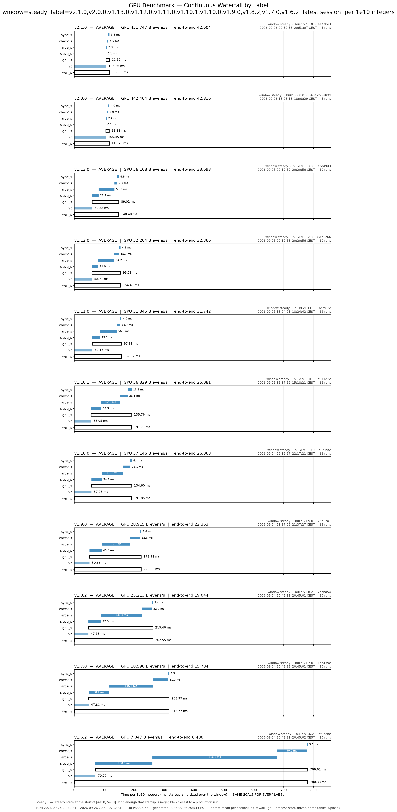
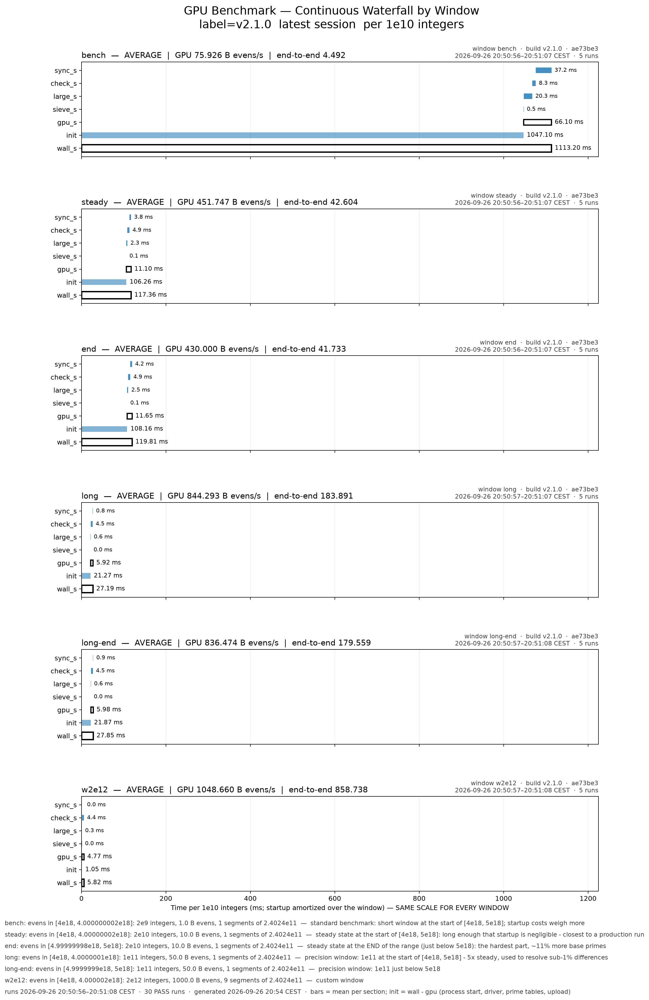

# PROJECT REFERENCE — goldbach-l0

The detailed reference: configuration, CLI, environment, pipeline, kernels,
host components, and the log of every optimization kept or dropped (§9.2).
Companion documents: [CORRECTNESS.md](CORRECTNESS.md) (the argument and its
invariants), [DEVELOPMENT.md](DEVELOPMENT.md) (build, tests, CI, shipping),
[BENCHMARKING.md](BENCHMARKING.md) (methodology), [PIPELINE.md](PIPELINE.md)
(the production run as a diagram).

--------------------------------------------------------------------------
## 1. What this project is

`goldbach-l0` verifies the even Goldbach conjecture (`n = p + q`, both
prime) for every even `n` in `[start, limit]`, on an Intel Arc B580
(Xe2 / Battlemage) through Level Zero — a from-scratch L0 implementation,
not ported from CUDA. The candidate side `p` only needs odd primes
`p <= 9781` (`MAX_GB_PRIME`, justified by the Oliveira e Silva 4e18
verification; the CPU fallback looks further); each `n` needs ONE prime
`q = n - p`.

Two pipelines: the dense path (default and production: mod-30 class map,
packed large-prime kernel, hit lists for the largest primes, mod-30
checker, exact statistics; §8, §9) and the opt-in **sparse class map**
(`--sparse` / `GB_SPARSE=1`; §9.2k): the map holds only 12 residue classes
mod 30030 (0.04% of the integers), candidates come from p <= 4e7, ~1.0e12
evens/s at 4e18 (17x the dense path) but no exact statistics.

- `tools/` is a symlink to a sibling clone of the companion
  `goldbach-tools` repo (validators, bench.py, run_range.sh); without it the
  build produces the verifier and the host tests only.
- Version constant: `gb::VERSION` (include/config.hpp, with the release
  history), echoed by `--info` and the `--csv` output.

--------------------------------------------------------------------------
## 2. Quick start

Run from the repository root (the default `--spv` path is relative). Build,
tests and CI: [DEVELOPMENT.md](DEVELOPMENT.md); benchmarks:
[BENCHMARKING.md](BENCHMARKING.md).

```bash
bash build.sh
./build/goldbach_l0 --cpu-check 1000000          # independent CPU reference -> PASS
./build/goldbach_l0 --info                       # device / driver / config
./build/goldbach_l0 --limit 100000000 --verbose  # small GPU run, human output
./build/goldbach_l0 --limit 1e8 --csv            # one key=value line
./build/goldbach_l0 --start 4e18 --limit 4000000010000000000 --csv
GB_PHASE=1 ./build/goldbach_l0 --start 4e18 --limit 4000000005000000000 --csv   # per-kernel trace
./build/debug_map                                # complete map vs Miller-Rabin (tools)
```

Production run of a whole range (resumable, slice journal, fail-stop):
`bash tools/run_range.sh 4000000000000000000 5000000000000000000`
(2e14-integer slices; re-run the same command to resume). Keep the display
on another GPU: a desktop compositor on the B580 costs ~20%.

Prime cache: a run uses `<cache>.<sqrt(limit)+16>` if present and valid,
else the smallest existing `<cache>.<L>` with L above it (only primes <=
its bound are used), else it generates and writes its own — so one
sqrt(5e18) cache (`base_primes.cache.2236067993`) serves every slice of
[4e18, 5e18]. A cache whose payload fails the content check is ignored.

--------------------------------------------------------------------------
## 3. Repository layout

```
goldbach-l0/
├── CMakeLists.txt          host targets, tests, ocloc SPIR-V rules (kernels/*.cl -> *_bmg.spv, -device bmg)
├── build.sh                cmake configure + build
├── include/
│   ├── config.hpp          tuning constants and VERSION (see §4)
│   ├── l0_context.hpp      RAII Level Zero wrappers + ZE_CHECK
│   ├── primes.hpp          prime lists, cache view, mask tables, Miller-Rabin
│   ├── verifier.hpp        RunStats / SegmentStats, run_gpu, verify_cpu
│   ├── check30.hpp         mod-30 checker plan; split_check.hpp: legacy checker plans
│   ├── gstats.hpp          exact statistics: plans, accumulator, campaign state
│   ├── ridge.hpp           Goldbach ridge top list
│   └── sparse.hpp, sparse_run.hpp   sparse class map geometry, plan, engine
├── src/
│   ├── main.cpp            CLI + human / --csv / --json / --per-seg output
│   ├── l0_context.cpp      Context (immediate in-order list), Module, Kernel
│   ├── primes.cpp          segmented sieve, GBPR cache, masks, Miller-Rabin
│   ├── verifier.cpp        run_gpu (dense pipeline), verify_cpu, device info
│   └── sparse.cpp          run_gpu_sparse
├── kernels/
│   ├── goldbach.cl         dense kernels: make_prime_map, sieve_large_packed,
│   │                       hl_harvest / hl_apply, bucket_* (GB_HITLIST=0),
│   │                       check30_*, count30; legacy checker modes;
│   │                       validation kernels (sieve_large_primes, check_numbers*,
│   │                       prep_large_fb, unpack_large_test, map_compare)
│   ├── sparse.cl           sparse kernels
│   └── *_bmg.spv           shipped modules (byte-identical to the pinned ocloc)
├── tests/                  host_tests, stats_ref, check_constants, cli_tests,
│                           test_ci, test_stats_tools, stats_compare, known_windows,
│                           gpu_validate.sh; data/ (base-2 pseudoprimes < 2^32)
├── ci/                     goldbach_ci.py (local CI, production control), README.md
├── scripts/                gstats.py, goldbach_live.py, notify_record.sh
├── docs/                   these documents, images/, make-plots.sh
├── bench/                  benchmark journals (append-only)
└── tools/ -> ../goldbach-tools   bench.py, waterfall.py, run_range.sh, live_stats.sh,
                            debug_* validators, benchmark.cpp, tuner.cpp, sweep.py
```

Generated and ignored: `build/`, `base_primes*.cache*`, `scm_plan.*.bin`,
`kernels/*.bin`, the campaign files (`goldbach_stats.*`, `goldbach_ridges.csv`,
`goldbach_records.txt`, `goldbach_live.json`, `range-*.journal` / `.log`),
`ci-state/`. Removed in v2.3.0: the `--wheel` path (§15), the archived
predecessor history bundle.

Build targets (CMakeLists.txt): `goldbach_l0`, `host_tests`, `stats_ref`;
with tools: `goldbach_bench`, `goldbach_tuner`, `debug_sieve`,
`debug_check`, `debug_check_hi`, `debug_fb`, `debug_map`, `debug_sparse`.
Validators depend on the `kernels` target.

--------------------------------------------------------------------------
## 4. Configuration constants (include/config.hpp, mirrored in kernels/goldbach.cl)

| Constant | Value | Meaning |
|---|---|---|
| `VERSION` | "2.1.0" | echoed by `--info` / `--csv` |
| `WG_SIZE` | 256 | threads per work-group; 128/512/1024 measured within noise |
| `TILE_WORDS` | 2048 | 16 KB SLM per tile (v1.8.1 optimum, §9.2d; `GB_TILE_WORDS` + ocloc `-DTILE_WORDS` to change) |
| `BITS_PER_TILE` | 524,288 | odd numbers per tile (= ODDS_PER_TILE) |
| `INTEGERS_PER_TILE` | ~1,048,576 | ~1M integer range per tile |
| `WORDS_PER_THREAD` | 32 | exactly ONE owner per word -> no atomics in tile kernel |
| `LARGE_PRIMES_PER_ITEM` | 4 | primes per large-kernel work-item (~98M items -> ~24.5M at 4e18). MUST stay mirrored in goldbach.cl |
| `CHECK_WORDS_PER_ITEM` | 4 | 64-even words per check work-item (256 evens). MUST match WORDS_PER_ITEM in goldbach.cl |
| `MAX_GB_PRIME` | 9781 | largest candidate prime needed (published 4e18 verification); ~1,206 primes, u16 (2.4 KB) |
| `LARGE_PACK_PPI` / `LARGE_PACK_GROUP` | 4 / 128 | sieve_large_packed: primes per work-item / per packing group (host); MUST match LARGE_PACK_PPI / LARGE_PACK_SG in goldbach.cl |
| `LARGE_WG_SIZE` | 64 | large-kernel work-group size |
| `CHECK_PHASE_A_CANDS` | 160 | two-phase checker: candidates handled word-level by check_phase_a before leftovers go to check_phase_b (`GB_CHECK_CAP` overrides; 144-160 flat, 128 -0.3 ms, 192 +1 ms) |
| `CHECK_PHASE_B_GROUPS` | 640 | check_phase_b grid-stride work-groups (`GB_CHECK_BGROUPS` overrides) |
| `MED_MIN_P` / `MED_MIN_P_CLASS` | 256 / 512 | tile-kernel primes >= this (and < split) use the prime-parallel SLM-atomic stage 3m (dense map / class map); `GB_MED_P=N` overrides |
| `CHECK30_PLAN` (include/check30.hpp) | 15 classes x 3-4 segments | mod-30 checker (production since v1.13.0, §9.2j): per n mod 30 the (candidate class s, pattern mask, funnels) segments of phase A; `GB_C30_PLAN` overrides, `GB_C30=0` = the v1.12.0 merge30 + class-split checker |
| `CHECK_PHASE_A_W64` | 12 | phase-A item width in 64-bit words (768 evens), all word checkers; MUST match A_W64 (14 until 2026-10-05, §9.2p) |
| `CHECK_SPLIT_CANDS` / `CHECK_SPLIT_STAGES` | 38 / "7/3" | class-split checker (v1.11.0, §9.2h): phase-A funnels per class list and stage masks (sexy-prime triplets, then pairs); `GB_SPLIT_CAP` / `GB_SPLIT_STAGES` override |
| `MASK_MAX_P` | 64 | primes < 64 use whole-word AND masks (17 odd primes 3..61; 1088 mask words = 8.5 KB). MUST match kernel |
| `SIEVE_PRIME_LIMIT` | 1,000,000 | base primes must reach sqrt(max q); 1e6 supports q to ~1e12 — raise + rebuild for higher |
| `DEFAULT_LIMIT` | 100,000,000 | default verification range [4, limit] |
| `DEFAULT_SEGMENT_EVEN` | 467,500,000 | default segment span (integer span; 233.75M evens; 425M from v1.12.0 to v2.3.0, §9.2u). Comment block records the measurements. tools/run_range.sh uses 467.5M (GB_RANGE_SEGMENT), bench.py each binary's default |
| `MAX_LEFTOVERS` | 1,048,576 | compact exception-list cap (2^20) |

Device assumptions in config.hpp header comment: 20 Xe-cores, 160 vector
engines, 128 KB SLM per Xe-core, 256 KB L1, 18 MB shared L3, subgroup
sizes 16/32, max WG 1024. `--info` confirms on this card: Intel(R) Arc
B580, 160 EUs (5 slices x 4 subslices x 8 EUs), 2850 MHz, 11.3 GB,
subgroups 16 32, max WG 1024, L0 API 1.17.

B580 geometry notes: tile walk = 256 threads x 32 words x 64 bits; one
work-group per `get_group_id`; check work-group covers 256 x 4 x 64 =
65,536 evens; map size for a 250M span ≈ 125M bits ≈ 15.6 MB (fits the
18 MB L3 — the reason small spans won once the host bottleneck was
removed).

--------------------------------------------------------------------------
## 5. CLI reference (src/main.cpp)

```
usage: goldbach_l0 [--limit N] [--start N] [--segment N] [--split N]
                   [--sparse] [--spv FILE] [--prime-cache FILE]
                   [--cpu-check N] [--json] [--csv] [--per-seg]
                   [--info] [--verbose]
```

| Flag | Default | Notes |
|---|---|---|
| `--limit N` | 100000000 | verify evens in [start, N]. N accepts full decimal or e-notation (`4e18` = `4000000000000000000`); junk, hex/octal and u64 overflow exit 2 with an error |
| `--start N` | 4 | first even: rounded up to even, at least 4. Everything below `start` is ASSUMED verified (campaign slices). No even n >= 4 in [start, limit] (e.g. start > limit) is a usage error (exit 2) |
| `--segment N` | 467500000 | integer span per segment; forced >= 2, even; shrunk to total range (min 2 segments kept for pipeline overlap); a span whose odd count exceeds 32 bits fails closed (exit 1) |
| `--split N` | 0 | base-prime split index; 0 = auto -> min(sieve_count, 36000) (verifier.cpp), clamped >= mask_count; > 2^32 - 1 is a usage error |
| `--spv FILE` | kernels/goldbach_bmg.spv | SPIR-V module path |
| `--prime-cache FILE` | base_primes.cache | keyed by limit: `<file>.<limit>` is tried first, then the legacy shared file; miss regenerates + writes |
| `--cpu-check N` | off | independent trial-division Goldbach check of [4, N], then exit (exit 0 = PASS) |
| `--json` / `--csv` / `--per-seg` | off | output modes (§6); `--per-seg` implies segment collection |
| `--info` | | print device/driver/config, exit |
| `--verbose` | | per-segment progress every 10 segments |
| `--sparse` | off | sparse class map pipeline (§9.2k; also `GB_SPARSE=1`); `--segment` other than the default sets the segment span D (rounded to M · dlt), `--split` the tile / large prime bound; needs start well above pmax (4e7) and sqrt(limit) (else exit 1 with a message) |

Exit codes: 0 success, 1 any thrown error (GPU failure, verification
failure, unsupported limit, damaged statistics state), 2 usage error.
`--wheel` (the W = 510510 representation, §15) was removed in v2.3.0. The verifier FAILS CLOSED: any GPU error or a
genuine counterexample throws; `result=PASS` in any output mode means all
evens in range were verified (or leftovers resolved on CPU).

--------------------------------------------------------------------------
## 6. Output formats

Human (default): banner `goldbach-l0 v1.9.0` + limit, start, segments,
leftovers, init/gpu/sieve/large/verify/offsets/sync times, total,
evens/second, `result: PASS`.

`--csv`: ONE line, exactly 23 `key=value` pairs (main.cpp):
`version limit start segment split segments leftovers result init_s
init_cache_s init_module_s init_upload_s gpu_s total_s sieve_s large_s
check_s offsets_s table_s sync_s evens_per_sec tiles large_items`.
Gotchas: `split=` echoes the CLI ARGUMENT (0 when auto) — the RESOLVED
split appears only in `--per-seg`'s `split` column; `evens_per_sec` =
total_evens / gpu_seconds (init excluded); `large_items`/`tiles` are sums
over segments.

`--json`: pretty-printed object with the same fields plus `spv` and
`per_segment` array when collected (`seg, start, end, evens, tiles,
large_items, split, mask_count, leftovers, sieve_s, large_s, check_s,
offset_s, wall_s`).

`--per-seg` (non-JSON): fixed-width table `#seg evens [start, end] tiles
large_items split sieve_s large_s check_s offset_s wall_s left`.

--------------------------------------------------------------------------
## 7. Environment variables

| Var | Effect |
|---|---|
| `GB_STATS=0` | dense path: no Goldbach statistics (§9.2l; default on for the mod-30 checker at start >= 1e6) |
| `GB_STATS_SAMPLE=N` / `GB_STATS_K=K` | full p(n) histogram on every Nth segment (default 256; 1 = all, ~+30%) / exact phase-A prefix per class (default 64, <= 128) |
| `GB_STATS_STATE=F` / `GB_STATS_LOG=F` | statistics files (default goldbach_stats.state / goldbach_stats.log in the cwd) |
| `GB_RECORDS_FILE=F` / `GB_STATS_LIVE=F` | record events (p(n) > 9781, new S(p); CPU re-proven, appended at once; default goldbach_records.txt) / live snapshot for scripts/goldbach_live.py (default goldbach_live.json, every 2 s) |
| `GB_RECORD_HOOK=cmd` | run `cmd KIND P N Q CHECK` in the background per record event (default scripts/notify_record.sh when present; empty: none). The script reads `GB_NOTIFY_WALL`, `GB_NTFY_TOPIC` / `GB_NTFY_SERVER`, `GB_NOTIFY_MAIL`, `GB_NOTIFY_CMD`, `GB_NOTIFY_SP` (README "The record hunt") |
| `GB_STATS_BGROUPS=N` | check30_xb work-groups (sampled segments; default 160; N >= 1, else the run fails before GPU work) |
| `GB_C30_PLAN=S` | mod-30 checker plan override; a leading `T:` bounds every funnel member below T (the statistics tail bound) |
| `GB_SPARSE=1` / `GB_SCM_*` | sparse class map: select the path and its knobs (list in §9.2k); `GB_PHASE=1` prints per-segment tile / large / phase A / phase B times and the pending rate, `GB_INIT_TRACE=1` the init breakdown |
| `GB_PHASE=1` | per-segment host-phase trace to stderr: prep (offsets/table), enqueue (args/l1/l2/l3), wait, collect + raw kernel start/end ticks and sieve->large / large->check gaps. Default off (a few clock reads per segment) |
| `GB_WHEEL_W=W` | host side of the multiplier wheel (must match the kernel's -DWHEEL_W: 30, 210, 2310) |
| `GB_BUCKET_VERIFY_DUMP=1` | with GB_BUCKET_VERIFY: on the first mismatch print the differing bits with Miller-Rabin truth |
| `GB_BUCKET=0` / `GB_BUCKET_MINP=p` / `GB_BUCKET_GROUPS=n` | bucket sieve off / threshold prime / grid (§9.2b; n >= 1) |
| `GB_BUCKET_VERIFY=N` | validate the bucket sieve on every Nth segment (1 = all) against a bucket-free rebuild; throws on any difference |
| `GB_HITLIST=0` / `GB_HITLIST_K=n` | bucketed primes by the bucket ring instead of hit lists / hit-list batch length (default 128, max 128, list buffer < 4 GiB) (§9.2t); GB_BUCKET_VERIFY checks either path |
| `GB_HL_FUSE=0` | hit-list apply as its own launch (hl_apply) instead of fused into the packed kernel (§9.2u) |
| `GB_UNORDERED=0` | in-order immediate list (pre-v2.4) instead of the unordered list with a barrier before every launch but the tile sieve and the harvest (§9.2v) |
| `GB_MASK_GROUPS=0` / `GB_MASK_PERIOD=N` | per-prime mask loop instead of the fused grouped stage / max group period in words (default 4096, <= 8 groups) |
| `GB_LARGE_WG=N` | large-kernel work-group size (multiple of 32) |
| `GB_MED_P=N` | tile-kernel medium-stage bound (default `MED_MIN_P`) |
| `GB_CHECK_CAP=K` | phase-A candidate count of the two-phase checker (default 160) |
| `GB_CHECK_BGROUPS=N` | phase-B work-groups (default 640; N >= 1: 0 would skip phase B, so it fails the run before GPU work) |
| `GB_SPLIT=0` | v1.11.0 A/B: twin checker on the dense map (v1.10.1 behaviour) |
| `GB_CLASSMAP=6` / `GB_CLASSMAP=0` | A/B: the v1.11.0 mod-6 class map / the dense map + split_map, both feeding the class-split checker (default: mod-30 class map + merge30) |
| `GB_SPLIT_CAP=K` / `GB_SPLIT_STAGES=S` | class-split checker funnels per list / stage masks ("7/3", "3", "7:20/3" = at most 20 triplet funnels) |
| `GB_WRITE_CHECKED=1` | class-split checker: also write checked[] (validation output; off in production, ~1%) |
| `GB_CHECK_NCAND=K` | measurement only: GPU sees only the first K candidates, the CPU fallback settles the rest (leftover count = evens unresolved after K) |
| `NEOReadDebugKeys=1` | driver-side: REQUIRED for any NEO debug env var to have effect (source-verified, §14); alone it is perf-neutral |
| `ZET_ENABLE_METRICS=1` | driver-side metrics enablement (+ `sysctl dev.xe.observation_paranoid=0`, Metrics Library; see §14) |

--------------------------------------------------------------------------
## 8. Pipeline (src/verifier.cpp `run_gpu`)

```
CPU setup: base primes to sqrt(limit) via mmap'd GBPR cache (segmented
           sieve on miss); goldbach candidates p<=9781 as u16; magic
           reciprocal + shift + ms32 tables for the split range
L0 setup:  Context (immediate command list, IN_ORDER flag — LOAD-BEARING,
           see §11), Module from SPIR-V, kernels @ WG_SIZE
Buffers:   per-slot x2 (double buffering): prime_map, checked, first_bits,
           mask tables, pending, leftovers, counters, ridge, histograms,
           tile_first; shared: gb_primes, sieve_primes, packed large primes,
           hit lists (K = 128 segments x capacity), magic/shifts/ms32
Per segment k (slot = k&1):
  host prep (overlaps GPU of segment k-1): first bits (class map,
    parallel_for over primes into a persistent buffer), tile_first table
    (parallel_for), small-prime group offsets
  enqueue: counter zero-fills, EVENT RESETS, make_prime_map(tiles),
           [every K-th segment: BARRIER, hl_harvest],
           BARRIER, sieve_large_packed_hl (hit-list apply fused in),
           [GB_BUCKET_VERIFY: rebuild + map_compare], count30 (statistics),
           check30_a, check30_b (sampled segments: check30_xs* / _xb)
  collect segment k-1 (other slot): host-sync on its check event, query
    kernel timestamps, check error flags / pending / leftover counts,
    statistics, Miller-Rabin fallback for leftovers
Drain: collect final segment.
Final one-even tail is MERGED into the preceding segment, and the loop
breaks when seg_end == limit (else limit would be scheduled twice).
```

Geometry (SegmentGeometry, verifier.cpp): q range =
`[seg_start - 9781, seg_end - 3]` (only odd q; bit i <-> q = q_first +
2i); q_first forced odd; the class map holds 8 arrays of `tpc` tiles of
BITS_PER_TILE = 131072 bits (class_geometry); slot alternates.
Map must be sized in WHOLE tiles — the tile kernel writes whole tiles, a
partial last tile would write past the buffer (device-lost comment,
verifier.cpp).

Auto split: `min(sieve_count, 36000)` (rationale and measurements in the
comment at the split selection in verifier.cpp). The split is what makes 4e18 feasible:
walking all ~98M base primes per tile blew the driver watchdog (engine
reset).

--------------------------------------------------------------------------
## 9. Kernel reference (kernels/goldbach.cl)

### 9.1 make_prime_map — tile sieve (one work-group per 64 KB tile)
- Stage 1: each of 256 threads fills its 32 owned SLM words with ones.
- Stage 2: the ONLY barrier in the kernel.
- Stage 3a (SMALL_PRIME_MASK=1): primes < MASK_MAX_P(64) applied as
  whole-word ANDs from the host-built `mask_table[p_idx*64 + phase]`;
  walk = load mask, AND, phase += 1 (word-index mod p). Comments carry two
  hard-won warnings: (a) the magic-reciprocal ceil trick is WRONG here —
  x - ceil(x/p)*p underflows and the OOB mask load page-faults -> device
  lost; 32-bit `%` is exact and cheap since x < 2^32, p < 64
  (goldbach.cl:161-168); (b) advancing the phase by `64 % p` instead of 1
  per word mis-aligns every prime with 64 % p != 1 — silently restoring
  composites AND clearing primes (tools/debug_map.cpp catches this class
  of error, goldbach.cl:174-182).
- Stage 3.5: tile 0 restores q = p bits (1*p is prime) when q_first <= 64;
  range-sensitive, guarded by `q_first <= MASK_MAX_P` — the reason masks
  stay valid at every range.
- Stage 3: primes [mask_count, sieve_split) clear multiples inside each
  thread's private 2048-bit range. Two paths:
  - TABLE path (use_table=1, production): host precomputed
    `tile_first[tile*split + j]` (u32, 0xffffffff = none) so the kernel
    does NO 64-bit math; p < TILE_BITS jumps to my range with an exact
    32-bit reciprocal (d < 2^19 proven in ms32 comment, verifier.cpp);
    p >= TILE_BITS has at most one mark, range-check only. Loads are
    software-pipelined in TABLE_BATCH=8 batches (latency-bound broadcast
    loads; two live batches = 16 loads in flight).
  - LEGACY reciprocal path (use_table=0): mul_hi with 64-bit
    ceil(2^64/p) magic + shift + ceil correction; kept for huge segments
    / debug tools. Host owns ALL skip logic via fb_global (~0ull = skip).
- Stage 3m (v1.7.0): primes [own_end, sieve_split), own_end = first prime
  >= MED_MIN_P (512), are walked PRIME-parallel: thread `me` takes primes
  own_end+me, +256, ... and clears all of that prime's marks in the tile
  with 32-bit SLM `atomic_and`. First bit per tile = segment-global
  fb_global plus one exact 32-bit modulo. Two extra barriers (owned plain
  RMWs must finish before cross-thread atomics; atomics before stage 4).
  This replaced a threads x primes walk (every thread visited every prime
  for <= 1 mark) and is what lets the auto split rise from 2400 to 40000,
  moving ~1/3 of the global atomic marks into SLM. The tile_first table
  now holds only the owned columns (row stride = own_end).
- Stage 4: coalesced whole-tile write to global; tail beyond q_odds
  masked so the map is exact.
- No barrier between primes: every thread owns its words exclusively.

### 9.2 sieve_large_primes — the atomic kernel
- One work-item per LARGE_PRIMES_PER_ITEM=4 primes from [split, count);
  a bounded batch matters: one item per prime would create ~383K
  work-groups per segment at 4e18.
- First markable bit computed INLINE, division-free since v1.7.0:
  `mod_u64_u32` estimates q_first / p with a float reciprocal (two
  refinement steps) and brings the remainder into [0, p) with exact
  integer fix-up loops — exact for any float rounding. The emulated u64
  division it replaced was ~60% of the kernel (setup-only timing
  0.033 s -> 0.0148 s over the 2e9 window). Shared with prep_large_fb, so
  debug_fb validates it over all ~98M primes.
  `first = max(p*p, first odd multiple >= q_first)`; skip if > q_last.
  debug_fb validates the formula bit-exact.
- Marks with 32-bit `atomic_and` on the containing u32 half of the u64
  word. Long comment: 64-bit atomic_and is ABSENT from this ocloc's
  header set (both int64-atomics extensions on) and the error misleadingly
  says "ambiguous"; an int-literal mask with a u64* silently picks the
  32-bit overload (warning-only). AND-clearing is monotone -> concurrent
  clears converge. (goldbach.cl)
- Launched in work-groups of 256: groups = ceil(ceil(large_count/4)/256).

### 9.2a sieve_large_packed — production large-prime kernel (v1.7.0)
- Same marking as sieve_large_primes; the prime list is streamed at ONE
  BYTE per prime: gaps[i] = half-gap to the previous prime (0 at each
  packing-group start), bases[g] = first prime of each group of
  LARGE_PACK_GROUP = 4 x 32 = 128 primes. A SIMD32 subgroup owns one group;
  each lane reads its 4 gap bytes as one u32 and rebuilds its primes with a
  subgroup exclusive scan (decode_large). Host: pack_large_primes, fails
  closed if a half-gap exceeds 255 (max gap below 2.24e9 is 292).
- Why it wins: after the division fix the u32 stream (~393 MB/segment)
  both bounded setup and evicted the L3-resident map under the atomics;
  at 1 B/prime large_s fell 0.0405 -> 0.0349 (SIMD16) -> 0.0316 (SIMD32,
  work-group 64: LARGE_WG_SIZE; 32-128 flat, 256 +5%, 1024 +12%).
  A marks-disabled proxy MISREPORTS this (it has no atomics for the stream
  to interfere with) — time the real kernel.
- Cost split at 4e18 (2e9 window): setup ~0.017 (decode/dispatch floor
  ~0.009 + modulo ~0.008), mark loop ~0.005, atomics ~0.009-0.010.
- Measured and dropped: 2 B/prime u64 packing (pre-page-fix), L3-bypassing
  prime loads (LSC L1UC/L3UC 2.5x slower, L1S/L3UC 1.5x slower), 8 primes
  per item (~2%, noisier), native_recip, a third mod refinement step.
- GB_LARGE_WG=N overrides the large-kernel work-group size.
- Validation: debug_fb decodes ALL ~109M primes of the 5e18 list at several
  splits via unpack_large_test (bit-exact vs host); debug_map runs the
  packed kernel (GB_MAP_LARGE_PLAIN=1 for the u32 kernel). A deliberately
  broken decode fails every debug_map case (false primes) and debug_fb.

### 9.2b Bucket sieve for the largest primes (v1.7.0)
- Primes p > max(q_odds_full, BUCKET_MIN_P_FACTOR(8) x q_odds_full) ~ 1e9
  leave sieve_large_packed. Each active one owns exactly ONE entry
  `off | p << 32` (its next hit) in a ring of R = max lookahead + 2 buckets
  (~20 at 4e18; bucket t % R = segment t). Global bit coordinates: segment
  t covers [t*delta, t*delta + q_odds_t), delta = segment_even / 2; q
  ranges overlap by q_odds_full - delta (the 9781 back-extension).
- bucket_process (segment k): mark `off`; if off >= delta the SAME hit is
  also in segment k+1 -> refile it there; else file the next hit off + p
  under its first containing segment. Filing is work-group aggregated (SLM
  counters, one global atomic per target bucket per chunk). The last
  segment marks only.
- bucket_activate: files first hits. At segment 0 all primes with
  p*p < q_first0 (one u64 division each, one-time); later only primes whose
  first hit p*p enters the ring horizon (host pointer, monotone in p).
- Per segment order: packed -> activate -> barrier -> bucket_process ->
  barrier -> reset the drained bucket's count (before any refill: the next
  activation can target it only from segment k+1).
- Fail closed: bucket overflow, an entry outside a non-last segment, a
  lookahead >= R, or a late activation sets *err; the host throws.
  Capacity = 1.1 * lambda + 8 sqrt(lambda) + 64K, lambda = sum q_odds_full/p.
- Cost model (measured): a bucket entry ~200 ps per hit (8 B read + 8 B
  write + mark; the traffic also evicts the L3-resident map), a packed
  prime ~22 ps of setup per segment -> bucketing pays only above ~9 x
  q_odds. Steady state at 4e18 (2e10 window, 80 segments): 17.0 -> 18.0 G
  ev/s, large_s -10%; threshold 7e8 17.7G, 1e9 18.0G, 1.3e9 17.8G. The
  2e9 benchmark window gains less (the one-time activation is ~1/8 of it).
- VALIDATION: GB_BUCKET_VERIFY=1 rebuilds every segment's map without
  buckets (tile + packed over ALL large primes) and map_compare counts
  differing words; any difference throws. Passed: 120 segments at 4e18,
  120 ending at 5e18, a ragged last segment, all-primes-bucketed
  (GB_BUCKET_MINP=0), and 10,000 small segments at 1e15 with ~180 p*p
  activations and ~1,700 ring wraps. Mutation (overlap refile removed):
  caught (9 words / 40 segments) — while a NORMAL run of the broken kernel
  still reports PASS, leftovers=0: a lost bucket mark only matters for
  composites whose smallest factor exceeds ~1e9, which other candidates
  mask. Re-run GB_BUCKET_VERIFY=1 after ANY change to this code;
  GB_BUCKET_VERIFY=N (every Nth segment, ~1/N cost) is only a cheap
  production tripwire for gross failures.
- Since 2026-10-06 the bucketed primes go through hit lists by default
  (§9.2t); the ring below remains the GB_HITLIST=0 path.
- Knobs: GB_BUCKET=0 (off), GB_BUCKET_MINP=p, GB_BUCKET_GROUPS=n (1024;
  4096 marginally faster), GB_BUCKET_VERIFY=N. Enabled only for the
  uniform dense geometry (start >= 9783, >= 2 segments).

### 9.2c v1.8.0 — instruction-count pass (roofline: the kernels are ISA-bound)
Method: disassemble (`ocloc disasm -file kernels/goldbach_bmg.bin -device
bmg -dump DIR`), count instructions per hot loop, and time variants with
stages removed. Xe2 has no native 64-bit integer ALU, so every u64 add /
compare / shift in a hot loop costs several instructions plus moves.
- Large-prime marking (`mark_multiples_u32`, packed + plain kernels): the
  mark loop in 32-bit arithmetic on u32 words: 39 -> 15 instructions per
  mark; large_s -7%. Overflow-free loop condition (n - bit > p).
- Tile thread-owned marks (`mark_owned_u32`): u32 SLM words and 32-bit
  arithmetic: 37 -> 14 instructions per mark; sieve_s -3.5%.
- Fused small-prime mask stage: primes 3..61 are grouped (host
  `small_prime_group_masks`, greedy, period <= 4096 words -> 8 groups,
  75 KB); each owned word = AND of 8 table loads, stored once (replaces the
  ones-fill plus 17 loads + 17 SLM RMWs per word). sieve_s -11%. Period
  sweep: 4096 best (0.1086 s) vs 8192 (0.1143), 16384 (0.1161); >8 groups
  with a 16-slot loop ~2% slower. GB_MASK_GROUPS=0 / GB_MASK_PERIOD=N.
- Checker phase A: branch-free funnel `(m >> r) | ((m' << (31-r)) << 1)`
  (exact for r = 0 too, no per-word select) and candidates processed in
  runs sharing one word offset, so the 9-word window stays fixed in
  registers: 153 -> 67 instructions per candidate; check_s -11%. Cap 160
  re-checked (128: +10%, 192: +8%, 224: +17% check time).
- bucket_process filing in 32-bit (host guard p_max + q_odds < 2^32):
  verified, no measurable change (the kernel is memory/atomic-bound).
- Measured and dropped: FP64 quotient for the modulo (native FP64 exists
  but the packed kernel went 1.10 -> 2.28 ms/segment without marks).
- Result (bench.py, 9 runs each, paired): +9% (bench), +10% (steady,
  20.5 G), +11% (end, 20.1 G) over v1.7.0; 7.1 J per 1e9 evens.

### 9.2d v1.8.1 — tile size, medium-stage setup, float-float modulo
Stage-removal timing of the v1.8.0 tile kernel (2e10 window): medium stage
0.066 s of 0.108 (half setup, half marks), thread-owned 0.030, masks
0.003. The medium stage's setup runs per prime PER TILE, and with the
prime-parallel stage the old reason for big tiles is gone:
- Tiles 64 KB -> 16 KB (TILE_WORDS 2048, GB_TILE_WORDS on the host):
  sieve_s 0.109 (64 KB) / 0.100 (32 KB) / 0.087 (16 KB); 8 KB and 128 KB
  lose. More resident work-groups beat fewer per-tile setups. Auto split
  re-tuned to 30000 (flat 25K-40K).
- Medium-stage setup: d mod p via a float quotient and a wrap-around
  32-bit remainder (p < 2^30; exact % above) instead of the emulated u32
  '%': sieve_s -2.7%.
- Large-prime modulo (FF_MOD): float-float quotient (~46 bits, FMA
  residuals) + 32-bit wrap-around remainder for p < 2^30; the u64 float
  path stays for larger p. Packed kernel 2.76 -> 2.64 ms/segment.
  debug_fb (every large prime, now also at 5e18) is its bit-exact check.
- Tools: debug_fb staging race fixed (the prime upload and the poison fill
  shared one staging buffer; the host could overwrite the primes before
  the async DMA read them -> intermittent all-sentinel FAILED).
- Re-checked, unchanged: bucket threshold 1e9, segment 250M (200M/225M/
  275M lower), check cap 160.
- Result (bench.py, 9 paired runs vs v1.8.0): +4.7% bench (19.9 G),
  +5.1% steady (21.5 G), +5.1% end (21.0 G). Full [4e18, 5e18] ~275 days.

### 9.2e v1.8.2 / v1.9.0 — test-kill-or-survive round, multiplier wheel
Each idea measured on the 2e10 window (3 runs), kept only if it wins:
- SURVIVED v1.8.2: check_phase_a item width 4 -> 16 words (check -28%),
  LARGE_PACK_PPI 4 -> 16 (large -3.5%), no barrier before the bucket
  counter reset (+0.3%).
- KILLED: device-memory mirrors of per-segment tables (sieve -2%, copies
  cost the same), candidate reordering (breaks the register window),
  mask groups for primes 67..127 (<1% by analysis), wheel in the
  thread-owned stage (1-8 marks per thread cannot pay the setup),
  table-driven wheels in the medium stage (slower than the wheel-30
  nibble form), wheel 30030 (ties 2310).
- v1.9.0 MULTIPLIER WHEEL (the algorithmic change): a composite q whose
  smallest prime factor s is >= 67 is s*m with every prime factor of m >=
  s, so m is coprime to 2*3*5*7*11 — prime p only has to clear p*m for m
  coprime to WHEEL_W = 2310; every other multiple is divisible by a prime
  <= 11 and cleared by the mask stage (which marks EVERY multiple of the
  primes 3..61). Only 480 of 1155 odd multipliers are marked (-58% marks).
  Applied to: sieve_large_packed / sieve_large_primes (mark_multiples_whl,
  WHL_* constant tables generated for 30/210/2310, p > 61), the bucket
  sieve (next hit = next coprime multiplier, residue recomputed from the
  entry position; activation starts at the first coprime multiplier;
  lookahead up to 7p -> ring up to 128 buckets, capacity x 480/1155), and
  the medium tile stage for p < 16384 (wheel-30 nibble form; above that a
  prime has ~1 mark per 16 KB tile and the setup loses).
  large_s per 2e10: 0.273 (none) -> 0.212 (30) -> 0.202 (210) -> 0.191
  (2310). Result vs v1.8.2 (bench.py, 9 paired runs): bench 25.7 G
  (+20%), steady 29.0 G (+24.5%), end 28.5 G (+26%); 5.8 J per 1e9
  evens; [4e18, 5e18] ~203 days.
- BUG FOUND AND FIXED during validation: the wheel step (up to 7p) was a
  u32 in mark_multiples_whl and wrapped for p > ~613M, placing stray marks
  after a prime's first hit — false composites only (0 false primes: the
  first hit is exact and primes that large have no second hit in a
  segment). Invisible to the small debug_map windows and to the default
  GB_BUCKET_VERIFY (its reference is the same kernel); caught by
  GB_BUCKET_VERIFY with GB_BUCKET_MINP=0. Fixed with a 64-bit step, and
  debug_map gained two FULL production segments (4e18 and just below
  5e18, 125M odd numbers each, 12-thread Miller-Rabin, ~9 s) that catch
  this class independently (the buggy kernel: 101 / 99 false composites).
  GB_BUCKET_VERIFY_DUMP=1 prints the differing bits with MR truth.

### 9.2f v1.10.0 — test-kill-or-survive round 2 (+32%)
Method: tools-free interleaved A/B (fresh process per run, warm-up
discarded, paired geometric-mean ratio of the kernel-time sum over the 2e10
windows), plus stage ablations (compile-time variants that drop one stage
or one memory stream) to find where the time goes before changing it.
Final: tools/bench.py, 7 paired rounds vs the v1.9.0 build, same session:
steady 25.27 -> 33.35 G evens/s (+32.0% +-0.5%), end 25.00 -> 32.69 G
(+30.9% +-0.8%), 6.40 -> 5.23 J per 1e9 evens. (A browser used ~2.7% of the
B580 during this session, so both arms sit below the §13.2 numbers; the
ratio is what carries over.)
Clean re-run (no other process on the B580, 12 paired rounds, journal
bench-results.csv): bench 25.5 -> 30.4, steady 28.9 -> 37.2 (+28.5%), end
28.4 -> 36.4 G (+28.2%); long / long-end (1e11, 40 runs) 37.93 / 37.31 G,
4.3 J per 1e9 evens: [4e18, 5e18] ~155 days. The browser (~2.7% of B580
engine time) had cost ~13% in absolute terms.
SURVIVED, in order of discovery (each vs the build before it):
- Bucket threshold 8 -> 3 x q_odds_full (~1e9 -> 3.75e8): +9.6% steady,
  +11.6% end. The wheel cut bucket hits per prime to 480/1155 but left the
  packed kernel's per-prime setup unchanged, so the crossover moved down.
  Cost: ~4.8 GiB of bucket ring (R x cap) instead of 2.2 GiB.
- Bucket entry loads L1S_L3UC (LSC cache control, BKT_LD_CC): bucket
  0.92 -> 0.83 ms/segment, ~3%. Ablation: without its map atomics
  bucket_process halves (0.905 -> 0.435 ms): the ~70 MB/segment entry
  stream evicts the L3-resident map under the marks.
- Twin checker: phase A reads the map as the twin map (bit j = map[j] |
  map[j-1], formed while loading the register window: tw32/tw64) with the
  LOWER members of twin pairs as candidates, so one funnel tests p and
  p + 2. Needed because P(an item's 1024 evens all resolved after 160
  single candidates) is only ~13%: phase A nearly always ran to the cap.
  A separate make_twin_map pass cost as much as it saved; the fused form
  +3.7% (cap 100). Phase B then probes only the candidates the twin pairs
  did not cover (rest list): +1.1%. Validated by debug_check_hi (twin caps
  0/16/100/4000; the m << 2 mutation fails 15 cases).
- Bucket drain BEFORE the packed kernel: +1.9% (both windows). The packed
  kernel's ~23M atomics no longer follow the bucket's entry stream.
- 32-bit first-multiple setup in sieve_large_packed for q_first >= 2^60
  and p < 2^30 (p*p < q_first always; t = (p - q_first mod p) mod p, +p if
  odd, bit0 = t/2): +4.1%. Emulated u64 mul/compare/add per prime was a
  large part of the setup of the ~13M packed primes with <= 1 mark per
  segment. debug_map's full production segments are the check (dropping the
  odd fix-up: ~2.8M wrong bits per segment).
- Packed decode in u32 + the float-float split of q_first hoisted out of
  the per-prime modulo (ff_split / mod_ff): +1.1%.
- Medium tile stage loads batched 8 primes deep (MED_BATCH): +3.6%.
  Ablations: without the stage sieve_s 0.035 (vs 0.083); marks removed:
  unchanged; barriers only: 0.035; loads only: 0.048. The stage was
  latency-bound on its dependent per-prime loads, not on marks or bandwidth.
- MED_MIN_P 512 -> 256: +0.6%. LARGE_WG_SIZE 64 -> 128: +0.8% / +1.3%.
KILLED (no resolvable gain, or slower): uncached bucket STORES (2-3.7x
slower bucket); bucket groups 2048/4096; BKT_E 4/16; segment 225M (-1.8%),
275M (-3.9%), 300M (-33%, map leaves L3); split 20K-50K (30K stays);
phase A item width 8/12/20 with twins; sparser early-exit tests (every
2nd/4th funnel); a WHL_NEXT table replacing the coprime-advance loop plus a
single-modulo residue; staged setup-then-mark in the packed kernel; u32
fb_global for the medium stage (and its low-word read); native_recip in the
medium modulo; a two-stage medium load pipeline; TABLE_BATCH 4/12;
PROBE_BATCH 4/16; TILE_WHEEL_MAXP 8192/32768; one fill for both counters.
By analysis: multi-pattern constellation passes (prime quadruplets /
triplets before twins) — the disjoint cover and the extra window slides
make them no better per unit cost than twins alone; SLM-sorted coalesced
uncached bucket stores — an upper-bound ablation puts the gain under ~2%.
Validation of the round: debug_sieve, debug_check, debug_fb, debug_map
(incl. both FULL production segments), debug_check_hi (plain + twin),
--cpu-check, GB_BUCKET_VERIFY=1 over 120 segments at 4e18, 120 ending at
5e18, a ragged tail, all primes bucketed (GB_BUCKET_MINP=0), and 2,000
small segments at 1e15 — all clean.

### 9.2g v1.10.1 — round 3 (+4.0% long): aligned buckets, wheel 30030
All A/Bs on a clean B580 (round 3 was first measured with a browser on the
card and re-run; CIs ~+-0.05-0.2%). bench.py vs v1.10.0, 8 paired rounds:
long 37.98 -> 39.49 (+4.0%), long-end 37.35 -> 38.71 G evens/s (+3.7%);
kernel time per 2e10 260.4 -> 246.8 ms (+5.5%). The 2e10 windows read
-1.8% (steady) / -2.9% (end) on wall time: the bigger ring costs ~20 ms of
host time once per process (see below), nothing per segment. Production
slices (2e14, ~40 min) amortize it: [4e18, 5e18] ~147 days.
Ablation first: sieve_large_packed = decode + modulo 0.23 ms, + wheel
residue and first mark 0.39 ms, full 1.04 ms per segment — ~60% is the mark
loop past the first hit, bound by the atomics (a pure-u32 loop was -0.4%),
so the lever is fewer marks.
SURVIVED:
- Bucket stride rounded to 64 entries (512 B). bucket_process reads each
  bucket as SIMD16 x 8 B = 128 B loads; with an arbitrary cap every bucket
  base was only 8 B aligned and about half the buckets straddled two lines
  on every load. Any multiple of 16 entries (128 B) gives the full effect,
  8 entries none: bucket_process 0.633 -> 0.549 ms/segment, ~+1.7% on long.
  This was also why earlier threshold sweeps jumped by +-2% between
  neighbouring settings (cap % 16 changed with the threshold).
- Multiplier wheel 30030 for the packed kernel AND the bucket (5760/15015
  odd multipliers, -7.7% marks vs 2310; WHEEL_W). The bucket's lookahead
  grows to 11p: ring up to ~199 buckets (BKT_MAX_R 256), and at the new
  threshold ~6.9 GiB of VRAM. Packed alone +0.7%; with the bucket and
  threshold 3 x q_odds, vs 2310 at 4 x (both aligned), 1e11 windows at
  4.0/4.3/4.7/5.0e18: +1.6/+1.6/+1.4/+1.2% (4 x: +0.8%, 2.5 x: +1.1..1.4%,
  2 x: -2%). One corrupted step-table entry gives ~5,000 false primes per
  FULL debug_map segment.
- Ring split over two allocations (bkt_bucket). Past ~5 GiB of ring, the
  first submission touching it cost host time (4.97 GiB: 0.5 ms, 5.16 GiB:
  33 ms, 6.9 GiB: 37 ms, in the segment-0 enqueue); two halves: 19 ms.
  Kernel cost of the per-bucket pointer select: 0.09%. Not a VRAM-pressure
  effect (other clients hold ~166 MB; an unused 1.5 GiB dummy allocation
  costs nothing).
KILLED: bucket threshold 4 x without the 30030 bucket (kept only as the
intermediate step); native_recip in mod_ff (-0.1%); WHL_STEP in SLM
(-0.7%); 32-bit wheel mark loop (-0.4%); a first-hit NEXT table for 30030
(-0.6%); tiles 8 KB (-7.0%) / 32 KB (-4.9%); LARGE_PACK_PPI 8 (-0.8%) / 32
(-9.3%); twin cap 90/110; split 25K/35K; bucket groups 2048 and phase-B
groups 1280; large-GRF mode (auto: check 0.052 -> 0.077 s; forced: all
slower; wider phase-A items with it still worse); dropping the packed
kernel's barrier after the bucket drain (+0.14% +-0.22). By analysis:
folding primes 67..255 into the register mask stage (about even per
prime), triplet + twin checker passes (+13% candidates per funnel at
p <= 2000, eaten by the extra pass).
Validation: debug_sieve/check/fb/map (incl. FULL segments), debug_check_hi,
--cpu-check, GB_BUCKET_VERIFY=1 at 4e18 / 5e18 (120 segments each), ragged
tail, GB_BUCKET_MINP=0, 2,000 small segments at 1e15 — all clean.

### 9.2h v1.11.0 — round 4 (-24% long / long-end): class-split checker, class map
Method as in rounds 2-3 (interleaved fresh-process A/B, stage ablations,
disassembly), plus a CPU simulation of the checker on real maps near 4e18
(Miller-Rabin truth) to choose candidate patterns before writing kernels.
Final A/B vs the v1.10.1 build (its own shipped spv, 250M spans), 5
interleaved rounds, same session: long 1254.7 -> 940.2 ms (-25.1%, 39.9 ->
53.2 G evens/s), long-end 1279.8 -> 971.8 ms (-24.1%, 39.1 -> 51.5 G); 2e12
windows at 4e18 / 5e18: 53.6 / 52.7 G evens/s. bench.py session
2026-09-25 (display on the iGPU, other-GPU 0.0%, each build at its default
span, v1.11.0 350M vs v1.10.1 250M; 12 / 20 paired rounds): bench 38.3 vs
20.1, steady 51.3 vs 36.8, end 46.5 vs 35.7, long 53.17 vs 39.84 (-25.1%
time), long-end 51.45 vs 39.07 G evens/s (-24.1%); 3.25-3.32 J per 1e9
evens -> [4e18, 5e18] ~110 days.
SURVIVED, in order:
- Class-split checker (kernels split_map, check_split_a, check_split_b;
  include/split_check.hpp). q = n - p is divisible by 3 exactly when
  n = p (mod 3), so for the 2/3 of evens with n != 0 (mod 3) — the hard ones,
  which set an item's funnel count — only one of a twin funnel's two tests can
  succeed. Evens are grouped by n mod 3 and the map read as its q = 1 and
  q = 5 (mod 6) bits (S1 / S5, consecutive bits q, q + 6): n = 0 uses
  p = 1 (mod 6) on S5, n = 2 uses p = 1 on S1, n = 1 uses p = 5 on S5 — every
  test of every funnel can succeed. A funnel ORs pattern shifts (bit d = q - 6d,
  i.e. candidate p + 6d, used only where every p + 6d is prime): simulated on
  real maps, 35 triplet/pair funnels leave 0.1% pending vs 100 twin funnels.
  Phase B probes per class the untested useful candidates, then the futile
  ones (only q = 3 can hit), so checked/leftover sets are exactly a per-even
  scan's. check_s per 2e10: 52.2 -> 37.4 ms.
- Flat candidate loop: the nested slide loop compiled to ~107 register moves
  plus a 12-way pattern OR per slide (as costly as a funnel; sparse pattern
  lists slide almost every funnel). One flat loop with a 1-word and a 2-word
  slide path (raw words preloaded 2-4 ahead), pattern shifts <= 2: 37.4 ->
  33.0 (pairs). No early-exit test (P(all 16 lanes x 1024 evens resolved
  before the cap) ~1e-7): -0.8..2.3 ms. checked[] not written in production
  (validation output only, GB_WRITE_CHECKED=1): -1.1%.
- Class map (the algorithmic step): the sieve builds S1 / S5 directly as two
  arrays (M1 at word 0, M5 at word tpc * TILE_WORDS; dense bit b = 3t + phi is
  class bit t; q = 3 (mod 6) not stored). Tiles are class tiles (2/3 as many:
  a proxy launching 2/3 of the dense tiles measured sieve 68.9 -> 46.4 ms per
  2e10); per class the host builds first bits (compute_first_bits_class),
  tile rows and step-6 mask tables (small_prime_mask_table_step); the
  large / bucket kernels keep dense coordinates and convert per mark
  (map_clear: +0.9% measured by proxy); split_map disappears; the 10.4 MB map
  also stays L3-resident better under the atomics (large_s 124.9 -> 115.7 per
  2e10). Class mode is production whenever the split checker is (GB_CLASSMAP=0
  for A/B); split_segment accepts the range bottom (negative funnel offsets
  are floored, words below 0 read as 0; phase B treats q = 3 as prime).
  steady 2e10: 252.2 (dense) -> 220.0 ms.
- 350M spans (the class map is 12.1 MB): steady-state kernel time per 1e11
  -1.8% (4e18) / -2.5% (5e18) vs 250M; 300M -0.8%, 325M -1.4%, 375M 0%,
  500M: map leaves L3 (large_s x5).
- Class tiles: no medium-stage wheel (a mod-5 skip measured slower) and a
  separate wheel-free medium loop (the wheel code in the 8x-unrolled batch cost
  sieve 262.0 -> 252.9 ms per 1e11); MED_MIN_P 512 for class tiles (256 /
  384 / 640: +1.0 / +0.4 / +0.9%); split 30K -> 32K (-0.65%); bucket
  groups 2048 in class mode (-0.2 / -0.4%).
- Checker stages "7/3" (sexy-prime triplets, then pairs) at cap 38: -0.7% at
  4e18, 4.5e18 and 5e18 vs pairs at cap 60 (cap 40+ jumps: the triplet list's
  3-5-word gaps force full window reloads).
KILLED: 4-words-per-lane vector split_map (memory-bound: 0.049 -> 0.048
ms/segment); medium-stage first mark from q_t mod p (float-float) instead of
the 8-byte fb_global load (sieve +4.5%: the modulo costs more than the load);
mod-3 skip for dense medium primes >= 16384 (sieve +14%: per-(tile, prime)
setup dominates, marks are cheap); A_W64 8/12/14/15 (no spill-free win);
pairs+gap-12 stages ("3/5"), pair caps 50-70, phase-B groups 320/1280,
MED_BATCH 4/12/16, TABLE_BATCH 4/12, tiles 8 KB (+7%) / 32 KB (tie),
bucket factor 2.5/3.5/4, LARGE_WG 64/256, stage limits ("7:20/3").
Noted, not taken: a build without the dense tile wheel (TILE_WHEEL30=0)
runs class mode 0.4% faster (large_s -4 ms per 1e11 — a module layout /
JIT effect: not alignment of the wheel tables; noinline wrecks the sieve)
but costs the dense A/B mode 3.7%.
Validation of the round: debug_map in both layouts (class: every case incl.
FULL 250M and 350M segments at 4e18 and below 5e18, per-prime mask path,
plain large kernel); mutations caught (M5 off-by-one 3,107 diffs per FULL
segment; wrong mod-5 inverse 410,896 false primes); GB_BUCKET_VERIFY=1 in
class mode (120 segments at 4e18 and ending at 5e18, ragged tail,
GB_BUCKET_MINP=0, 2,000 small segments at 1e15; a skipped bucket mark is
caught while a normal run still PASSes); debug_check_hi (216 split cases incl.
class-map phase B at the range bottom; pattern-shift and pending-index
mutations fail 43 / 93 cases); debug_sieve, debug_check, debug_fb,
--cpu-check; end-to-end PASS in every mode (default, GB_CLASSMAP=0,
GB_SPLIT=0, GB_MASK_GROUPS=0, GB_BUCKET=0, GB_PMIN=1 — the p_min capture
variant, since removed —, --wheel) at low range, 1e12, 4e18 and 5e18.

### 9.2i v1.12.0 — round 5 (-2.2% long / -3.9% long-end): mod-30 class map
bench.py vs the v1.11.0 build (each at its default span), 10 interleaved
rounds, other-GPU 0.0%: long 53.16 -> 54.35 G evens/s (-2.20% time),
long-end 51.45 -> 53.54 G (-3.93%), 3.1-3.2 J per 1e9 evens ->
[4e18, 5e18] ~107 days.
SURVIVED:
- Branch-free class conversion for multiplier-wheel marks (map_clear_w:
  wheel marks are never q = 0 (mod 3), so no third branch): -0.64%. A
  timing-only variant without any conversion put the whole conversion at
  ~4% of the large kernels.
- Mod-30 class map (cm = 2, the default; GB_CLASSMAP=6 keeps v1.11.0's):
  8 arrays for the residues coprime to 30 (8/15 of the odd numbers instead of
  2/3): 20% fewer tiles and tile marks (sieve_s per 1e11 257 -> 214 ms), a
  smaller map under the atomics. The large / bucket kernels convert dense
  bits with b / 15 and a 15-entry phase -> class nibble table passed in the
  former phi1 / phi5 arguments (no signature change). merge30 rebuilds the
  checker's stride-6 S1 / S5: five S words = one aligned word of each of
  four class arrays, interleaved with the carry-free nibble spread
  ((x & 15) * 0x1111) & 0x8421 (a per-bit version cost 0.20 ms/segment,
  this one 0.086); it restores q = 5 (prime, not stored) so phase A keeps
  the n = p + 5 witnesses at the bottom of the range (without it
  debug_check_hi found extra leftovers there). check_s grows +38 ms per 1e11
  (merge 27 ms + reading separate S arrays), sieve -44 ms.
- Canonical mask-group tables (all class modes): every group's pattern is
  periodic in the bit index with period P and 64 is invertible mod P, so a
  progression's phases are the canonical table (marks at 0 mod p) shifted by
  whole words, Y = CRT(r_p) / 64 mod P. The host uploads one table set once
  and per segment computes 8 offsets per class (group_y) instead of rebuilding
  ~75 KB of tables per class — with 8 classes the per-segment host prep had
  grown to 2.9 ms and starved the GPU (wait 0.0; +7% wall).
- 425M spans for the mod-30 map (-1.5% / -1.3% kernel time vs 350M; 400M
  +0.1%, 450M -1.1%, 475M +0.8%, 500M +0.2%). Split 32K, MED_MIN_P 512,
  cap 38 and 2048 bucket groups re-checked at 425M: unchanged.
KILLED: skipping wheel multipliers divisible by 17 (masks clear them; 1/17
fewer marks) with an incremental m mod 17 — '%' form +2.1%, conditional
subtracts +2.1%: the mark loop is issue-bound, not purely atomic-bound;
u32 step for p <= 2^32 / 11 (0%); nibble-packed WHL_STEP (one constant load
per 8 marks, +0.5%); a uniform r = 0 branch in the checker funnel to drop one
shift per word (+3.7%: two funnel bodies push the kernel into spills).
Validation: debug_map in dense / mod-6 / mod-30 layouts, every case incl.
FULL 250M / 350M / 425M segments at 4e18 and below 5e18, GB_MAP_EXPLICIT=1
(explicit per-class tables vs canonical + offsets); mutations caught (group
offset +1: 3,312 diffs; phase-table class address +1: 18 false primes;
merge30 nibble placement: 73 failing debug_check_hi cases; mod-30 phase-B
address: 8); debug_check_hi 288 split cases incl. mod-30 class maps at the
range bottom; GB_BUCKET_VERIFY=1 (120 segments at 4e18 and ending at 5e18,
ragged tail, GB_BUCKET_MINP=0, 2,000 small segments at 1e15); debug_sieve,
debug_check, debug_fb, --cpu-check; end-to-end PASS in every mode
(default, GB_CLASSMAP=6/0, GB_SPLIT=0, GB_MASK_GROUPS=0, GB_BUCKET=0,
GB_PMIN=1 — the p_min capture variant, since removed —, --wheel).

### 9.2j v1.13.0 — round 6 (-7.45% long / -7.35% long-end): mod-30 checker
bench.py vs the v1.12.0 build (both at 425M), 10 interleaved rounds,
other-GPU 0.0%: long 54.35 -> 58.72 G evens/s (-7.45% GPU time, +-0.04%),
long-end 53.54 -> 57.79 G (-7.35%), steady 52.2 -> 56.2, end 51.3 -> 55.2,
bench 36.6 -> 38.3; 3.12 -> 2.93 J per 1e9 evens -> [4e18, 5e18] ~99 days.
Per 1e11 (long): check 156 -> 91 ms, large 541 -> 533, sieve 210 -> 217.
Method: stage ablations (timing-only -D switches), a CPU simulation of the
packed kernel's SIMD lanes and of checker designs on a real 4e18 map (numpy
sieve with all 109M base primes, 2e6 evens), then interleaved fresh-process
A/Bs (ablation profile per 425M segment before the round: sieve 0.90 ms,
packed 1.73, bucket 0.54, checker 0.66).
SURVIVED, in order:
- Mod-30 checker (check30_a / check30_b, include/check30.hpp), the
  algorithmic step. Evens are grouped by n mod 30 (15 classes r); for a
  candidate p = s (mod 30), q = n - p lies in the class array of residue
  r - s, and the evens n0 + 30 i of class r are consecutive bits of it, so a
  funnel is the class-split one on that array: the checker reads the mod-30
  class map directly (merge30 and the S1 / S5 arrays are gone, 0.117 ms per
  segment) and uses only the candidate classes with r - s coprime to 30.
  The mod-6 checker spent 1/4 of the tests of 4/5 of the evens on
  q = 0 (mod 5); here every phase-A test can succeed. In-class patterns
  p, p + 30, ... (30 = 2 mod 7 allows up to six members) are far denser than
  sexy triplets. Simulation on the real map: 0.05% of evens left for phase B
  after 38 funnels (mod 6, "7/3") vs 28 (mod 30, triplets) vs ~19 (4-5 member
  patterns).
  The plan is per class r a list of segments (s, mask, funnels); each segment
  start reloads the register window from another array. First kernel: phase
  A 0.73 ms/segment (slower than the old A + merge): the reloads dominated.
  Plan-variant timings isolated it: a reload cost ~60 funnels, because each
  lane read its window with 37 scalar loads, i.e. every SIMD load touched 16
  cache lines. Fixes: 5 x vload8 per window (one LSC message each; -25%
  phase A), the pattern OR specialized per mask (constant shifts; -18%), then
  the plan re-chosen by a greedy on the simulated map with the measured
  costs (a segment start ~14 funnels; target 0.1% for phase B): 3-4 segments
  and ~20 funnels per class. Phase A + B per segment 0.665 -> 0.435 ms.
  Plans from reload weights 8-18 and targets 0.07-0.15% all measure within
  1%. Validated by debug_check_hi (4 plans incl. all-phase-B and every-
  candidate plans, x 8 cases incl. the range bottom; mutations of the
  window order, funnel offset, phase-B class and pattern OR all fail 8-29
  cases). -5.9%.
- Keep allocating the (unused) S1 / S5 buffers. Without them the bucket
  kernel ran 0.55 -> 0.63 ms/segment: the large-prime kernels depend on where
  the two slot maps land (one slot 0.66 vs the other 0.57 ms; up to +5% on
  the packed kernel in some layouts). Not alignment (32 MB-1 GB aligned maps:
  no change) and not page size; pads of 2 / 4 / 8 / 12 / 16 MB between
  buffers flipped it irregularly, and a joint allocation of both maps was
  fast or slow depending on unrelated earlier pads. v1.12.0's layout is fast
  on this driver, so it is kept. A startup calibration over candidate map
  placements is the robust fix if a driver update moves it.
- Phase-A items 16 -> 14 words (A_W64, all word checkers): check30_a spilled
  ~26 registers at 16 (12: spill-free, -1.0%; 14: another -0.28% / -0.22%
  despite ~12 spilled; 8 +0.3%, 10 +0.04%).
- One-hit path in the packed kernel: p >= q_odds has at most one hit
  (bit0 < p), so no wheel step after it: -0.15%. Mutation (p >= q_odds / 2)
  gives 144-153 false primes per debug_map case.
- Phase-B PROBE_BATCH 8 -> 4 and auto split 32K -> 36K: -0.20% / -0.16%
  together (split 34K -0.11%, 38K 0, 42K +0.27%, 28K +2.6%).
KILLED: segment 400M (+1.8%), 450M (+0.5%), 475M (+2.6%); bucket threshold
2.5x (+1.2%) / 3.5x (+0.8%); re-tuned checker plans after the width change
(flat); L1 prefetch of the next segment's window (LSC prefetch, L1C_L3C
+0.02%, L1UC +0.4%: the reloads are bandwidth-, not latency-bound, and after
the fixes all reloads are ~12% of phase A); SLM-queued (compacted) marks in
the packed kernel — the simulation put the per-slot mark loops at 54% SIMD
efficiency (21% for the 21M primes above 2.2e8), but the queued version was
+44% (a timing ablation had already shown the atomics at ~38% of the kernel
and the loop past the first mark at ~50%, so the attainable part was small).
By measurement/analysis: pipeline bubbles are 12 us per segment (0.35%);
the B580 has one CCS (ccs_mode 1), so segments cannot overlap across queues;
bucket_process without its map atomics is only 11% faster (the entry stream
and re-filing dominate) and then the packed kernel slows by 4% (the bucket's
atomics warm the map in L3 for it); tile buckets for medium primes above the
tile size, a mod-210 class map (a mod-210 checker needs 7x the reloads; a
mod-30 checker on it needs a merge again), and the multiplier wheel with 17
(round 5: +2.1%) were not re-tried.
Mod-210 class map, simulated 2026-10-05 and DISCARDED (no kernel written):
a CPU simulation of the checker on an exact map at 4e18 (2e7 evens; it
reproduces the shipped v2.2 plan: 0.044% pending, 85 members per class)
with the shipped greedy cost model (segment start 10-14 funnels, members
< 3000) needs ~110-143 units per class for 0.04% pending on a mod-210 map
(~70 tests, ~8.5 segments: each candidate class mod 210 holds only ~9
primes below 3000) vs 60-72 on the mod-30 map (84 tests, 3.3 segments) —
phase A x1.8-2.0, about +0.3 ms per 425M segment against the sieve's
-1/7 (~-0.13 ms). A mod-30 checker behind a 210 -> 30 merge (~0.1 ms, as
merge30) plus span amortization (span sweeps: flat within ~2%) nets at
best ~1%, not worth a rewrite of the sieve, large, bucket and statistics
kernels.
Validation of the round: debug_check_hi (408 cases), debug_sieve, debug_check,
debug_fb, debug_map (incl. FULL production segments), GB_BUCKET_VERIFY=1 over
71 segments at 4e18 and ending at 5e18, end-to-end PASS in every mode
(default, GB_C30=0, GB_CLASSMAP=6/0, GB_SPLIT=0) at 1e8, 1e12 (ragged), 1e15
(small segments), 4e18 and below 5e18.

### 9.2k v2.0 — sparse class map (`--sparse`; kernels/sparse.cl, src/sparse.cpp, include/sparse.hpp)

A second, opt-in pipeline (`--sparse` or `GB_SPARSE=1`; the dense v1.13.0
path is unchanged and stays the default). bench.py, interleaved fresh-process
arms, display on the iGPU, other-GPU 0.0%:

| Window | v2.0 sparse (M = 30030) | sparse, M = 2310 | v1.13.0 dense | speed-up | energy / 10⁹ evens |
|---|---|---|---|---|---|
| 2×10¹² at 4×10¹⁸ | **1029.6 G evens/s** | 774.3 G | 59.4 G | ×17.3 | 0.17–0.25 J vs 2.82 J |
| 2×10¹² ending at 5×10¹⁸ | **1018.8 G** | 758.3 G | 58.5 G | ×17.45 (±0.6%) | 0.17 J vs 2.83 J |
| long — 10¹¹ at 4×10¹⁸ | 807.6 G | 680.4 G | 58.7 G¹ | ×13.8 | — |
| long-end — 10¹¹ below 5×10¹⁸ | 795.9 G | 678.3 G | 57.8 G¹ | ×13.8 | — |

bench.py, 3 interleaved fresh-process rounds after a warm-up (session of
2026-09-26, `tools/bench.py --arm dense --arm sparse:GB_SPARSE=1 --arm
sparse2310:GB_SPARSE=1,GB_SCM_M=2310`); evens/s = evens / GPU time (init
excluded, as for every version). A mod-30030 segment spans 2.4×10¹¹ integers,
so the 10¹¹ windows run as one partial segment; production slices (2×10¹⁴)
behave like the 2×10¹² windows. ¹ the dense arm's 10¹¹ runs of this session
were slowed on the host side (an iGPU reset storm on the display GPU slowed
the CPU; kernel times were normal), so the column shows v1.13.0's own
benchmark (§9.2j, same machine); its 2×10¹² runs were clean.

Final v2.0.0 build (plan cache + validation, rest cap 384; `tools/bench.py
--arm v2.0.0:GB_SPARSE=1`, 5 runs after a warm-up, 2026-09-26 18:08, CV
< 0.3%): **1045.5 G / 1041.1 G** on the 2×10¹² windows at 4×10¹⁸ / ending at
5×10¹⁸, 839.2 / 842.5 G on long / long-end, 442.4 / 437.6 G on steady / end
(2×10¹⁰: a small partial segment, init-weighted), 69.0 G on bench. Init
0.19 s (was ~1.0 s: the plan build dominated it). [4×10¹⁸, 5×10¹⁸] at
1.04e12 evens/s: 4.8e5 s ≈ 5.6 days.

v2.1.0 (cleanup release; production dense/sparse paths unchanged from
v2.0.1, stock spv byte-identical — only concluded experiment kernels and
never-selected A/B knobs were removed) re-benched with the same session
shape (`tools/bench.py --arm v2.1.0:GB_SPARSE=1`, 5 runs after a warm-up,
2026-09-26 18:51 UTC, other-GPU 0.0%, no throttling): **1048.9 G** on the
2×10¹² window at 4×10¹⁸ (CV 0.06%), 848.0 / 836.0 G on long / long-end,
452.5 / 426.1 G on steady / end (small windows, CV 4–5%), 76.7 G on bench —
parity with v2.0.0 within noise on every window, as expected from identical
kernels.

**The idea.** Every even n needs ONE certified prime q = n − p, so the map
does not have to cover every odd q. The sparse map holds only the q in K
residue classes mod M — M = 30030 with K = 12 classes (default; 0.040% of the
integers) or M = 2310 with K = 8 (0.35%) — instead of the 26.7% of the mod-30
class map. The classes are chosen so that every even class r = n mod M can
use at least one of them: q = n − p lies in class c when p ≡ r − c (mod M),
and p can be prime only when r − c is a unit, i.e. c differs from r mod every
odd prime of M. Half of the classes are 1 and half 2 (mod 3); within each half
the residues mod the other primes of M are spread so that no residue vector of
r can collide with all of them (a structured random search; K = 12 is the
minimum for 30030 because a residue mod 5 must repeat among 6 tuples). Every
even class has at least one usable class (checked at startup); 0.6% (30030)
/ 4.2% (2310) have exactly one. The
candidate side draws p from a wider range instead: p ≤ pmax with ~300-420
candidates per residue class (pmax 4e7 for 30030, 2e6 for 2310, vs
p ≤ 9781). Each test still succeeds with probability ~ (M / φ(M)) / ln n
(12.2% at 4e18 for 30030), so an even needs about as many tests as with the
full map — CPU simulation on an exact map at 4e18 (M = 2310): mean 8.8 tests
vs 11.2 for the full map, max 130, none unresolved over 1e7 evens with
p ≤ 2e6 — while the sieve marks 670x (30030) or 77x (2310) fewer numbers.
Soundness does not depend on any of this (see *Fail closed* below).

**Geometry** (include/sparse.hpp). Segment s verifies the evens
n ∈ [N_s, N_s + D), N_s = N_0 + sD, N_0 ≡ 0 (mod M), D = M·dlt (dlt = 8M
for 30030: D = 2.4e11, 1.2e11 evens per segment; the map is K·(dlt + TB) bits
= 12 MB, L3-resident). Class array k: bit t ↔ q = Q_s + c_k + M t,
Q_s = N_s − M·TB, t < T = dlt + TB. Even class r (cr = r/2): n = N_s + r + M i,
i < dlt. A candidate p = s + M a with s = r − c_k: q = n − p is bit
t = i + U of class k with U = TB − a − [r < c_k] — no division anywhere in the
checker. TB = pmax/M + 6 covers the candidates (U ≥ 1).

**Pipeline** (per segment, two pipeline slots like run_gpu): host — first
hits of the tile primes per class (incremental across segments:
t ← t − dlt mod p), mask-group word offsets per class (CRT of the first hits,
canonical tables as in v1.12.0), valid even range per class (partial first /
last segment); GPU — scm_tile → barrier → scm_large → barrier → scm_check_a →
barrier → scm_check_b; host — collect the other slot, Miller-Rabin fallback
for leftovers.
- **scm_tile**: SLM tiles of the class arrays (16 KB): mask groups for the
  primes 13..61 not dividing M (whole-word ANDs), thread-owned walk for
  64 < p < 512, prime-parallel SLM-atomic stage up to the split (p < 131072,
  flat 65K..1M). 0.64 ms per 1.2e11-even segment.
- **scm_large**: every base prime ≥ split each segment (109M at 5e18):
  packed decode (v1.7.0 format), R = Q mod p (float-float modulo, u64 fallback
  for p ≥ 2^30), then per class k: δ = ((c_k − ρ) · p⁻¹) mod M (table
  p mod M → p⁻¹) is the first multiplier ≥ m0 in the class, and
  t = aδ + (ρ + bδ − c_k)/M (p = Ma + b, ρ = −Q mod p; the last numerator is
  ≥ 0) — all 32-bit; marks with global atomic_and. 6.0 ms per segment, of
  which ~1 ms setup: the marks are bound by random L3 line accesses (reads
  and plain stores cost the same as atomics).
- **scm_check_a** (phase A): one work-item = 32 u32 words (1024 evens) of one
  class; per plan segment (class k, pattern mask, U window of ≤ A3_SPAN words)
  ONE window of 32 + span + 4 words is loaded (vload8) and pattern-ORed
  (prefix doubling: masks 3 / 7 / 15 / 31 in 1 / 2 / 2 / 3 shift-OR steps;
  direct shift-ORs for 29 / 27 / 23), and every funnel reads its words
  through a switch on its uniform word offset (static register indices);
  rr ≠ 0 uses the one-shift funnel `(m >> rr) | (m' << (32 − rr))`, rr = 0 a
  plain OR (3 ops per word instead of 4). Unresolved evens are written as one
  entry per word: cr << pshift | word << 32 | miss mask.
- **scm_check_b** (phase B): one lane per pending word, probing the class's
  rest list (every untested candidate p ≤ pmax of the usable classes,
  ascending, entry U | k << 28) in lockstep with its neighbours (adjacent
  evens probe the same candidates: coalesced gathers). Leftovers go to the
  CPU (resolve: every odd prime ascending, then beyond pmax).

**Checker plan** (make_plan_scm, host, ~0.5 s for 15015 classes, parallel).
Per even class a list of segments (k, mask, funnels), analytic: every test
succeeds with about the same probability, so a greedy picks, per step, the
(class, mask, U window of span words) with the most tests per cost —
segment cost 3 + (members − 1) funnel units, a funnel 1 — and takes all of
its funnels until 64 tests (18.5 funnels, 3.4 segments per class at 30030).
Phase A then leaves ~0.020% of the evens for phase B. The "window greedy"
(best window per (class, mask)) beat the sequential greedy by 17% of phase A.
Rest lists are capped at 384 candidates per class (`GB_SCM_RESTCAP`; beyond
that a pending even goes to the CPU; after ~64 failed phase-A tests, 384
more fail with probability ~0.878^384 ≈ 2e-22 — no leftovers in any benchmark run).

**Plan cache.** The plan depends only on the geometry, pmax, TB and the plan
knobs, so it is written once to `scm_plan.<M>.<fnv64 of the key>.bin` next to
the prime cache (key: M, residues, pmax, TB, target, segment costs, rest cap,
span, max members, meta stride; checksummed). On load — and after every
build — `validate_plan_scm` decodes every funnel and rest entry back to its
candidate p and requires p prime, ≤ pmax and in a usable class of that even
class, so a stale or corrupted file can only fail closed (startup throws;
delete the file or set `GB_SCM_PLAN_CACHE=0`), never certify an even through
a non-prime candidate. `GB_SCM_PLAN_CACHE=0` always
rebuilds. Init 1.0 → 0.19 s; the build itself runs only on the first start
of a geometry.

**Fail closed.**
- A set map bit is a prime: the map is an exact sieve of its classes by every
  base prime (primes of M divide no class member); a prime cleared by its own
  mark (only below sqrt(limit)) merely costs a candidate. An even counts as
  verified only through a tested (candidate prime, set bit) pair; everything
  else is pending, then a leftover resolved by deterministic Miller-Rabin on
  the CPU (a real counterexample throws).
- Module handshake (scm_geometry): the host compares the module's compiled M,
  K, residues and layout constants (item width, span, pattern shift, tile,
  packing, groups, meta stride) with its own before any segment — a module
  built for another geometry would skip classes (their evens would count as
  verified) or sieve with the wrong primes.
- Plan validation (above): every candidate the checker can test is a prime of
  a usable class, independent of the builder and of the cache file.
- Pending overflow (cap 0.125% of a segment's evens, ~6x the measured rate)
  and leftover overflow throw; start must lie well above pmax and sqrt(limit)
  (else "use the dense path"); GPU errors throw (ZE_CHECK).

**Validation** (tools/debug_sparse.cpp; `GB_SCM_M=2310|30030`).
- `debug_sparse map START [DLT]`: one full GPU segment vs an independent CPU
  sieve of the same class progressions (modular inverse by Fermat, 128-bit
  arithmetic), every bit, plus 200,000 Miller-Rabin spot checks of that truth.
  Clean for both geometries at 4e18 (full production segments), just below
  5e18, 2e18, 1e15, 2e11 / 1e11, and tiny segments (T = 4967: one partial
  tile). The MR spot check caught a validator bug (for M = 30030 its truth
  sieve "marked" multiples of 13, which divides M: M⁻¹ mod 13 does not exist) —
  the GPU map was right.
- `debug_sparse check START DLT [PERMILLE|real] [SEED]`: phase A + B on the
  real GPU map or on random maps vs a per-even CPU reference of the plan —
  exact pending set, checked bits and leftover set; partial first / last
  segments; forced leftovers (GB_SCM_RESTCAP=6 / 50: up to 8M leftovers per
  segment). Clean for both geometries.
- Mutations caught (M = 2310): first-hit t + 1 (533K false primes), one class
  skipped (117K), medium-stage first hit (8), mask-group offset (380K),
  large-kernel early-reject bound (36), funnel shift, the rr = 0 funnel word,
  phase-B class index.
- End to end PASS, 0 leftovers: single-even windows, odd start / limit, 1e9,
  1e12, 1e15 (ragged), 1.2e17, 2e12 windows at 4e18 and ending at 5e18,
  --segment variants; low ranges (start 4) are rejected.

**Measured** (per 1.2e11-even segment at 4e18, M = 30030): phase A 104 ms,
large 6.0, phase B 5.3, tile 0.64 — phase A is ~90% of the GPU time.
Ablations of phase A (timing-only builds): the offset dispatch ~17%, pattern
OR ~15%, window load latency ~7%, pending extraction ~7%; the funnel ALU is
~2/3 of a funnel's cost at ~77% of the issue rate.

SURVIVED (in order): the sparse map (M = 2310, 7.7x); span windows + switch
dispatch (phase A 24.4 → 17.9 ms, 2310); span 12 (2310) / 8 (30030); window
greedy (−17% phase A); one-shift funnel with the rr = 0 split (−4.7%); direct
shift-ORs for gapped masks (−1.7%); 32-word items (−6%); plan target 64–68;
M = 30030 (the sieve 5.8 → 0.7 ms per 1.6e10 evens, checker +3%: +25%); pmax
2.6e7 → 4e7 (+1.5%, +0.24 s init); phase-B probe batch 4 → 1 (−9% phase B).
KILLED: a register window that slides word by word (a one-word slide ~95
instructions: slower); SLM-staged windows (A2: SLM bandwidth, +59%); per-lane
multi-word slides; items of 36 / 40 / 48 words (I-cache: the funnel switch
grows); register-indirect window indexing (+58%); sub_group_broadcast of the
funnel offsets (+8%); a per-offset loop cascade instead of the switch (+50%);
large GRF (tie) and SIMD32 (spills, 2.5x); persistent-lane phase B (lost the
lockstep coalescing: 15x slower); reading before marking and a small-prime
mark filter in scm_large (slower); sub_group_any-gated pending stores; an
explicit per-mask plan cost model (worse than members-based); pattern shifts
up to 12 (−6% funnels in the plan, but gapped masks cost more to OR).

Env vars (sparse path): `GB_SPARSE=1` (select the path; also `--sparse`),
`GB_SCM_M` (2310 | 30030), `GB_SCM_PMAX`, `GB_SCM_DELTA` (dlt),
`GB_SCM_SPLIT_P` / `GB_SCM_OWN_P` (tile stage bounds), `GB_SCM_TARGET`,
`GB_SCM_SEGW0` / `GB_SCM_SEGW1` (plan costs), `GB_SCM_SPAN` / `GB_SCM_WPL`
(must match the module: handshake), `GB_SCM_RESTCAP` (384), `GB_SCM_PLAN_CACHE=0` (no plan cache), `GB_SCM_PCAP` /
`GB_SCM_LCAP` (caps), `GB_SCM_BGROUPS`, `GB_SCM_LARGE_WG`, `GB_SCM_SPV`
(module override), `GB_INIT_TRACE=1`, `GB_PHASE=1` (per-segment kernel times).
Production: `GB_SPARSE=1 bash tools/run_range.sh START LIMIT` (the default
--segment 425000000 selects the geometry's segment).

### 9.2l v2.2 — exact Goldbach statistics (dense path; include/gstats.hpp)

Goal: record exact, mathematically useful data during verification at
~1% cost. p(n) = smallest prime p with n − p prime. README "Exact Goldbach
statistics" has the user-facing description and file formats.

Design, as shipped:
- **Tail-bounded checker plan** (CHECK30_PLAN "3000:..."; `T:` prefix parsed
  by make_plan30, Plan30::member_lt): every phase-A funnel member < 3000,
  so every even with p(n) >= 3000 fails phase A, and check30_b — whose rest
  lists are ascending over the useful candidates, then the futile ones —
  finds its exact p(n) as the first hit. check30_b records p(n) >= tail_t
  into hist_p / first_p (by p >> 1; global atomics, ~1 per segment at 4e18)
  and gates first_p by want_p (bins without a campaign first occurrence).
  The plan was chosen by a greedy over funnel options (window reload
  weighed as 10 funnels, 84 members per class; scratch planner, not
  shipped): phase A + B 0.383 ms per 425M segment vs 0.402 for the v1.13.0
  plan, pending 0.046% vs 0.059%. Bounds measured: 1500 0.465 ms, 2000
  0.413-0.422, 2500 0.398, 3000 0.383, 4000 0.389, 6000 0.369 (A+B; T >=
  2500 is free). Side effect: complete ridges >= 3000.
- **Sampled full histogram** (every GB_STATS_SAMPLE-th segment, default
  256, segment 0 always): check30_xs8/6/4/3 + check30_xb replace
  check30_a/b. For class r, the first K = 64 useful candidates (< the tail
  bound, make_stats_plan) are tested ASCENDING one at a time; a candidate's
  newly set bits are exactly the evens with p(n) = p (popcount -> SLM ->
  hist). Per class the candidates p >= 7 live in NA = 8 / 6 / 4 / 3 class
  arrays (r = 0; r = 0 mod 3; r = 0 mod 5; else), so four kernel variants
  keep one register window per array (W + 2 words, W = 8 / 9 / 12 / 14)
  instead of reloading a window per candidate; p = 3 / 5 (first, when
  useful) take a direct load. Host tables: per entry slot | d << 8 with
  d = (pmax_slot - p) / 30, so a candidate sits at t = (Um & 31) + d of its
  slot window (offset t >> 5 in {0, 1} because chunks keep every slot's
  span < 32 bits). check30_xb probes the rest of the class list ascending
  (SLM histogram for the first 32 bins per class, global beyond).
- **count30**: one lane per 4 words of all 8 class arrays (vload4), primes
  per class in [seg_start - 3, seg_end - 3] and twin pairs (11/13, 17/19,
  29/31: AND with the partner class, shifted one bit when the partner's
  phase wraps) for q in [seg_start - 5, seg_end - 5]; both ranges tile the
  run without gaps, and the host corrects the two run edges with
  Miller-Rabin (GoldbachStats::finish_run). 0.023 ms per segment.
- Host (GoldbachStats): merges per collect, resets p_hist / p_first /
  x_cnt itself after reading them (they are shared allocations; three
  per-segment memory fills had cost ~0.2%), writes the log line and the
  state only after a PASS, refuses to merge a run overlapping a recorded
  range, and checks the sampled-histogram total against the sampled
  segments' even count before writing anything.

Measured (fresh-process interleaved, 1e12 at 4e18, 3 rounds, gpu_s):
v2.1.0 8.4210, v2.2.0 with GB_STATS=0 8.4136 (-0.09%), v2.2.0 default
8.4931 (+0.86%); below 5e18: 8.5484 / 8.5413 / (+1.24% at sampling 64,
before the fill removal). Segment span re-checked: 400M +2.2%, 450M +0.04%.

KILLED:
- Exact bit-parallel phase A on EVERY segment (the first design): one
  window reload per candidate made it L2-bandwidth bound at ~20 us per
  candidate per segment (K = 56: phase A 1.25 ms vs 0.32); register windows
  (8 arrays x 8 words) were no faster (per-candidate overhead: index math,
  an 8-way switch, the subgroup reduce over only 8 words), the per-class
  variants brought it to ~1.2 ms + phase B 0.25 ms: +31% total. Hence the
  tail-bound + sampling split. (A first variant without forced unrolling put
  the windows in private memory: 3 ms; `#pragma unroll` to XS_WMAX with
  `if (i < W)` guards fixes it once W is constant after inlining.)
- First-occurrence tracking inside the exact phase A (a separate kernel for
  segments with wanted prefix bins): unnecessary once first occurrences are
  kept for tail bins only (prefix p < tail bound by construction).
- count30 fused into check30_a's epilogue: scalar loads no faster than the
  separate kernel; with vload8s the larger check30_a ran slower for every
  segment (layout/JIT effect, as in §9.2j). count30 with 8 words per lane:
  0.029 ms (4 words: 0.023, 1 word: 0.033).
- Sampling every 32nd / 64th segment: +0.5% / +0.25% for no scientific gain
  (~10^12 sampled evens per slice either way).
Validation: tests/stats_ref.cpp (independent CPU Miller-Rabin p(n), π, π2)
vs the GPU log + state, bit-exact on every field: 10^12 (5,000-20,000 small
segments), 4e18, 4.4e18, the top of the range, sampling 1 / 3 / 5 / 7 /
default, a tail-1000 test plan (dense tail; first occurrences crossing the
exact prefix — which exposed and fixed the prefix cap), K = 33 / 64 / 100 /
128; debug_check_hi with the new plan (all cases); host_tests 111 checks
(plan tail bound and ascending phase-B order, stats tables, count30 limits
by brute force; mutations caught); GB_BUCKET_VERIFY=1 at 4e18 and 5e18;
end-to-end PASS in every checker mode.

### 9.2m Medium-stage setup in 32-bit / float (MED_F32, 2026-10-05)
ISA reading (IGC_ShaderDumpEnable=1 at ocloc compile): the class-map medium
stage spent ~45 instructions of setup per (tile, prime) — 64-bit sentinel /
compare / subtract on fb_global, a 32-bit integer multiply and two divergent
fix-up `while` loops — and ~2/3 of these setups yield at most one mark.
med_prime_f32 reads fb's low word (class coordinates < 2^32: 0xffffffff is
only the sentinel), and for class arrays < 2^24 bits (uniform guard; 14.2M at
425M spans) computes the remainder exactly as fma(-trunc(d / p), p, d) with
two select fix-ups: ~22 instructions. bench.py, 5 paired rounds, stock VRAM:
long 56.20 -> 56.61 G evens/s (+0.74% +-0.08), long-end 55.17 -> 55.59
(+0.78% +-0.08); sieve per 1e11 216.9 -> 210.4 ms, other stages unchanged.
debug_map: every case incl. FULL 350M / 425M mod-30 segments at 4e18 and below
5e18, 0 diffs. Not taken (by ISA count): the large-prime mark loop (~45-50
instructions per mark) — that kernel is VRAM-bound (its time tracks the memory
clock 1:1), so ALU trims there cannot pay.

### 9.2n check30_a funnel by rotates + multiply-shift U (C30_ROT, C30_UDIV, 2026-10-05)
- C30_ROT: the funnel word `(m[i] >> rr) | ((m[i+1] << l) << 1)` was 4 ops
  (shr, shl, shl 1, bfn). With R[i] = rotate(m[i], 32 - rr) (native rol, each
  word rotated once per funnel) it is bitselect(R[i+1], R[i], ~0u >> rr) plus
  the OR: 3 ops, exact for rr = 0 (rotate by 32 = identity, mask ~0) with no
  second funnel body (round 5's rr = 0 branch spilled) and no extra registers.
- C30_UDIV: every candidate of a plan segment is p = 30a + s, so
  U = U0 - floor(p / 30) with U0 = (vk - s) / 30 once per segment and
  floor(p / 30) = (p * 34953) >> 20 (exact for every p < 2^16, checked
  exhaustively): 3 ops per funnel instead of the 7-op signed division;
  spill 768 -> 704 B.
- bench.py, 5 paired rounds vs MED_F32: rotate alone +0.44% / +0.49%, both
  +0.58% / +0.62% (long / long-end, CI <= +-0.08%); check per 1e11
  98.5 -> 93.3 ms, other stages unchanged. debug_check_hi: every case OK; a
  mutant with the select boundary off by one bit fails 32 cases.
- Measured and dropped in the same session: auto split 40K / 44K / 48K
  (-0.04% / -0.30% / -2.9% vs 36K); a contiguous u32 fb table for the medium
  stage (timing-only bound: sieve -2.0 ms per 1e11, +0.23%: not worth a host
  table change); MED_BATCH 12 / 16 (spill / SIMD16 fallback). Ablation: the
  medium stage is still ~110 of 210 ms of tile sieve per 1e11.

### 9.2o Clear masks by one rotate (MARK_ROL, 2026-10-05)
Every mark built its AND mask as ~(1u << (b & 31)) — and + shl + not. CLR_MASK
(goldbach.cl) is rotate(0xFFFFFFFE, b): one native rol, count mod 32 by
definition. Applies to all seven mark sites (tile owned / medium / wheel
loops, map_clear / map_clear_w for the large and bucket kernels); the medium
mark loop goes from 7 to 5 vector ops per mark. bench.py, 5 paired rounds vs
0dafec0: +0.45% long, +0.44% long-end (CI <= +-0.10%); sieve -1.7 ms and
large -2.5 ms per 1e11. debug_map: all 39 cases OK; GB_BUCKET_VERIFY=1 over
120 segments at 4e18 and 120 ending at 5e18: PASS.

### 9.2p Re-tunes after the round, tile-sieve profile (2026-10-05)
- Checker item width A_W64 14 -> 12 (config CHECK_PHASE_A_W64): with the
  rotate funnel, 12 is spill-free; +0.18% / +0.20% (long / long-end, CI
  <= +-0.08%), check -1.8 ms per 1e11. debug_check_hi OK; a 2e10 window at
  4e18 gives a byte-identical GBSTATS line and state vs the A_W64 = 14 release.
  13 and 15 do not compile.
- Medium-stage bound (GB_MED_P) 384 / 256 vs 512: -0.50% / -0.87% even with
  the cheaper MED_F32 setup; 512 stays.
- Tile-sieve ablation profile (timing-only ABL_NOMASK / ABL_NOOWN /
  ABL_NOMED, 1e11 at 4e18, sieve 209 ms): medium stage ~110 ms, thread-owned
  walk ~68 ms, mask groups ~19 ms, rest (fill, barriers, write-out) ~12 ms.
  Per-slot kernel times (GB_PHASE=1, both pipeline slots): within 0.6% on
  every kernel — no map-placement effect on this driver.

### 9.2q Thread-owned walk setup in 32-bit / float (OWN_F32, 2026-10-05)
The table path's jump into a thread's range (primes 64..512) ran ~50 vector
instructions per (thread, prime) of emulated 64-bit math (mul_hi on u64, u64
shifts / compares, k * p). own_prime_f32 keeps everything in 32 bits (tile
offsets < 2^17) with the exact fma remainder of MED_F32 and one scalar
reciprocal per prime (uniform), ~18 instructions; the ms32 loads go away.
bench.py, 5 paired rounds vs e162ddc: +0.59% long, +0.57% long-end (CI
<= +-0.08%), sieve -5.3 ms per 1e11. debug_map: all 39 cases OK; a 2e10
window at 4e18 gives a byte-identical statistics state.

### 9.2r One-hit primes by a coprimality bitmap (LARGE_OH_BM, 2026-10-05)
~20M of the ~33M packed primes per 425M segment are >= q_odds: their only
odd multiple first = p m0 in the segment is marked iff m0 is coprime to
30030. mark_multiples_whl answered that with three modulos and gathers from
the two 60 KB tables WHL_INV / WHL_IDX. p is coprime to 30030 and first is
odd, so m0 is coprime to 30030 iff first is coprime to 15015: one bit of
CP15015 (470 words, generated) at x = (q_first mod 15015 + 2 b) mod 15015.
bench.py, 5 paired rounds vs 93e5a89: +1.46% long, +1.44% long-end (CI
<= +-0.06%); large per 1e11 559.6 -> 546.8 ms. debug_map: all 39 cases OK;
GB_BUCKET_VERIFY=1 over 120 segments at 4e18 and ending at 5e18: PASS; a
2e10 window at 4e18 gives a byte-identical statistics state.
Measured in the same session and dropped (vs 93e5a89, long / long-end):
L3-uncached packed gap stream (LSC L1S_L3UC -0.86 / -0.80%, L1C_L3UC -1.09 /
-1.02%: the packed kernel now loses where v1.7.0 lost too); tile mark loops
unrolled by two (-0.90% / -0.90%: sieve +8 ms); the check30_a candidate
loaded one funnel ahead (-0.03 / -0.05%); bucket threshold 2.5 x (+0.07 /
-1.69%) and 3.5 x (-0.51 / -0.41%); GB_BUCKET_GROUPS 4096 (0%); GB_LARGE_WG
64 (-0.08 / -0.06%); GB_LARGE_WG 256 +0.15 / +0.10% (to re-check on top of
LARGE_OH_BM).

### 9.2s Packed-kernel per-prime setup trims (FF_BIG, FF_I32, FF_FIX, OH_F32, 2026-10-05)
The packed kernel is NOT purely memory-bound: ~33M primes per 425M segment each
pay the mod_ff setup, and ALU trims there pay. ISA reading of the hi-range
path (q_first >= 2^60, p < 2^30), all four exact by construction:
- FF_BIG: float_int_low32 on qh >= 2^30 (xh >= 2^60, ih > 2^-30) has e >= 0
  and qh != 0, so the zero / negative-exponent branch (divergent goto + join,
  ~10 instructions) goes: float_int_low32_big. +1.0%.
- FF_I32: pr = p - float(p) in int instead of long (|pr| < 2^6): the emulated
  64-bit converts / add go. +0.5%.
- FF_FIX = 2: two select fix-ups first, then the original while loops behind
  one (u32)r >= p guard (still exact for any float error). +0.10% / +0.07%
  over the three others; FF_FIX = 1 (guard only) -0.06%.
- OH_F32: the one-hit residue (q_first + 2b) mod 15015 as y = qf15 + 2b
  (< 2^31 + 15015, b < p < 2^30), q = (u32)(float(y) / 15015) within 1 of
  floor, wrap-around remainder in [-15015, 2 * 15015), two select fix-ups —
  replaces the multiply-high modulo plus two conditional subtracts. +0.07%.
bench.py, 10 paired rounds vs c191d30 (same session, stock VRAM): long
58.50 -> 59.52 G evens/s (+1.74%, CI +-0.05%), long-end 57.41 -> 58.39
(+1.70%); large per 1e11 546.8 -> 532.3 ms, other stages unchanged.
debug_map: all 39 cases OK; GB_BUCKET_VERIFY=1 over 120 segments at 4e18 and
120 ending at 5e18: PASS; a 2e10 window at 4e18 gives a byte-identical
statistics state (primes 466918883, twins 14394267).
Measured and dropped in the same session (vs c191d30 or the set above):
LARGE_FEW_K (the bitmap walk for p >= q_odds / K: K = 2 -0.47%, 8 -0.16%,
4 / 16 no resolvable difference); GB_LARGE_WG 256 on top of LARGE_OH_BM
(+0.05% long, +0.02% long-end unresolved); float quotients for the
mark_multiples_whl setup modulos (a separate float modulo + two fix-ups is
longer than IGC's multiply-high; even the fused first residue was -0.06%);
the class index as a 16-bit multiply operand in map_clear_w (IGC widens it
back: identical ISA).

### 9.2t Hit lists replace the bucket ring (GB_HITLIST, 2026-10-06)
Sizing ablations first (1e11 at 4e18, timing-only switches ABL_SKIPOH /
ABL_OHNOATOM): the one-hit packed primes (p >= q_odds, ~22M per segment) cost
only ~16 ms of large's 532 ms per 1e11 and nearly all of it is their atomics
(~15 ps each) — batching them could win at most ~2%. The bucket was the
expensive part: bucket_process 0.69 ms per 425M segment for ~4.8M hits,
~140 ps per hit, i.e. the entry traffic (8 B read + 8 B write) and the
re-filing (wheel residue recomputed from (off, p): three modulos, two 60 KB
table gathers, a 64-bit step, the target-bucket division, SLM filing), not
the mark.
Hit lists: the same primes [bucket_begin, count) are touched once per batch of
K segments. hl_harvest gives each prime first_odd_multiple from the batch's
q_first (the reference path's own function), walks its odd multiples through
the batch in (segment j, offset < delta) form (all u32 for any K: off + p <
delta + 2^32 - delta; host guards q_odds_full < 2 delta and delta + p_max <
2^32), keeps multipliers coprime to 30030 (CP15015 bit of q mod 15015, the
multiplier wheel's set) and appends each hit as a bare u32 offset to segment
j's list, and to j - 1's when it lies in the q_odds_full - delta overlap. Two
passes per chunk (count into SLM, one global atomic per (group, segment),
store); overflow sets the bucket's error flag and the run fails closed.
hl_apply streams one segment's list (u64 pairs, L1S_L3UC like the bucket) and
marks with map_clear_w. No ring (6.9 GiB) and no activation: p^2 hits come
from first_odd_multiple. Lists: K x bucket_cap x 4 B (K = 128: ~2.7 GB).
Per 425M segment at 4e18 (GB_PHASE): apply 0.175 ms; harvest ~3.3 ms per
batch fixed (decode + one 64-bit modulo per prime) + ~0.23 ms per segment of
walking / storing, so K matters: vs f719227, 6 paired rounds, long / long-end:
K = 19 +1.7 / +1.1%, 32 +4.7 / +4.5%, 48 +6.4 / +6.5%, 64 +6.5..6.9 /
+7.0..7.4%, 96 +7.7 / +8.2%, 128 +8.45 / +9.15%. The harvest time is in
large_s (its own event) and gpu_s is the loop wall time, so the batch
burst is fully counted.
Host prep had to follow: with the GPU segment down to ~3.3 ms the host loop
(first bits 1.36 ms — a fresh 2.3 MB vector per segment paid page faults —,
copy 0.29 ms, tile table, enqueue, collect) became the limit (GPU idle
between segments; sync 12.5 -> 51 ms per 1e11 at first). first_bits_class_range
fills a persistent buffer over 6 parallel_for workers, each copying its own
slices: prep 2.0 -> 0.9 ms (CPU check: 400 segment positions at 4e18, 5e18,
1e12, 1e8 and the range bottom, K = 8 and 2, serial and parallel chunks:
identical to the old function).
Final (bench.py, 8 paired rounds vs the active release f719227, its own binary
and module): long 59.54 -> 64.62 G evens/s (+8.54%, CI +-0.05%), long-end
58.38 -> 63.77 (+9.23%, +-0.06%); large per 1e11 532.3 -> 473.0 ms, sync
12.5 -> 5.3 ms, sieve / check unchanged; 2.93 -> 2.78 J per 1e9 evens.
Validation: GB_BUCKET_VERIFY=1 (every segment vs tile + packed over ALL large
primes) PASS at 4e18 and ending at 5e18 for K = 1, 5, 7, 16, 19, 40, 64, 128,
a ragged last segment (121 segments, K = 128 and K = 50, at 4e18 and ending
at 5e18), and the GB_HITLIST=0 ring path; debug_map all 39 cases OK; 2e10
windows at 4e18 and ending at 5e18 give byte-identical statistics states vs
f719227 (primes 466918883 / 464488293, twins 14394267 / 14246111). Bugs caught on the way, both by the verify / the
fail-closed flag: the value step 2p overflowed u32 for p > 2^31 (only near
5e18 and only once K made a prime walk more than one step: 18,819 differing
words), and a 32-entry counter buffer under K = 64 (overflow flag).
Measured and dropped: batching the one-hit packed primes (bound above).

### 9.2u Hit lists: fused apply, one-walk harvest (2026-10-06)
GB_PHASE on top of §9.2t (per 425M segment at 4e18): sieve 0.86 ms, hl_apply
0.17 ms, packed 1.56 ms, count30 + checks 0.39 ms, harvest 33.7 ms per batch
of 128 (0.26 ms per segment) — the harvest and the apply each ran alone.
- Fused apply (`sieve_large_packed_hl`, host `hl_fuse`; GB_HL_FUSE=0 restores
  the launch): list marks and packed marks are atomic ANDs on one map and
  commute, so every packed work-item first takes list pairs (grid-stride),
  then its primes. hl_apply alone was latency-bound (~4.8M marks in
  0.17 ms). +1.15% / +1.17% vs d5fe523 (5 paired rounds, CI <= +-0.11%), of
  which ~0.35% is a module-layout effect on check30 (check_s 91.6 -> 89.1 ms
  per 1e11 with GB_HL_FUSE=0 in the new module; the old binary with the new
  module reproduces it).
- One-walk harvest into per-group regions: ablations of the old harvest
  (two walks over every odd multiple, CP15015 test per step) showed ~16 ms
  per batch of fixed cost that was neither walk nor store: every 256-prime
  chunk did ~nseg global atomic_adds on the same nseg counters (~38M
  same-address atomics per batch). Now each of hl_G harvest work-groups owns
  one region of hl_capg entries per segment (hl_capg a power of two >=
  m * 1.10 + 10 sqrt(m) + 64 for the mean m = lam / hl_G; 4e18: 3552 groups x
  2048), so a single walk files hits with SLM positions only; the walk
  steps over multipliers coprime to 30030 (WHL_STEP copied to SLM; (segment,
  offset) per hit from a float quotient plus exact fix-ups). The apply
  streams the regions and skips their unused tails (gcnt per (segment,
  group)). Overflow sets BKT_ERR_OVERFLOW (fails closed). Harvest per batch
  at 4e18: 33.7 -> 21.2 ms.
Final (bench.py, 5 paired rounds vs d5fe523): long 64.60 -> 67.67 G evens/s
(+4.76%, CI +-0.16%), long-end 63.75 -> 66.89 (+4.94%, +-0.12%); large per
1e11 472.9 -> 440.1 ms, check 91.6 -> 88.9 ms; 2.76 -> 2.70 J per 1e9 evens.
Validation: GB_BUCKET_VERIFY=1 PASS for K = 1, 3 at 4e18, K = 7, 16 (ragged)
and 128 ending at 5e18, K = 128 at 4e18 (two batches), GB_HL_FUSE=0;
debug_map OK; mutants fail (overlap emit dropped: 16 words differ; region
overflow forced: device error flags 2).
Measured and dropped (same session):
- Harvest of batch b+1 sliced into batch b's packed launches (double-buffered
  lists): -2.3% / -2.6% — the slices ran slower inside the packed kernel
  (their list stores compete with the atomics for L2) and check_s rose.
- Per-prime next-batch state (skip first_odd_multiple's 64-bit modulo from
  the second batch on): no gain once the counter contention was gone.
- SLM-staged single pass (hits in 16-32 SLM slots per thread): -7% harvest
  at best before the region layout; superseded.
- SLM copies of CP15015 / WHL_STEP in the packed kernel: -0.3% / -20%.
- Medium stage skipping the marks p m with 7 | m (counter per prime): sieve
  204 -> 250 ms per 1e11 — the loop is not purely SLM-atomic-bound.
- Bucket threshold with the cheaper lists: 1.5x -3.0%, 2x -1.3%, 2.5x
  -0.2% (unresolved), 3.5x -1.6%, 4x -1.4%, 5x -3.5%, 7x -13.5% (p >= 2^30
  leaves the 32-bit packed path); 3x stays. GB_LARGE_WG 64 +0.29% / +0.12%
  (unresolved), 256 -0.4%.
- Adopted afterwards (user decision: the sampled p(n) histogram covers
  different, still uniform, segments): default segment 425M -> 467.5M,
  +1.16% / +1.29% (4 paired rounds, CI <= +-0.36%); 450M +0.6 / +1.0%, 480M
  +0.85 / +1.1%, 491.5M +1.1 / +1.3%, 510M -34% (the class map no longer
  fits the 18 MB L3); tile-exact 424.66M (108 full tiles per class) +-0%.
  Also dropped: multi-hit primes (p < q_odds) in the hit lists (minp 0.3 /
  0.5 / 0.7 / 1.0 q_odds: -12.4 / -8.7 / -7.2 / -4.7%), split 24K / 30K /
  45K / 60K (-9.6 / -3.7 / -0.3 / -1.1%), packed wheel steps as nibbles
  (WHL_STEP8, one gather per 8 marks: large +6 ms per 1e11). Harvest
  ablation: its scattered list stores are ~58% of it (19.8 -> 8.3 ms per
  batch without them), near the 2.66 GB/batch write floor.

### 9.2v Unordered list: the next segment's sieve overlaps the checker (2026-10-18)
A Level Zero microbenchmark (an SLM-atomic kernel and an L2-atomic kernel,
independent) shows that the B580 overlaps two kernels on ONE queue when the
immediate list is not in-order: 3-9% off their serial sum (tails fill; no
real concurrency). The pipeline now creates the list without IN_ORDER and
`Kernel::launch` appends a full barrier before every launch, so the old
order holds everywhere except `Kernel::launch_overlap`: the tile sieve of
segment k (its slot's map, tables and counters were last used by segment
k-2, host-synchronized; the per-segment fills before it are this slot's
too) and the hit-list harvest (lists, counts and the error flag only; the
barrier before segment k-1's checker orders it after the last apply). The
sieve then runs alongside segment k-1's last checker kernel and the drains;
phase A (or the first sampled variant) also overlaps count30 (both only read
the finished map). Only run_gpu uses the unordered list (`Context(true)`):
the sparse path and the debug tools keep the in-order list, since raw fills
and copies get no barrier. In run_gpu those are safe (init uploads finish
under host_sync before any launch; the per-segment fills before the sieve
are its own slot's) except the bucket ring's count reset after
bucket_process, which now takes a barrier: the first CI run (935884f) failed
GB_BUCKET_VERIFY=1 GB_HITLIST=0 on it (2893 words differ), the in-order list
had serialized the two.
Result (1e11 windows, 3 alternating pairs, production statistics on): long
0.7270 -> 0.7176 s (+1.31%), long-end 0.7339 -> 0.7248 s (+1.25%) (GB_STATS=0,
before the phase-A overlap: +1.21% / +1.19%; GB_HITLIST_K=7, a harvest every
7 segments: +1.6%). tests/gpu_validate.sh (full): 0 failures. Validation: 2e10 at 4e18
and ending at 5e18 with GB_BUCKET_VERIFY=1, K = 128 and K = 7: PASS and
byte-identical statistics states vs the in-order list. Measured on the way:
half segments (233.75M, so two maps would fit the L2 for a full overlap)
cost 9% — no. Dropped the same day (slower): a 32-bit wheel step with the
class mode hoisted out of the packed mark loop (large +1.2%), and a
WHL_NXT one-gather setup instead of the WHL_IDX probe loop (+0.5%).
Large-kernel ablations at 4e18 (per 1e11, large 432 ms): marks past the
first ~196 ms (atomics ~158), setup + one-hit marks ~98, decode / modulo /
hit lists ~138; primes 430K-4M cost 94.5 ms (~30 ps per mark), so bucketing
them (stores alone ~19 ps per hit in the harvest) cannot win.
Check-before-mark (2026-10-19, NULL, not committed): ~3/4 of the large
marks land on q the tile sieve already cleared (q = p m, m with a factor in
(13, split)), so map_clear_w read the word first (LSC L1UC_L3C load, the
level where the atomics execute) and skipped the atomic when the bit was
already 0. Exact (2e11 at 4e18: identical stats.state, primes, twins) but
large 434 -> 459 ms per 1e11, total -3.15% long / -2.46% long-end (bench.py,
8 paired rounds, CI ±0.13%), -3.3% on 2e12. The marks are non-returning
(posted) atomics; a load is a full L3 round trip the work-item must wait
on before branching, so it costs more than the atomic it saves. Any
read-before-write filter on the map loses for the same reason.
Gap-stream cache hint (v2.5.1, 2026-10-19): the packed kernel reads its
prime list (gaps4, 1 B per prime, ~33 MB per segment, each word once) with
plain loads, so the stream passed through L3 (18 MB) and evicted the
15.6 MB class map the atomics work on. One 16-byte LSC load per item with
L1S_L3UC (LARGE_GAPS_CC 5, as bkt_load): large 433.8 -> 431.2 ms per 1e11,
+0.37% long / +0.46% long-end (8 paired rounds, CI ±0.05% / ±0.10%),
+0.36% on 2e12; stats.state identical on 2e11. L1UC_L3UC (1) lost 1.35%.
Segment sweep with it (long, 5 rounds): 440M / 485M within ±0.15% of
467.5M; 500M +0.5% but 10M short of the 510M L3 cliff (-34%), not adopted.

### 9.2w Host-side USM: statistics block, ridge buffers in host USM (2026-11-14)
The segment loop is GPU-bound (sync 0.0 ms, gpu = sieve + large + check), so
the shared-USM migrations of the per-segment host reads can only matter
through what they cost the device. Two host-only changes, no kernel change,
measured stacked (Experiment workflow, bench.py, 8 paired rounds, production
statistics on, 1e11 windows):
- The seven per-slot statistics buffers as sub-ranges of one shared block
  (one migration each way per segment instead of seven): NULL. Push CI
  (5 rounds): long +0.016% (CI ±0.032%), long-end +0.026% (±0.074%);
  experiment: long +0.031% (±0.035%).
- On top of it, the two ridge append buffers (1 MB each) in host USM
  (zeMemAllocHost; the 4-byte count read no longer pulls the megabyte to the
  host and back every segment): long 768.0 -> 767.4 ms, +0.098% (±0.036%);
  long-end 775.7 -> 774.9 ms, +0.089% (±0.052%). Kept.
Both keep the original allocations, unused, so no device allocation moves.
Exact on 2e12 at 4e18 in every arm: all compared fields and the statistics
line identical to the active release, primecount OK, ridge_found 352,
ridge_dropped 0, the same top-30 ridge records.

### 9.3 prep_large_fb — present in the module, NOT launched by run_gpu
Kept (and validated by debug_fb); the host no longer calls it. Do not
confuse its presence with an active stage.

### 9.4a Production checker (v1.7.0): check_phase_a + check_phase_b
- Measured (1e7 evens at 4e18): evens still unresolved after the first K
  candidates: K=64 6.5%, 96 2.0%, 128 0.62%, 192 0.06%, 256 0.007%,
  384 ~1e-6. A 256-even item runs until its HARDEST even resolves, so the
  single-phase checker spent most of its time (~300 candidates per
  subgroup) on a fraction of a percent of the evens.
- check_phase_a: the 32-bit register-window word checker (below) capped
  at CHECK_PHASE_A_CANDS candidates; writes the partial checked[] and
  appends every unresolved even to a per-slot `pending` list (one atomic
  per subgroup via scan/reduce). pending is sized segment_evens/8; the
  host throws if a segment overflows it (fail closed).
- check_phase_b: grid-stride, one lane per pending even, continues with
  candidates [cap, gb_count) as independent bit probes (8 in flight per
  lane), fully bounds-guarded (no geometry assumptions); sets the even's
  checked[] bit or appends it to the normal leftover list (CPU fallback).
- Same candidates, same order, same outputs as check_numbers — validated
  by tools/debug_check_hi (all caps 0..4000, dense + sparse random maps at
  4e18/5e18 + low range, exact checked[] and leftover set; mutation-tested).
- check_numbers_w32 (also selectable alone): the same 256 evens per item as
  8 native u32 words with a 9-word register window that slides one load
  whenever the uniform Tw = T >> 5 drops; T = (Tbase - p)/2 in 32-bit.
  Xe2 emulates 64-bit shifts, so this cut the per-candidate cost ~30%.
- Measured and dropped: subgroup-interleaved words + shuffle funnel
  (coalesced, but loses per-word skip: slower), register window with u64
  words (+7% only: ALU-bound), dynamic per-lane item pools (1.3x cost per
  iteration, no fewer iterations), prefetching p / sparser exit tests.
- check_s at 4e18 (2e9 window): 0.0198 -> 0.0137 (w32) -> 0.0102 (two-phase).

### 9.4 check_numbers — shifted-bitset Goldbach check (v1.6 checker; validation reference)
- Per work-item: WORDS_PER_ITEM=4 disjoint 64-even words (independent
  accumulators for ILP; 4 is the optimum, 8 spills).
- Core algebra (goldbach.cl:496-513): with bit_n = (n - seg_start)/2 and
  bit_q = (q - q_first)/2, q = n - p gives `bit_n = bit_q + S`,
  S = (p + q_first - seg_start)/2 — an EXACT integer for odd p, so each
  candidate is one funnel shift `acc |= (qw0 >> r) | (qw1 << (64-r))`
  covering up to 64 evens per 64-bit op.
- Interior-check form (goldbach.cl:559-571): decompose T once per
  candidate into Tw = T>>6, r = T&63 (r identical for all items/words) so
  w0 = wi + Tw is one add; in production geometry (q_first = seg_start -
  9781, candidates <= 9781) T >= 0 and map_words = words+77 covers
  max(w0)+1 = words+76, so the bounds guards are PROVABLY dead and the
  hot path drops them behind a uniform `geo_safe` check; the guarded
  loop stays for low ranges where T can go negative (negative word loads
  as 0 = exactly "q < q_first unusable").
- p = 2 skipped (only matters for n = 4 = 2 + 2, CPU fallback).
- EARLY_EXIT=1: skip saturated words; item-level `break` when all full
  (its cost is one partial-tail straggler item per work-group,
  ~0.5 us/cand — cheap; most evens saturate after ~100 of ~1200
  candidates).
- Epilogue: mask partial word, write `checked[wi]` (WRITE_CHECKED=1,
  store fully hidden behind map loads), report each unresolved bit to the
  compact leftover list via `atom_inc(leftover_count)` (atomics only on
  misses; ~1 per run at low ranges — n=4).

--------------------------------------------------------------------------
## 10. Host components

- primes.cpp: `odd_primes_up_to` EXCLUDES 2 on purpose (the GPU map stores
  only odd numbers; p=2's odd-multiple stepping is meaningless — comment
  at primes.cpp:23-26). `segmented_odd_primes_up_to` for huge n (2e9 at
  4e18; flat bitmap would need ~2 GB). Cache format: magic "GBPR" + u64
  limit + u64 count + u32 payload; PrimeCacheView mmaps it (keyed
  filename so different limits coexist; zero-copy payload).
  `small_prime_mask_table`: 64 masks per prime indexed by word-index mod
  p; q_first must be ODD. `is_prime_u64`: deterministic Miller-Rabin,
  bases {2,3,5,7,11,13,17,19,23,29,31,37}, valid for all u64.
- l0_context.cpp: `alloc_device` rounds every buffer >= 1 MB up to a whole
  number of 2 MB pages, 2 MB aligned (v1.7.0). A size that is not a 2 MB
  multiple is only partly backed by 2 MB pages; the large kernel's
  scattered atomics over the 15.6 MB map then ran 15-200% slower depending
  on placement (one pipeline slot was consistently ~55% slower; this is
  the likely root of the old "bimodal slow mode"). Rounded: large_s -30%
  and a tight run-to-run band. `ZE_CHECK` throws on any non-SUCCESS result. Context
  picks the first GPU device; the immediate command list is created with
  `ZE_COMMAND_QUEUE_FLAG_IN_ORDER` — comment: LOAD-BEARING for
  correctness (kernels share buffers across launches without event
  deps; without the flag the tile kernel's whole-word stores can race
  the large kernel's atomic ANDs). `set_local_arg` = nullptr + size (L0
  allocates SLM).
- verifier.cpp helpers: `segment_geometry` (pure), `compute_first_bits`
  (per segment, one division per prime, ~0ull skip), `build_tile_first_table`
  (parallel_for over tiles, 16 workers), `build_magic_reciprocals`
  (ceil(2^64/p); shift search validated up to 2^33; s>32 -> fallback),
  `stage_upload` (shared staging + copy; host_sync before free is
  LOAD-BEARING — without it the first segment races the uploads and the
  device is LOST), `SlotEvents` (timing events, one pool each,
  HOST_VISIBLE | KERNEL_TIMESTAMP), `resolve_leftovers` (Miller-Rabin
  fallback; throws on an index outside the segment or a real
  counterexample), `parallel_for`.
- Timing: kernel times from event timestamps; device timer resolution via
  DEVICE_PROPERTIES_1_2 (base struct "returns garbage" comment); deltas
  skipped when end < start (clock anomalies on some driver builds).
- sync_seconds = max(0, gpu - sieve - large - verify) — "residual, may
  overlap"; offset_seconds is ~0 in the dense path since the work moved
  GPU-side.

--------------------------------------------------------------------------
## 11. Sync rules — the "learned the hard way" list (all still enforced)

1. `zeCommandListAppendBarrier` (not an event wait) between map-building
   kernels and before check: event waits order but do not FLUSH on this
   driver; without the barrier, composites resurrect (nondeterministic —
   debug_map caught it). §14 source-verifies: barrier = PIPE_CONTROL
   DataportFlush + UnTypedDataPortCacheFlush; WaitOnEvents emits none.
   (A minimal repro on recent runtimes runs clean — the barrier stays
   as defense-in-depth.)
2. `zeEventHostReset` strictly BEFORE enqueueing the signaling launch:
   reset-after-enqueue can lose the signal -> size-dependent hangs.
3. The table-upload `host_sync()` before the first segment: kernels
   racing the initial copies lose the device.
4. The immediate list MUST be IN_ORDER (l0_context.cpp).
5. Map buffers sized in WHOLE tiles and segment span < 2^32 (32-bit
   large offsets guard).
6. Mask-path phase must advance by 1 per WORD (word-index mod p), not
   64 mod p (§9.1a/b).
7. 32-bit modulo only in the mask phase (ceil-correction underflow ->
   page fault, §9.1a); 32-bit atomic_and spelled with u32* + u32 mask
   exactly (§9.2).

--------------------------------------------------------------------------
## 12. Testing & validation matrix

| Tool / gate | What it proves | Expected result |
|---|---|---|
| `--cpu-check 1000000` | independent trial-division Goldbach reference | PASS |
| `ctest` → `host_tests` (CI: gcc, clang, ASan+UBSan) | host math the kernels trust, vs brute force: odd prime lists (flat, segmented, multi-block), the GBPR cache (miss, mmap hit, prefix of a larger cache, corrupted header, and — since v2.3.0 — a valid header over a damaged payload: zero hole, even entry, out of order, on both load paths; no temp files left), Miller–Rabin (sieve range, strong pseudoprimes, 2^64 − 59; all 10403 base-2 Fermat pseudoprimes below 2^32 from tests/data, the list checked by brute force below 2^22, and ψ1..ψ11; `GB_PSP_FILE=` streams Feitsma's full list below 2^64), all small-prime mask layouts (dense, step 6 / 30, groups, canonical + offsets), sparse first-hit and group offsets, split / mod-30 / sparse plan coverage, `validate_plan_scm` rejecting tampered plans, and the statistics state (merge, overlap, concurrent commits, truncation, tail_t mismatch, sampled-count mismatch). Every regression check fails on the code before its fix | `host_tests: ... 0 failed -> PASS` |
| `ctest` → `check_constants` (`tests/check_constants.py`) | every host ↔ kernel "MUST match" constant (config.hpp / sparse.hpp / split / check30 / verifier.cpp vs goldbach.cl, sparse.cl and the snapshots) and the sparse module `-D` options in CI / CMake vs `scm_geo()` — static, no GPU | `0 mismatch(es) -> PASS` |
| `ctest` → `stats_known` (`stats_ref --known`) | p(n) of T. Oliveira e Silva's published S(p) (9781, 9629, ... and small ones) and his record-holder property over the 2000 evens below each | `0 failure(s) -> PASS` |
| `ctest` → `known_windows` (`tests/known_windows.py selftest`) | the published windows of GoldbachGPU v3.2.0 (Llorente-Saguer 2026; [4e18, 4e18 + 1e10 .. 1e15], 1e12 across 2^63): prime counts equal the published π(x) differences, every listed n has the listed p(n) (Miller–Rabin); `run` / `campaign` modes on a stand-in binary and synthetic campaign files | `-> PASS` |
| `ctest` → `stats_tools` (`tests/test_stats_tools.py`) | scripts/gstats.py (totals, tail, records, --ref / --export on a synthetic t0) and scripts/goldbach_live.py (S(p) proven only with coverage from 4e18, MISMATCH events never shown as records) on synthetic files | `-> PASS` |
| `ctest -L gpu` → `gpu_validate` (local, GPU) | `tests/gpu_validate.sh`: GPU statistics log + state vs `stats_ref` (tests/stats_compare.py) on 6 windows (one across 2^63), the published windows via `known_windows.py run` (quick: 4e18 + 1e10 and + 1e12; full also + 1e13 and 1e12 across 2^63), end to end in every checker mode, GB_BUCKET_VERIFY=1 (hit lists: both ends, multi-batch K = 5 / 50, ragged first / last segments; the GB_HITLIST=0 ring), `--cpu-check`, the debug_* validators when built | `gpu_validate: 0 failure(s) -> PASS` |
| `ctest` → `cli_tests` (`tests/cli_tests.sh`) | malformed numbers and options missing their value exit 2; empty / reversed ranges, `--split` > 2^32 - 1 and the removed `--wheel` exit 2; limits above 2^64 - 2^40 exit 1 before GPU work; `2e5` == `200000`; CPU reference PASS | `cli_tests: PASS` |
| `test_ci.py` (CI static job) | the local CI's journal chain (incl. a PASS row disagreeing with its own `limit=`, a cut-off row), reference cache keys, exact gates | `0 failure(s) -> PASS` |
| CI `kernels` job | every module compiles; each shipped `.spv` passes `spirv-val`, is byte-identical to a fresh ocloc 26.40 compile (deterministic output) and contains every `__kernel` of its source | all `fresh` |
| `debug_sieve` | tile kernel (table AND legacy paths) bit-exact vs CPU sieve | OK both, diff_words=0 |
| `debug_check` | check kernel vs CPU; expected sole miss n=4 | OK (miss n=4 only) |
| `debug_fb` | large-prime first-offset formula vs host reference | OK both geometries |
| `GB_BUCKET_VERIFY=1` (verifier mode) | the map with hit lists (default) or the bucket ring (GB_HITLIST=0) == a rebuild with the packed kernel over ALL large primes, every segment, over long multi-segment runs (batch boundaries, p*p activation, ragged segments) — the ONLY check that sees bugs in the largest primes' marks (end-to-end PASS cannot) | no throw |
| `debug_check_hi` | all checkers (two-phase at caps 0..4000, w32, v1.6; mod-30 checker: 4 plans x 8 cases on mod-30 class maps, GB_C30_ONLY=1; class-split: stage sets x caps x random / mod-3 / class-map inputs, split maps and class-layout checked[] too; GB_SPLIT_ONLY=1) vs a per-even CPU reference on random maps in the PRODUCTION geometry (4e18/5e18) + low range; exact checked[] and leftover set, map buffer allocated with no slack | CHECK_HI OK |
| `debug_sparse map START [DLT]` / `check START DLT [PERMILLE\|real] [SEED]` (`GB_SCM_M=2310\|30030`) | sparse class map: every map bit of a full segment vs an independent CPU sieve (+ MR spot checks of that truth); phase A + B vs a per-even CPU reference on real / random maps with forced leftovers (§9.2k) | MAP OK / CHECK OK |
| `debug_map` (GB_MAP_SPV=file to test a variant spv; positional args are `q_first q_odds split [spv]`) | COMPLETE map (tile+masks+large) vs deterministic Miller-Rabin at real ranges — the authoritative map validator | OK |
| end-to-end `--csv` | `result=PASS`, `leftovers=0` near 4e18; leftovers=1 (n=4) at low ranges | PASS both windows |
| `bench.py` | interleaved fresh-process A/B with paired CIs, append-only journal (BENCHMARKING.md) | — |
| `goldbach_tuner` | staged safe auto-tuning, fresh child per measurement, SIGTERM->SIGKILL at deadline, never resets the GPU, stops escalating after hard failures | — |

Benchmark discipline (binding for any new test): fresh process per run;
median of >= 5, never select from a single run; desktop (X session) runs
can land in an ~18%-slower "slow mode" — the TTY/headless path is the
production one; per-launch bimodality affects large_s specifically.

--------------------------------------------------------------------------
## 13. Performance

### 13.1 Primary benchmark (the living definition)

Objective: minimize the wall-clock of the complete range **[4e18, 5e18]**
on one B580 without changing any result. The decision windows are
`long` (1e11 at 4e18) and `long-end` (1e11 ending at 5e18), measured with
`tools/bench.py` as interleaved fresh-process paired rounds; a change is
kept only when its 95% interval clears the base on both. Methodology:
[BENCHMARKING.md](BENCHMARKING.md). (Before v1.10 the primary benchmark was
a 2e9 window at 250M spans with `sweep.py`; its numbers are start-up
dominated and not comparable.)

### 13.2 Measured performance

- v1.7.0 (tools/bench.py, 2026-09-24, display on the iGPU, 9 runs each):
  bench window 16.6 G, steady (2e10 @4e18) **17.7 G**, end (2e10 below
  5e18) 17.3 G ev/s, CV <= 1.1%; 8.1-8.3 J per 1e9 evens in steady state.
  Full [4e18, 5e18] ~320 days. Journal: bench-results.csv.
  Figures: `docs/images/` (regenerate: `bash docs/make-plots.sh`):

  
  
- v1.8.0 (bench.py, 9 paired runs vs v1.7.0 and v1.6.2): bench 19.1 G,
  steady **20.5 G**, end **20.0 G** ev/s; 7.2-7.4 J per 1e9 evens; full
  [4e18, 5e18] ~290 days (§9.2c).
- v1.6.2 production headless record: **8.796 G ev/s** median, CV 0.07%, 74/74
  runs pass + fast, band 8.780-8.810. Phase
  ledger per 125M-even segment: large_s 0.0544, sieve_s 0.0381, check_s
  0.0198 (shares 54 / 27 / 14, sync ~5%).
- Desktop (X session) same-day control: ~7.0 G fast band; desktop runs
  are bimodal (large_s bands ~0.076 / 0.093 / 0.115). PRODUCTION RUNS
  HEADLESS (§16).
- Range shape: range-end costs +8.8% vs range-start (prime list 98.2M ->
  108.9M, +11%); sampled 2e10 windows 6.4-7.1 G ev/s (desktop).
- Full [4e18, 5e18] projection: ~658 days continuous at the headless
  rate.
- Host compiler: GCC vs clang measured TIE — keep GCC; clang stays useful
  for -Wformat cross-checks.

### 13.3 Bottleneck profile (why the large sieve is closed on one B580)

sieve_large_primes runs at ~90% of the ~14.45 G marks/s scattered-32-bit-
RMW issue ceiling (~142M atomic marks per 125M-even segment). Exact CPU
mirror of the kernel's decisions: 75% of large primes make ZERO marks per
segment (setup = ~20% of the kernel); marks are perfectly
Poisson-uniform across words (var/mean 0.998, no clustering); 56% of all
marks belong to the 271K primes <= 3.9M. Every aggregation / carry /
wheel alternative measured worse — the remaining lever is multi-GPU
slicing: k disjoint `--start/--limit` slices run independently TODAY
with zero code changes.

--------------------------------------------------------------------------
## 14. Driver notes (NEO / compute-runtime, source-verified)

- **Why AppendBarrier works and event waits don't**: barrier ->
  `createBarrierFlags` -> Xe2 PIPE_CONTROL **DataportFlush +
  UnTypedDataPortCacheFlush** (gfx_core_helper_xe2_hpg_core.cpp:171);
  WaitOnEvents emits only CS-stall/semaphore — no data-port flush
  (cmdlist_hw.inl:3664-3756). TIMESTAMP-flagged events DO flush — keep
  the KERNEL_TIMESTAMP flag on our events. A minimal standalone repro on
  current runtimes runs clean, so the historical gap is not reproducible
  now; the barriers stay as defense-in-depth.
- NEO debug env vars are INERT without `NEOReadDebugKeys=1`
  (debug_settings_manager.cpp:117). `NEOReadDebugKeys=1` alone is
  perf-neutral. `ForcePreemptionMode`: -1 default (BMG MidThread), 1
  Disabled, 2 MidBatch, 3 ThreadGroup, 4 MidThread.
- Metrics: `ZET_ENABLE_METRICS=1` + `sysctl dev.xe.observation_paranoid=0`
  + libigdmd.so.1/Metrics Library; prefer query-based capture around the
  kernel; `zeCommandListAppendMetricMemoryBarrier` required; template:
  zello_metrics in the NEO tree. Never mix metric-sampled and unsampled
  timings in one comparison.
- Allocation alignment implies caching: cache-line-misaligned buffers get
  UNCACHED MOCS on Xe2; keep 64-byte alignment in any hand-rolled offset
  math. Xe2 coherency is per-allocation (PAT at GEM-create), not
  per-access.
- ocloc determinism: older toolchains produced different-but-equivalent
  SPIR-V across sessions (id-space / `__clang_ocl_kern_imp_*` layout
  wobble). The pinned ocloc 26.40 is deterministic — CI gates on byte
  identity of every shipped `.spv` — but the native `.bin` is not shipped
  and the validators + an A/B remain the gate for any kernel change.

--------------------------------------------------------------------------
## 15. Wheel representation (`--wheel`) — removed in v2.3.0

Kept as the record of a negative result; the code is in git history
(last in v2.2.1). Besides losing to the dense path, its CPU fallback
stopped at p = 9781, so a record even would have been reported as a false
counterexample there.


Map = odd numbers coprime to W = 510510 = 2·3·5·7·11·13·17.
phi(W) = 92160 coprimes per period, ALL odd (2 | W). Wheel index
`iw(x) = (x/W)·92160 + C[x mod W]`; tables C (count), g (next-coprime
offset, max 26), slotnum (k-th coprime), T (64-slot coprime pattern).
Wheel primes 3..17 have no marks (FIRST_WHEEL_PRIME_INDEX=6); split
<= 65535 (tile-walk delta bound 2^22).

Not competitive with the dense path: the check kernel loses the dense
shifted-window trick (pays a 2 MB T-table gather + ~23-iteration scatter
vs one funnel shift), the coprime-walk sieve costs more than the 2.75x
mark reduction saves, and the dense map is already L3-resident so the
2.77x smaller wheel map buys nothing. A hybrid (wheel sieve + dense
check) also lands below dense. KEPT available and auditable via
`--wheel` (+ the `debug_wheel` validators) until v2.2.1, never production.

**Fixed in v2.0.1 — misplaced witnesses at the bottom of the range.**
check_wheel's clamped window (acc word with n0 < p + 3, i.e. q = n0 - p
below 3) shifted the pattern T[3] right by jmin AND placed its bits at
jb + jmin, so the t-th coprime q >= 3 was credited to even
n = p + q - 2·jmin instead of p + q. Every even < 9784 of a `--wheel` run
starting at 4 could be marked verified by a non-witness. The run still
PASSed (those evens do satisfy Goldbach, and the full candidate list set
their bits anyway), which is why `debug_wheel check` never saw it. Found
by the v2.0.1 documentation review, confirmed by an exact emulation
(15168 / 15168 credited pairs wrong) and on the GPU with
`GB_WHEEL_NCAND=1` / `3` (old module FAILs segment 4, fixed module
passes). The dense and `--sparse` paths do not have this code.

--------------------------------------------------------------------------
## 16. Testing gotchas (each one bit someone already)

1. `--limit` accepts full decimal and e-notation; junk, hex, octal and
   over-u64 values are usage errors (exit 2) — write big limits as
   `4000000000000000000` or `4e18`, never partially-parseable text.
2. Author-machine only: inside the ZCode desktop-app terminal, cmake /
   gcc / ocloc need `env -u LD_LIBRARY_PATH` (AppImage env shim); a
   normal shell runs `./build.sh` directly.
3. ocloc quirks: `-options` must be ONE quoted token (else exit 226);
   `-11` is the generic build-failure code (usually a parse error in the
   source — check for reserved words like `half` before blaming the
   atomics); ocloc segfaults on unbalanced braces and on some functional
   casts (u32(x)); 64-bit atomic_and does not exist in its headers (use
   the u32-half form).
4. Desktop (X session) runs can be ~18% (and at worst ~10x in extreme
   windows) slower — benchmark headless/TTY for production numbers;
   NEVER compare a slow-mode window against a fast-mode window.
5. Stale debug binaries: rebuild validators after config.hpp changes
   (they hardcode the production constants).
6. `--csv split` echoes the ARGUMENT; the resolved auto-split is in
   `--per-seg`.
7. leftovers=1 at low ranges is EXPECTED (n=4 = 2+2; p=2 not in the
   map); leftovers>0 near 4e18 is NOT.
8. Do not run the tuner on a display GPU with unsaved work; the tuner
   never resets the GPU automatically — after a hard failure, recover
   manually before retrying.
9. zsh: `$COMMON`-style variables don't word-split (past tooling trap);
   `==` as a command fails under zsh ("== not found").
10. A checker that credits the WRONG witness still passes end to end and
    against a full-candidate reference: Goldbach is true, so some other
    candidate sets the same bit. Validate checkers with a truncated
    candidate list (`GB_WHEEL_NCAND`, `debug_check_hi`'s random maps) so
    that each set bit has to come from exactly the right (n, q) pair (§15).

## Goldbach ridge tracking (2026-09-26)

`include/ridge.hpp` (RidgeTracker), kernels/goldbach.cl phase-B checkers
(check_phase_b / check_split_b / check30_b), src/verifier.cpp + src/sparse.cpp
(CPU fallback). See README "Goldbach ridge tracking" for the semantics; the
engineering notes:

- The `hit` accumulator of the phase-B probe loops is a per-probe bitmap
  (`bit u = probe rest[ro+j+u]`); `ctz(hit)` after the first hitting batch is
  the smallest witness (the lists are ascending: useful residues first, then
  the futile q = 3/5 tail — exact for n > MAX_GB_PRIME + 5; the host-side
  minimality check drops the rare tiny-n exceptions).
- Buffer: 1 + 2*RIDGE_CAP u64 per slot (host USM), u32 append count in word 0
  (atomic_add), entries (n, p) — same lifecycle as pending_n (4-byte fill at
  enqueue, host merge after the check event).
- A dedicated second check30_a launch ("floor pass") over sub-floor funnels
  was built and abandoned: it validated bit-exactly in debug_check_hi on
  every geometry/scale/plan but misresolved rare evens only inside the full
  pipeline (root cause not isolated; likely a driver/JIT interaction in the
  window-slide path). The shipped design records only what phase B sees.
- The two-segment enqueue pipeline means the threshold ratchet lags one
  segment: the first two segments of a fresh store append at the raw floor
  (~125K entries at 4e18 / floor 3); floor 3000 (500 before)
  + RIDGE_CAP 64K keeps that well under the buffer. Steady state: ~0.5 ms host per segment.
- Sparse path (2026-09-27): the map cannot yield smallest-prime witnesses,
  so true ridges come from two host-side ascending Miller-Rabin scans: the
  leftover fallback (normally empty) and `GB_RIDGE_SCAN` (default 64, 0 off)
  — the head of each segment's phase-A pending list, copied D2H (a few KB)
  and decoded with check_b's exact entry format (`cr << pshift | word << 32 |
  miss mask`, even i = 32w + b, n = N + 2cr + M i; mirror verified against
  scm_check_b). The sample runs BETWEEN segments — sample segment s-1 before
  enqueueing s, when the queue holds nothing new — so the copy's host_sync
  never stalls the pipeline and the cost is a bounded GPU idle gap (~0.5% at
  64 evens, host ~5 µs/even with a small-prime prefilter before MR). The
  sampled head varies with atomic scheduling order; every record passes
  RidgeTracker::consider's exact validation, so the store stays exact.
  E2E-validated 2026-09-27 (3 segments at 4e18, floor 3): 30/30 store rows
  re-verified by an independent 12-base Miller-Rabin (p, q, minimality).
- v2.2 (§9.2l): the dense checker plan keeps every funnel member below
  3000, so every even with a ridge >= 3000 reaches phase B: the dense top
  list is complete from v2.2 on (the limitation above applies to v2.1.0
  stores).
